# Sample-Optimal Culprit Identification for Agent Failures: Fixed-Confidence Attribution with Automata-Aware Sequential Replay

**Kushagra Yogendra Bansal (25bde0080) and Kartik Kesharwani (25bde0053)**

*Short title: Sample-Optimal Agent Failure Attribution.* The title states the **research objective**. We prove δ-correctness and an elimination-based sample-complexity bound, we do not prove optimality, and we therefore never describe AFCR as "sample-optimal" in the body of this paper (§8.6).

*Evidence labels:* **[proved]**, **[cited]**, **[measured, synthetic]**, **[hypothesis]**, **[pending]**.

## Abstract

Diagnosing which step of a failed LLM-agent run was decisive can be done by counterfactual replay, but every replay is an expensive, stochastic rollout. We ask whether *adaptive, fixed-confidence* allocation of replays, combined with a formally represented execution-prefix structure, reduces that cost without sacrificing the reliability of the answer. We cast step attribution as best-arm identification over interventions (repair or resample at each step), equip the stopping rule with a per-trajectory δ-correctness statement and an explicit abstention outcome, and prove a condition (strong Markov property plus an exact time–state–action match) under which one rollout may validly serve several candidate steps. A 48-state agent automaton, with 64- and 96-state variants and a controlled tool-using agent, provides exact ground truth by dynamic programming. In **synthetic** experiments (30 paired failed trajectories per method, δ = 0.1), uniform allocation needed 1.79× as many rollouts as LUCB-style allocation at the same stopping rule and plain LUCB needed 1.42× as many as LUCB with valid prefix reuse (paired Wilcoxon tests, Holm-corrected p ≤ 0.0007; rollout counts are censored at the budget cap and therefore conservative). Across all guaranteed runs we observed 0 wrong answers among 3,620 certified trials, which is consistent with, but does not prove, the guarantee; the instance-dependent lower bound of Garivier and Kaufmann lies 15–24× below our measured cost, so we make **no optimality claim**. ALFWorld and HotpotQA were **not** run (adapters are tested with scripted mocks only), and the guarantee is conditional on the replay model (assumptions A1–A6).

**Keywords:** failure attribution, counterfactual replay, best-arm identification, fixed confidence, finite automata, LLM agents.

## 1. Introduction

Long-horizon agents plan, search, call tools, update memory and answer. A failure at the end of such a run can originate in a decision made many steps earlier: a wrong subgoal leads to a wrong search, a misread document corrupts memory, and the final answer is merely the *symptom*. Asking an LLM to read the log and name the decisive step is weak: the best step-level accuracy reported for the Who&When benchmark is about 14 % [cited: Zhang et al., 2025], and judge-based attribution is correlational rather than causal. The principled alternative is to *intervene*: change one step, re-run the agent from the resulting state and see whether the outcome changes (AgenTracer, CAR, CausalFlow, REFLECT, DoVer).

Replay, however, is expensive and stochastic. A trajectory with $T$ candidate steps needs at least $T$ replays, and because the agent is stochastic each step needs many replays before its effect can be estimated. Spending a fixed number of replays per step wastes budget on steps that are clearly harmless and starves the ambiguous ones. *Adaptive* allocation, in the spirit of fixed-confidence best-arm identification, concentrates replays where they matter and stops when a statistically valid condition holds. Execution structure may add a second source of savings: a rollout that passes through the same (time, state) as another candidate's start carries information about that candidate.

**Relation to existing work.** (Verified against full texts; §2.) CAR performs same-policy resampling with a fixed number of rollouts per step and no stopping rule or error guarantee; AgenTracer scans steps with oracle corrections; the conformal-attribution paper gives marginal coverage over a population of trajectories but no replay; Zero-Replay and GCJR cut replay cost by prediction or by deterministic pruning. We did not find prior work that combines sequential, confidence-controlled allocation of *stochastic* replays, an explicit abstention outcome and a proved condition for sharing rollouts across candidates. This is a **narrower gap than the project brief assumed** (outcome B); novelty is provisional.

**Research questions.** RQ1: does adaptive allocation reduce the number of rollouts at matched confidence? RQ2: is the observed error of the stopping rule consistent with δ? RQ3: does prefix reuse reduce cost, and is naive sharing really invalid? RQ4: how do the best–second gap, the number of candidates, trajectory length and state-reconstruction noise change the cost?

**Contributions.** (C1) A target-agnostic fixed-confidence replay engine with abstention and three decision rules (§3.4). (C2) A proved validity condition for prefix reuse, with an unbiasedness test and a negative control (§7, §8). (C3) A 48-state automaton benchmark with exact ground truth and implementations of nine formal models (§5). (C4) A reproducible synthetic experiment suite with paired statistics (§9–10). (C5) An honest account of what is *not* done: real benchmarks, joint causes, optimality (§11–12).

## 2. Related work and novelty assessment

We read the five supplied references and roughly fifteen further papers; reading depth is recorded per paper in `research/related_work.md` (FULL, THM, KEY = full text keyword-scanned, ABS = abstract only) together with a machine-readable comparison matrix.

| Work | Unit | Replay | Allocation | Stopping / guarantee | Real benchmarks |
|---|---|---|---|---|---|
| Who&When (Zhang et al., 2025) | agent, step | none (LLM judges) | non-statistical | none | yes |
| AgenTracer (Zhang et al., 2025) | step | oracle-corrected, scan | sequential scan | none | yes |
| CAR (Shah, 2026) | step, Shapley | same-policy resample | **fixed K per step** | per-estimate CIs only | synthetic SCMs only |
| Conformal attribution (Feng et al., 2026) | step sets | none | — | marginal coverage (exchangeability) | yes |
| Zero-Replay (Cha et al., 2026) | event | predicted, not run | static budgeted agenda | calibration only | trace families |
| GCJR (Li et al., 2026) | event sets | deterministic | graph-pruned | exact for fixed outcomes | small pilot |
| Garivier & Kaufmann (2016); Kaufmann & Kalyanakrishnan (2013) | arm | — | adaptive | δ-PAC, lower & upper bounds | bandits only |

Two corrections to the brief: Who&When is an LLM-judge benchmark (no replay, no Shapley); the budget-bounded Monte-Carlo Shapley estimator belongs to CAR. **Conclusion: outcome B.** Not novel: replay for attribution, same-policy resampling with CIs, fixed-confidence BAI, KL-LUCB, side-observation pure exploration (Russo et al., 2025). Narrow claim of this work: fixed-confidence stopping with abstention under stochastic replay, a proved reuse condition, and an automaton substrate with exact ground truth. Some neighbours (DoVer, the LUCB and lil'UCB originals, Russo et al.) were read at abstract level only, and later postings cannot be excluded; the assessment must be repeated before submission.

## 3. Problem formulation

### 3.1 Trajectories and outcomes

A failed trajectory is $\tau=(q_0,a_1,q_1,\dots,a_T,q_T)$ over *time-augmented* states $x_t=(q_t,t)$; the state includes task progress, memory, tool state and environment configuration. The outcome is $Y\in\{0,1\}$ with $Y=1$ meaning success; for the original run $Y=0$.

### 3.2 Interventions

For a candidate step $t$ and an intervention policy $g_t$ the replay restores $q_{t-1}$ at time $t-1$, applies $g_t$ at step $t$ and lets the agent continue under its own stochastic policy $\pi$. We use two protocols: **repair**, which forces a designated reference action $\rho(q_{t-1})$; and **resample**, which redraws the action from $\pi$ (CAR's null intervention). The potential outcome is $Y^{(t,g_t)}$.

### 3.3 Estimand

$$\mu_t=\Pr\big(Y^{(t,g_t)}=1\ \big|\ \text{replay context}\big),\qquad \Delta_t=\mu_t-\mu_{\mathrm{ref}} .$$

The reference $\mu_{\mathrm{ref}}$ is the success probability of the unintervened agent from the initial state; it is common to all steps, so ranking by $\Delta_t$ equals ranking by $\mu_t$ and we report $\Delta_t$ only for interpretation. Different protocols give different rankings: the protocol is part of the estimand. We deliberately do **not** equate temporal association, predictive power, interventional effect, unique responsibility and joint necessity; this work identifies the *interventional effect of a repair*.

### 3.4 What "culprit" means: three targets

Let $\hat\mu_{a,n}$ be the empirical mean after $n$ observations of arm $a$ and $[\mathrm{lo}_a,\mathrm{hi}_a]$ the confidence interval of §6.2.

* **argmax-ε**: return $h$ with $\mu_h\ge\max_a\mu_a-\varepsilon$. For $\varepsilon=0$ the rule certifies the *unique* best step and cannot stop on tied instances.
* **first-above-θ**: the earliest $t$ with $\mu_t\ge\theta$ (AgenTracer's decisive step under stochastic replay).
* **last-above-θ**: the latest $t$ with $\mu_t\ge\theta$ (CAR's point of commitment, with a margin $\theta>0$ instead of "CI excludes zero").

The three definitions exist in the literature; a single hard-wired target would have silently chosen one of them.

### 3.5 Ties and abstention

If the best two steps are indistinguishable the system returns an **abstention** with the candidate set of steps not yet eliminated, never a fabricated answer. We separate the probability of an incorrect certified answer (bounded by δ) from the probability of abstention (not bounded, and reported). A budget timeout is *not* a δ-PAC stopping event.

## 4. Assumptions

* **A1 (reproducible prefix).** The replay starts exactly at $q_{t-1}$ at time $t-1$.
* **A2 (Markov, time-augmented).** The future depends on the past only through $(q_t,t)$; $Y$ is a function of the terminal state.
* **A3 (fixed protocol).** $g_t$ and $\pi$ are fixed across pulls and across arms (stationary policy).
* **A4 (fresh randomness).** Every rollout uses independent randomness; no common random numbers across arms.
* **A5 (single intervention).** The intervention changes only the designated step.
* **A6 (declared estimand).** The target is $\mu_t$ in the replay context, not the observed-trace association; joint causes are out of scope.

| | Toy automata | Controlled tool agent | Production LLM agent |
|---|---|---|---|
| A1 | holds | holds (snapshots) | often violated: hidden context, tool side effects |
| A2 | holds | holds | usually violated; mitigate by taking the full history as state |
| A3 | holds | holds | violated by model updates and provider drift |
| A4 | holds | holds | violated by caching and batched inference |
| A5 | holds | holds | hard to guarantee for natural-language edits |

Adaptivity and repeated decisions are handled by an anytime-valid confidence sequence plus a union bound (§8), so no multiple-testing correction is needed afterwards. LLM sampling randomness is *probabilistic* (it enters through $\pi$), whereas the nondeterminism of an NFA is a formal device; the two must not be conflated.

## 5. Formal models and the benchmark automaton

**Implemented and unit-tested** (`src/afcr/automata`): DFA (total δ, explicit sink completion), NFA (active-state sets, subset construction), ε-NFA (closure, conversion to NFA and DFA), probabilistic automaton (normalised distributions, exact acceptance probability by matrix products, Monte-Carlo estimates with Wilson intervals), labelled transition system (reachability, deadlock detection, counterfactual branches), Mealy and Moore machines (Mealy→Moore requires state expansion), a pushdown automaton (a depth-bounded DFA provably fails on nesting depth 5), and a bounded Turing machine (step and tape bounds; hitting a bound means *unknown*, not *reject*).

| Model | State | Transitions | Memory | Acceptance | Nondeterminism | Probability | Fit for agent traces | Limits for causal attribution |
|---|---|---|---|---|---|---|---|---|
| DFA | state | total function | finite | final state ∈ F | none | none | nominal skeleton | no uncertainty |
| NFA / ε-NFA | state set | relation (+ε) | finite | some path accepts | formal | none | possible outcomes | no likelihoods |
| Probabilistic automaton | state | distributions | finite | P(accept) | none | yes | natural for stochastic agents | Markov, finite |
| LTS | state | labelled | finite | reach/deadlock | allowed | optional | actions as labels | labels are conventions |
| Mealy / Moore | state | outputs on edges / states | finite | transducer | none | none | controllers | no acceptance |
| PDA | state + stack | stack ops | unbounded stack | final & empty | allowed | none | nested tool calls | no probability |
| Turing machine (bounded) | state + tape | rewrite | tape (bounded here) | halts in accept | none | none | general computation | bound ≠ power |

A probabilistic automaton or LTS is the natural model of a stochastic agent; DFA, NFA, PDA and Turing machines serve formal-language demonstrations and structural views of the same specification, and we do not force every formalism into the same causal interpretation.

**The 48-state agent automaton.** Six groups of eight states (plan, observe, tool, memory, validate, terminal; Figure 12). The state count is validated programmatically (unique identifiers *and* unique labels; no sink or visualisation nodes). Seven decision states carry planted faults — wrong subgoal, wrong resource, misread document, invalid tool, memory corruption, premature stop and incorrect recovery — whose fault actions enter a corridor of corrupted states with small heal, leak and false-accept probabilities. Benign filler states extend the model to 64 and 96 states. Backward induction gives $V_t(q)=\Pr(\text{success}\mid q,t)$ and hence the exact intervention values

$$\mu_t^{\mathrm{rep}}=\sum_{q'}P\big(q'\mid q_{t-1},\rho(q_{t-1})\big)V_t(q'),\qquad \mu_t^{\mathrm{res}}=V_{t-1}(q_{t-1}) .$$

The DP was checked against Monte Carlo in the test-suite. Because earlier steps are pure re-rolls of a state that still faces the fault, steps before the planted cause only slightly exceed the baseline success probability (Figure 2) — CAR's "run-forward confound" made visible in exact numbers.

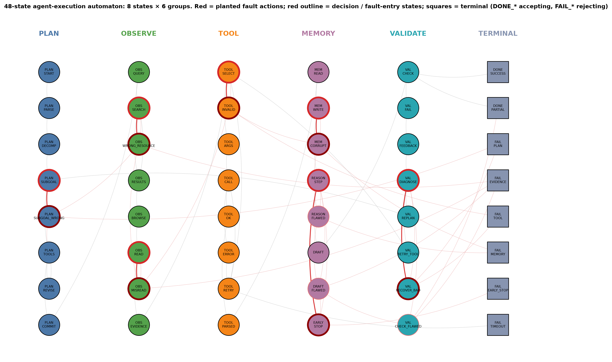

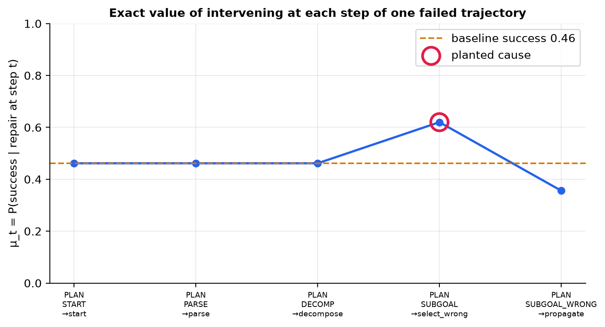


**Stage-B tool agent.** A controlled order-total agent (lookups, memory, calculation, validation, recovery) with six planted failure types, stochastic and deterministic variants, executed tools (including a restricted arithmetic `calc` tool), explicit snapshots and exact values by memoised backward induction.

## 6. Automata-Aware Fixed-Confidence Replay (AFCR)

AFCR is a working name. **Input:** a failed trajectory, the task, intervention protocols, a replay environment, an outcome evaluator, δ, a rollout budget and optional seeds. **Output:** a culprit *or* an abstention with a candidate set; per-step estimates, intervals and pull counts; total rollouts and simulated steps; stopping status; whether the guarantee applies (and why not); original and counterfactual traces; a machine-readable record.

### 6.1 Algorithm

```
AFCR(env, target, δ, budget):
  for each eligible step t:  N_t = 0, S_t = 0                          # one arm per candidate
  loop:
    [lo_t, hi_t] ← KL ball of radius x_n / n,  x_n = ln(2·K·n·(n+1)/δ)     # running intersection over time
    if target.decide(lo, hi):   return certified answer                     # δ-guarantee applies (Theorem 1)
    if rollouts ≥ budget:       return ABSTAIN(best guess, candidate set)   # not a δ-PAC event
    arms ← all unseen arms first; otherwise {h = argmax mean,  ℓ = argmax_{a≠h} hi_a}   # LUCB
    for a in arms:
        y ← replay(a)                          # a real intervention and re-simulation
        update (N_a, S_a) with y
        if prefix-aware:                       # only exact (time,state,action) matches (Theorem 3)
            for j in matched_arms(rollout): update (N_j, S_j) with y
```

The engine handles ties (tie-breaks by fewer pulls then index), insufficient observations (unseen arms), numerical edge cases (clipped KL, bisection with conservative bracket ends), budget exhaustion and invalid inputs (δ outside (0,1), negative budgets, unknown strategies, invalid sharing/confidence combinations raise readable errors).

### 6.2 Confidence sequences

The primary sequence (**stack-KL**, ours) uses, for the $n$-th observation count of an arm,
$$B_{a,n}=\{q:\ n\,\mathrm{kl}(\hat\mu_{a,n},q)\le x_n\},\qquad x_n=\ln\frac{2Kn(n+1)}{\delta},$$
where $\mathrm{kl}$ is the Bernoulli KL divergence and $K$ the number of eligible arms. Baselines: **stack-Hoeffding** (same union bound, Hoeffding radius); the **KL-LUCB exploration rate** of Kaufmann and Kalyanakrishnan (2013, Theorem 1), $\beta(t,\delta)=\ln(k_1Kt^{\alpha}/\delta)+\ln\ln(k_1Kt^{\alpha}/\delta)$ with $\alpha>1$ and $k_1>2e+1+\tfrac{e}{\alpha-1}+\tfrac{e+1}{(\alpha-1)^2}$ ($\alpha=1.1\Rightarrow k_1\approx 405.5$), valid for independent arms with one observation per pull and therefore **not** combined with prefix sharing; and a **Wilson** interval for the CAR-style baseline, which is *not* anytime-valid. Each sequence carries `anytime_valid` and `valid_under_sharing` flags, and the engine reports `guarantee_applies = false` whenever the combination is not covered by a theorem.

### 6.3 Baselines

Uniform and random allocation with the **same** stopping rule (matched confidence); successive elimination; equal budget without stopping (matched budget); a CAR-style fixed-K rule **re-implemented from the paper's description, not from its code**, with resample arms and Wilson intervals; naive sharing (negative control); and an oracle that knows the exact means. Baselines that need LLMs or labelled data (Who&When judges, AgenTracer, conformal methods, REFLECT) were **not reproduced**, and no comparative numbers from them are reported.


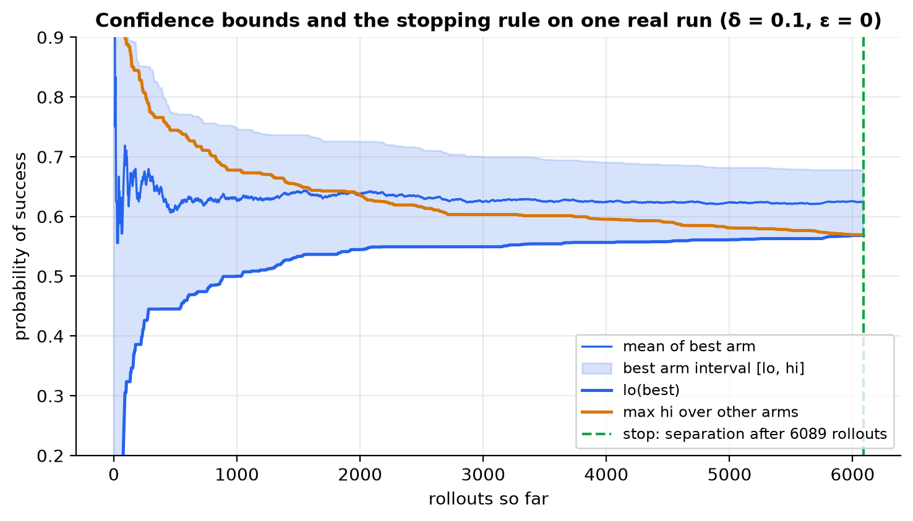


## 7. Prefix-aware extension

An intervention at an early step can change the state distribution, so a shared prefix does **not** make downstream outcomes interchangeable (CAR refuses to cache coalition values for the same reason). The extension therefore records the actual (time, state, action) path of every replay and credits a rollout started at arm $i$ to arm $j>i$ **only if** at time $j-1$ it is in the original state $q_{j-1}$ and (repair protocol) takes $\rho(q_{j-1})$. Under the resample protocol the state match suffices. Mechanisms and validity conditions:

| Mechanism | Valid when |
|---|---|
| Exact-match reuse (implemented) | A1–A4, Markov time-augmented state, exact state equality, action = reference action (repair) |
| Caching deterministic environment transitions | the environment kernel is deterministic given (state, action) |
| Sharing state-value information across candidates | **not** done: requires additional (parametric or model-based) assumptions |
| Naive sharing (implemented only as a negative control) | never |

Reuse is disabled automatically when state-reconstruction noise is present (A1 false). The Stage-B agent and the text-game adapter use the same rule with full-state or action-history equality.

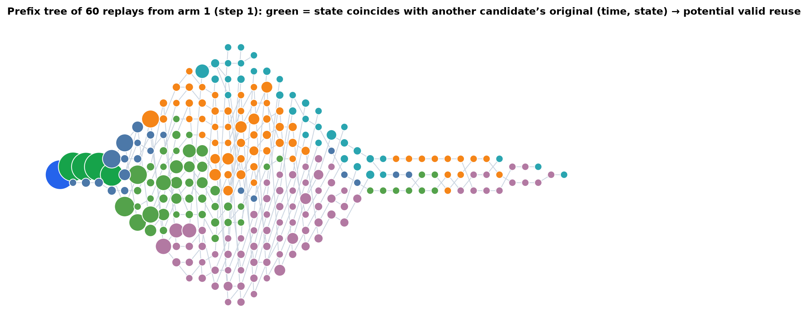


## 8. Theoretical analysis

Setting: arms $a\in[K]$ with unknown $\mu_a\in[0,1]$; the observations of arm $a$, in collection order, are i.i.d. Bernoulli($\mu_a$).

### 8.1 Correctness of the stopping rule

**Theorem 1 (δ-correctness for any sampling rule) [proved].** $\Pr(\exists a,n:\ \mu_a\notin B_{a,n})\le\delta$. Consequently every rule of the form "return $h$ when $\mathrm{lo}_h+\varepsilon\ge\max_{a\ne h}\mathrm{hi}_a$" (and the two threshold rules) returns a wrong answer with probability at most δ, whatever the sampling rule.

*Proof.* Reward-stack model: the $n$-th pull of arm $a$ reveals $X_{a,n}$ no matter when it happens, so for a fixed pair $(a,n)$ the first $n$ entries are i.i.d. and adaptivity only chooses *which* $n$ is observed. Fix $(a,n)$. The event $\mu_a<\mathrm{lo}$ means $\hat\mu_{a,n}>\mu_a$ and $n\,\mathrm{kl}(\hat\mu_{a,n},\mu_a)>x_n$, i.e. $\hat\mu_{a,n}\ge u$ where $u>\mu_a$ solves $n\,\mathrm{kl}(u,\mu_a)=x_n$; the Chernoff bound gives probability at most $e^{-x_n}$. The upper tail is symmetric, hence $\Pr(\mu_a\notin B_{a,n})\le2e^{-x_n}=\delta/(Kn(n+1))$. Summing over $a\le K$ and $n\ge1$ and using $\sum_{n\ge1}\frac1{n(n+1)}=1$ gives at most δ. On the complement event $E$ every interval contains its mean. If the rule stops with $\mathrm{lo}_h+\varepsilon\ge\mathrm{hi}_a\ge\mu_a$ for all $a\neq h$, then $\mu_h\ge\mathrm{lo}_h\ge\mu_a-\varepsilon$: $h$ is ε-optimal (for ε = 0, the unique best arm). A running intersection of intervals preserves coverage on $E$. Dependence between arms is irrelevant because only a union bound over arms is used. For the threshold rules, a step certified "above" has $\mu\ge\mathrm{lo}\ge\theta$ and a step certified "below" has $\mu\le\mathrm{hi}<\theta$, so the returned first/last step is exactly correct on $E$. ∎

### 8.2 Sample complexity

**Theorem 2 (elimination) [proved for successive elimination only].** Let $\Delta_a=\mu^\star-\mu_a>0$ and $n_a=\min\{n:\ n>8x_n/\Delta_a^2\}$. On $E$, successive elimination with the stack-KL intervals stops after at most $n_{\max}+\sum_{a\ne a^\star}n_a$ rollouts, where $n_{\max}=\max_an_a$; in particular this is $O\!\big(\sum_a\Delta_a^{-2}\ln\frac{K}{\delta\Delta_a}\big)$ with probability at least $1-\delta$. The proof is in Appendix A. **For LUCB with the stack bound no bound is proved here (empirical only).** The literature bound for KL-LUCB (Kaufmann and Kalyanakrishnan, 2013, Theorem 3) is cited and applies to *their* exploration rate, not ours.

**Comparison with uniform allocation (upper bounds only).** Uniform allocation must give every arm $n_{\max}$ pulls, i.e. $Kn_{\max}$ rollouts; the elimination bound is $\sum_an_a\le Kn_{\max}$ with equality only when all gaps are equal. This compares *bounds*, not performance; performance is measured in §10.

### 8.3 Number of candidates and trajectory length

Cost scales with the hardness $H=\sum_a\max(\Delta_a,\varepsilon/2)^{-2}$, so the best–second gap enters squared, and with $\ln K$ through $x_n$. Long trajectories add many early steps whose value is the re-roll baseline: they tie with each other but not with the best step, which is harmless for argmax certification but can make the runner-up gap small (§10.4).

### 8.4 When prefix reuse is valid

**Theorem 3 (prefix reuse) [proved].** Let the process be Markov on time-augmented states, $Y$ a function of the terminal state, and arm $j$ defined by the start $(q_{j-1},j-1)$ with first action $\rho(q_{j-1})$. If a rollout of arm $i<j$ visits $(j-1,q_{j-1})$ and takes $\rho(q_{j-1})$, then, conditionally on that event, its outcome is Bernoulli($\mu_j$) and independent of the history before time $j-1$.

*Proof.* The event is determined by the rollout up to and including its action at time $j-1$, so it is a stopping-time event. By the strong Markov property the future after that action is independent of the past given (state, action) and has exactly the law used by a direct pull of arm $j$. Hence the matched observations of arm $j$, in collection order, are i.i.d. Bernoulli($\mu_j$) and the stack argument of Theorem 1 applies per arm; cross-arm dependence is handled by the union bound. ∎

The theorem is **false** when A1 fails (reconstruction noise) and for naive sharing. §10.8 checks it numerically.

### 8.5 Established versus new

| Claim | Status | Source |
|---|---|---|
| $\mathbb E[\tau]\ge T^\star(\mu)\,\mathrm{kl}(\delta,1-\delta)$ for every δ-PAC strategy | cited | Garivier and Kaufmann (2016), Thm 1 (read) |
| KL-LUCB is δ-PAC with $\beta(t,\delta)$ above | cited | Kaufmann and Kalyanakrishnan (2013), Thm 1 (read) |
| Stack-KL is anytime-valid; stopping rule is δ-correct for any sampling rule | proved | Thm 1 (standard ingredients, assembled here) |
| Elimination sample complexity | proved | Thm 2 (shape agrees with Even-Dar et al., 2006, abstract-level) |
| LUCB + stack-KL sample complexity | empirical | §10 |
| Prefix reuse validity under Markov + exact match | proved | Thm 3 (+ numerical check, §10.8) |
| Pure exploration with side observations is a known setting | cited | Russo, Song and Pacchiano (2025), abstract-level |

### 8.6 Finite-sample or asymptotic? Optimality

Theorems 1–3 are **finite-sample** statements. The Garivier–Kaufmann bound is a lower bound for independent arms, with $T^\star(\mu)^{-1}=\sup_w\inf_{\lambda\in\mathrm{Alt}(\mu)}\sum_aw_a\,d(\mu_a,\lambda_a)$; their optimality statement is asymptotic ($\delta\to0$), and they caution against calling an algorithm "optimal" for a constant-factor match. We compute $T^\star$ numerically and find the measured cost of LUCB 15–24× above the bound (Table 5), so **AFCR is not claimed to be sample-optimal in any sense**.

## 9. Experimental design

**Stages.** A: synthetic (bandit-arm model with prescribed gaps; 48/64/96-state automaton). B: controlled tool agent (stochastic and deterministic). C: ALFWorld **[pending]**. D: HotpotQA **[pending]**.

**Instances.** Automaton: the failed trajectory of one sampled run conditioned on failure, at least four steps and at least one planted fault; fault probability 0.6 at the planting state unless varied; exact ground truth $\arg\max_t\mu_t$ (and the planted step, recorded separately: *identification of a planted cause is not the same as identification of the argmax*). Bandit-arm model: $K$ arms, one best arm at 0.8, one runner-up at 0.8−gap, the rest at $\mathrm{clip}(0.8-3\,\mathrm{gap})$.

**Methods and budgets.** δ = 0.1 unless varied; rollout cap 60 000 (150 000 in sweeps with small gaps); equal-budget 3 000; naive sharing 6 000 (it is invalid and the run is only to show how it fails).

**Metrics.** Exact (or ε-optimal) accuracy with abstentions counted as forced-choice answers; certification rate; abstention rate; error among certified trials; mean/median/p90 rollouts with bootstrap intervals; rollouts to reach 90 % accuracy; wall-clock time and simulated steps are stored in the raw rows. *A stopping rule with a theoretical $(1-\delta)$ guarantee is a different object from an empirical 90 % accuracy target and the two are reported separately.*

**Statistics.** Trials are paired by instance (identical seeds across methods). Accuracy: Wilson 95 % intervals. Rollouts: 1 000–2 000-resample bootstrap. Paired differences: bootstrap CI and two-sided Wilcoxon signed-rank test; the four primary comparisons are corrected together with Holm–Bonferroni. Rollout counts of trials that hit the cap are *censored*; means and medians are therefore lower bounds on the true cost, most severely for uniform and random allocation. No other significance claims are made.

**Reproducibility.** Every trial is a plain-dict spec; instance seed = group base + trial index; algorithm RNG = seed + 7; raw rows (`results/raw/*.csv`) and aggregates (`results/processed/*.json`) are stored separately; `python -m afcr.experiments.suite --aggregate-only` recomputes the aggregates. Test-suite: 179/179 backend tests and 46/46 frontend tests pass.


## 10. Results (all synthetic)

### 10.1 Main comparison on the 48-state automaton

**Table 1** (δ = 0.1; 30 paired instances per method; cap 60 000 rollouts).

| Method | n | Accuracy [Wilson 95%] | Certified | Abstained | Error among certified | Mean rollouts [95% CI] | Median |
|---|---|---|---|---|---|---|---|
| Oracle (exact means) | 30 | 100% [89%, 100%] | 100% | 0% | 0.0% | 0 [0–0] | 0 |
| LUCB + valid prefix reuse | 30 | 93% [79%, 98%] | 90% | 10% | 0.0% | 14,530 [8,646–21,704] | 4,281 |
| LUCB | 30 | 93% [79%, 98%] | 83% | 17% | 0.0% | 20,637 [14,124–28,126] | 8,328 |
| Successive elimination | 30 | 93% [79%, 98%] | 80% | 20% | 0.0% | 24,528 [17,691–31,998] | 12,320 |
| Uniform (same stopping rule) | 30 | 93% [79%, 98%] | 57% | 43% | 0.0% | 36,929 [29,737–44,830] | 34,274 |
| Random (same stopping rule) | 30 | 97% [83%, 99%] | 50% | 50% | 0.0% | 37,911 [30,554–46,150] | 46,100 |
| Equal budget (no stopping) | 30 | 80% [63%, 90%] | 0% | 0% | — | 3,000 [3,000–3,000] | 3,000 |
| LUCB + naive sharing (invalid) | 30 | 47% [30%, 64%] | 13% | 87% | 25.0% | 5,396 [4,747–5,880] | 6,000 |
| CAR-style fixed K=100 | 30 | 0% [0%, 11%] | 0% | 0% | — | 1,607 [1,283–1,957] | 1,300 |

*Reading the table.* Means include trials that stopped at the cap (censored); fixed-budget methods never certify by design; the CAR-style rule is scored against the planted step with resample arms (its own definition of locus) and is not comparable on the argmax estimand — in this model late corrupted states still produce a success among 100 rollouts, so "CI excludes zero" fires late; this is a property of our re-implementation on our model and **not** a verdict on CAR. Naive sharing certified 4 of 30 trials and 1 of those was wrong: with so few certified trials this is weak evidence by itself, and the stronger evidence is the bias test of §10.8.

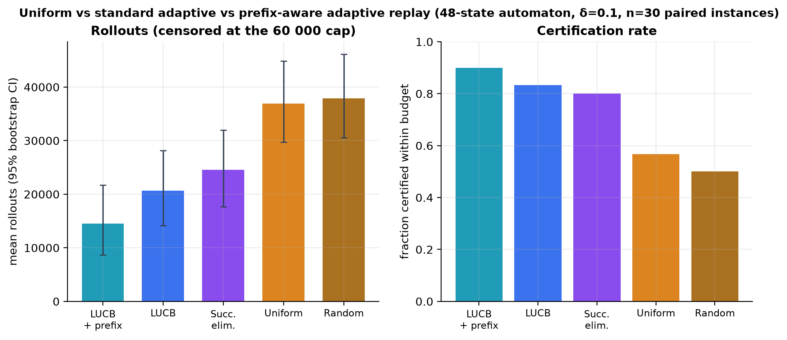


### 10.2 Paired statistics (Holm-corrected)

**Table 2.**

| Comparison (second vs first) | Pairs | Ratio of mean rollouts | Mean difference [95% bootstrap CI] | p (Wilcoxon) | p (Holm) | Significant at 0.05 |
|---|---|---|---|---|---|---|
| Uniform (same stopping rule) vs LUCB | 30 | 1.79× | 16,292 [11,060, 22,096] | <0.001 | <0.001 | yes |
| Random (same stopping rule) vs LUCB | 30 | 1.84× | 17,275 [11,536, 23,887] | <0.001 | <0.001 | yes |
| Successive elimination vs LUCB | 30 | 1.19× | 3,891 [1,908, 6,404] | <0.001 | <0.001 | yes |
| LUCB vs LUCB + valid prefix reuse | 30 | 1.42× | 6,106 [4,185, 8,177] | <0.001 | <0.001 | yes |

Adaptive allocation therefore reduced cost relative to uniform and random allocation at the same stopping rule and δ (1.79× and 1.84×), successive elimination was 1.19× as costly as LUCB, and valid prefix reuse removed a further factor of 1.42. These ratios are ratios of *censored* means and are conservative.

### 10.3 Bandit-arm model

**Table 3.**

| Gap | Method | n | Accuracy | Certified | Error among certified | Mean rollouts [95% CI] |
|---|---|---|---|---|---|---|
| 0.1 | LUCB | 60 | 100% | 100% | 0.0% | 6,709 [6,296–7,188] |
| 0.1 | Successive elimination | 60 | 100% | 100% | 0.0% | 7,876 [7,504–8,264] |
| 0.1 | Uniform (same stopping rule) | 60 | 100% | 100% | 0.0% | 23,467 [21,890–25,044] |
| 0.1 | Random (same stopping rule) | 60 | 100% | 100% | 0.0% | 23,192 [21,947–24,561] |
| 0.1 | Equal budget (no stopping) | 60 | 100% | 0% | — | 3,000 [3,000–3,000] |
| 0.1 | Oracle (exact means) | 60 | 100% | 100% | 0.0% | 0 [0–0] |
| 0.2 | LUCB | 60 | 100% | 100% | 0.0% | 1,503 [1,413–1,600] |
| 0.2 | Successive elimination | 60 | 100% | 100% | 0.0% | 1,736 [1,621–1,857] |
| 0.2 | Uniform (same stopping rule) | 60 | 100% | 100% | 0.0% | 5,783 [5,501–6,083] |
| 0.2 | Random (same stopping rule) | 60 | 100% | 100% | 0.0% | 5,766 [5,394–6,169] |
| 0.2 | Equal budget (no stopping) | 60 | 100% | 0% | — | 3,000 [3,000–3,000] |
| 0.2 | Oracle (exact means) | 60 | 100% | 100% | 0.0% | 0 [0–0] |

### 10.4 Gap, number of candidates, automaton size, fault probability

**Table 4 (K = 8, δ = 0.1, cap 150 000; mean rollouts) and the Garivier–Kaufmann lower bound (Table 5 below).**

| Gap | LUCB | Successive elim. | Uniform | Lower bound T*·kl(δ,1−δ) | LUCB / lower bound |
|---|---|---|---|---|---|
| 0.050000000000000044 | 27,515 | 36,381 | 100,600 | 1,165 | 23.6× |
| 0.09999999999999998 | 6,609 | 7,837 | 25,481 | 313 | 21.1× |
| 0.15000000000000002 | 2,769 | 3,384 | 10,660 | 147 | 18.8× |
| 0.19999999999999996 | 1,537 | 1,867 | 5,781 | 86 | 17.8× |
| 0.30000000000000004 | 648 | 765 | 2,471 | 42 | 15.3× |

*(Table 5: the last two columns give $T^\star(\mu)\,\mathrm{kl}(\delta,1-\delta)$ and the ratio. Every method lies above the bound, necessarily; LUCB is 15–24× above it.)*

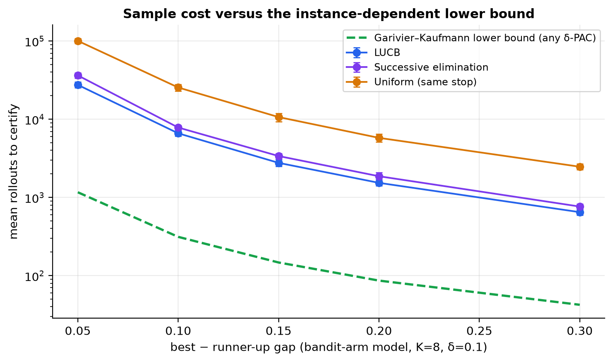


**Number of candidates (gap 0.2).**

| K | LUCB | Successive elim. | Uniform | Uniform / LUCB |
|---|---|---|---|---|
| 4 | 1,416 | 1,441 | 2,808 | 2.0× |
| 8 | 1,565 | 1,890 | 5,526 | 3.5× |
| 16 | 1,812 | 2,612 | 11,676 | 6.4× |
| 32 | 2,391 | 3,953 | 22,869 | 9.6× |
| 64 | 3,362 | 6,249 | 49,713 | 14.8× |

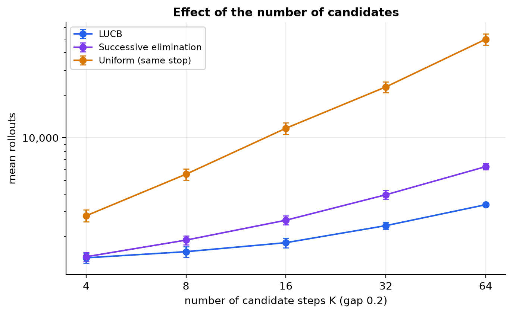


**Automaton size (48, 64, 96 logical states).**

| Logical states | Method | n | Certified | Mean rollouts [95% CI] |
|---|---|---|---|---|
| 48 | LUCB | 30 | 87% | 22,634 [15,340–29,860] |
| 48 | LUCB + valid prefix reuse | 30 | 97% | 14,282 [8,970–20,184] |
| 48 | Uniform (same stopping rule) | 30 | 57% | 40,204 [33,447–47,048] |
| 64 | LUCB | 30 | 80% | 28,140 [21,150–34,961] |
| 64 | LUCB + valid prefix reuse | 30 | 90% | 14,416 [8,578–21,172] |
| 64 | Uniform (same stopping rule) | 30 | 47% | 44,908 [38,194–50,621] |
| 96 | LUCB | 30 | 77% | 35,263 [28,064–41,893] |
| 96 | LUCB + valid prefix reuse | 30 | 90% | 13,860 [7,697–20,360] |
| 96 | Uniform (same stopping rule) | 30 | 50% | 50,354 [46,284–54,020] |

**Planted-fault probability** (a smaller probability brings the planted step closer to the re-roll baseline and therefore shrinks the true gap):

| Fault prob. | mean true gap | Method | Certified | Mean rollouts [95% CI] |
|---|---|---|---|---|
| 0.3 | 0.068 | LUCB | 73% | 31,470 [24,627–38,586] |
| 0.3 | 0.068 | LUCB + valid prefix reuse | 90% | 19,044 [13,101–25,453] |
| 0.3 | 0.068 | Uniform (same stopping rule) | 20% | 57,140 [53,369–59,601] |
| 0.45 | 0.084 | LUCB | 70% | 26,281 [18,521–34,085] |
| 0.45 | 0.084 | LUCB + valid prefix reuse | 80% | 19,619 [11,903–27,193] |
| 0.45 | 0.084 | Uniform (same stopping rule) | 53% | 47,749 [42,209–52,954] |
| 0.6 | 0.119 | LUCB | 77% | 19,717 [12,335–27,998] |
| 0.6 | 0.119 | LUCB + valid prefix reuse | 90% | 14,803 [8,008–22,739] |
| 0.6 | 0.119 | Uniform (same stopping rule) | 73% | 31,439 [24,637–38,561] |
| 0.8 | 0.159 | LUCB | 80% | 16,652 [9,332–24,791] |
| 0.8 | 0.159 | LUCB + valid prefix reuse | 93% | 13,600 [6,488–21,477] |
| 0.8 | 0.159 | Uniform (same stopping rule) | 77% | 22,807 [14,397–30,968] |

### 10.5 Calibration of δ and a stress test

Across **all** guaranteed runs in every group (3,620 certified trials) we observed **0 wrong answers**. On the hardest instances we could construct (two arms, gap 0.06, δ up to 0.5) the observed errors were δ=0.1: 0/300; δ=0.3: 0/300; δ=0.5: 0/300 (total 0/900). Zero errors is consistent with Theorem 1 but also shows that the stack bound is **conservative**: the test cannot demonstrate tightness, and it is used as a bug detector, not as a proof.

**Table 6 (K = 8, gap 0.15).**

| δ | n | Observed error among certified | Certified | Mean rollouts |
|---|---|---|---|---|
| 0.01 | 60 | 0.0% | 100% | 3,221 |
| 0.05 | 60 | 0.0% | 100% | 2,935 |
| 0.1 | 60 | 0.0% | 100% | 2,784 |
| 0.2 | 60 | 0.0% | 100% | 2,688 |
| 0.4 | 60 | 0.0% | 100% | 2,531 |


### 10.6 Accuracy versus rollout budget, and the 90 % target

**Table 7** (forced-choice accuracy; adaptive methods return their best guess when they cannot certify).

| Method | B=100 | B=200 | B=500 | B=1,000 | B=2,000 | B=5,000 | B=10,000 | B=20,000 |
|---|---|---|---|---|---|---|---|---|
| LUCB + valid prefix reuse | 87% | 93% | 95% | 93% | 97% | 97% | 98% | 97% |
| LUCB | 53% | 63% | 80% | 88% | 90% | 98% | 97% | 97% |
| Equal budget (no stopping) | 45% | 62% | 72% | 80% | 90% | 95% | 98% | 98% |
| Random budget | 35% | 58% | 70% | 78% | 95% | 98% | 97% | 95% |

| Method | Smallest B with accuracy ≥ 90% (point estimate) | … with Wilson lower bound ≥ 90% |
|---|---|---|
| LUCB + valid prefix reuse | 200 | 10000 |
| LUCB | 2000 | 5000 |
| Equal budget (no stopping) | 2000 | 10000 |
| Random budget | 2000 | 5000 |

LUCB without sharing is **not** clearly better than equal-budget spending in forced-choice accuracy at small budgets; its advantage is in the number of rollouts needed to *certify*. Prefix reuse is far more efficient per rollout (shared observations are free), which is why its accuracy at B = 100 is much higher. The 90 % line is an empirical target on a grid of budgets and is not the (1−δ) guarantee.

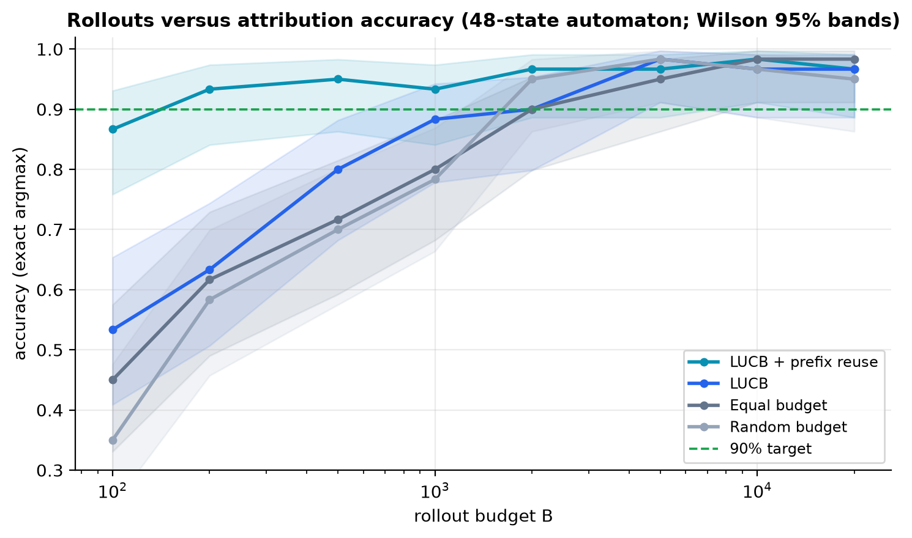


### 10.7 Ablations

**Table 8** (30 paired instances per level).

| Factor | Level | Accuracy | Certified | Error among certified | Mean rollouts [95% CI] |
|---|---|---|---|---|---|
| confidence | stack_kl | 93% | 83% | 0.0% | 18,448 [12,059–26,396] |
| confidence | stack_hoeffding | 93% | 83% | 0.0% | 22,764 [16,069–30,633] |
| confidence | kl_lucb_rate | 93% | 83% | 0.0% | 19,831 [13,554–27,394] |
| allocation | lucb | 93% | 83% | 0.0% | 18,448 [12,059–26,396] |
| allocation | successive_elim | 93% | 83% | 0.0% | 20,944 [14,662–28,386] |
| allocation | uniform_fc | 97% | 67% | 0.0% | 36,493 [30,004–43,330] |
| allocation | random_fc | 100% | 63% | 0.0% | 36,397 [29,789–43,632] |
| sharing | none | 93% | 83% | 0.0% | 18,448 [12,059–26,396] |
| sharing | valid | 97% | 87% | 0.0% | 12,693 [6,193–20,749] |
| sharing | naive | 47% | 20% | 16.7% | 5,355 [4,781–5,848] |
| candidates | all | 93% | 83% | 0.0% | 18,448 [12,059–26,396] |
| candidates | decision | 100% | 97% | 0.0% | 6,578 [2,125–12,883] |
| epsilon | 0.0 | 93% | 83% | 0.0% | 18,448 [12,059–26,396] |
| epsilon | 0.02 | 100% | 97% | 0.0% | 14,222 [8,936–21,317] |
| epsilon | 0.05 | 100% | 100% | 0.0% | 7,203 [4,860–10,929] |

Stack-KL needed fewer rollouts than stack-Hoeffding; the KL-LUCB rate was between the two here. Naive sharing is invalid and rarely certifies. Restricting candidates to decision states (a **domain prior**: it assumes we know which steps could be faulty) reduced cost considerably; this is a different problem from the unrestricted one and must not be presented as a like-for-like speed-up. A tolerance ε > 0 reduced cost and abstentions substantially by declaring near-ties acceptable.

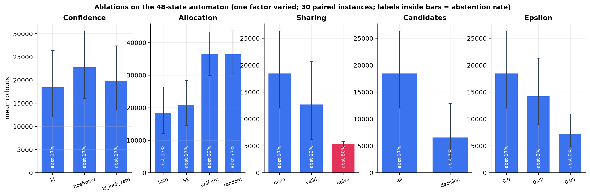


### 10.8 Empirical check of Theorem 3, and why naive sharing is invalid

One instance (seed 5), 8 000 rollouts started at the first candidate step. For every later candidate we compare the mean of the *validly matched* observations with its exact value, and the mean of the observations that *naive sharing* would credit.

| Candidate step | exact μ | matched observations (n) | mean of matched observations | z | naive-credited observations (n) | mean of naive observations | z |
|---|---|---|---|---|---|---|---|
| t=2: PLAN_PARSE | 0.462 | 7761 | 0.458 | -0.7 | 8000 | 0.459 | -0.5 |
| t=3: PLAN_DECOMP | 0.462 | 7517 | 0.456 | -0.9 | 8000 | 0.459 | -0.5 |
| t=4: PLAN_SUBGOAL | 0.620 | 2863 | 0.628 | 0.8 | 8000 | 0.459 | -29.7 |
| t=5: PLAN_SUBGOAL_WRONG | 0.356 | 4441 | 0.344 | -1.6 | 8000 | 0.459 | 19.2 |

The z-scores of matched observations are small (unbiased); the naive observations are strongly biased for every candidate whose value differs from the re-roll baseline (here the planted step and the first corrupted step; |z| ≈ 20–30), which also explains why naive sharing prevents certification. The same check passes on the tool agent in the test-suite.

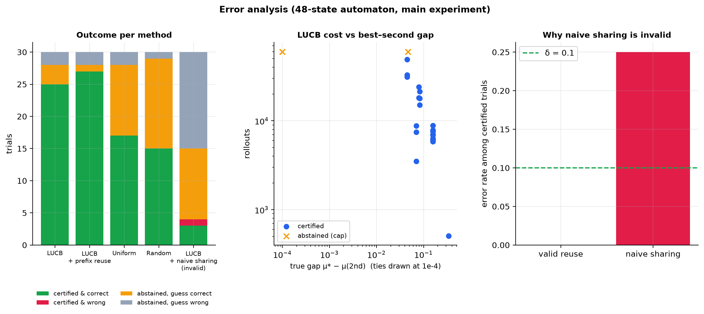


### 10.9 State-reconstruction noise (assumption A1 violated)

**Table 9.** Accuracy is measured against the argmax of the *noisy replay context*, the estimand that is actually being sampled; prefix reuse is disabled automatically.

| Reconstruction noise | n | Accuracy vs noisy-context argmax | Certified | Mean rollouts |
|---|---|---|---|---|
| 0.0 | 30 | 97% [83%, 99%] | 97% | 11,908 |
| 0.1 | 30 | 97% [83%, 99%] | 77% | 23,514 |
| 0.25 | 30 | 100% [89%, 100%] | 70% | 31,055 |
| 0.5 | 30 | 80% [63%, 90%] | 30% | 54,780 |

As noise grows the replay context drifts from the original, certification becomes rarer and the guarantee concerns the replay model, not the original run.

### 10.10 Stage B: the tool-using agent

**Table 10.**

| Variant | Method | n | Accuracy (ε-optimal) | Certified | Mean rollouts [95% CI] |
|---|---|---|---|---|---|
| stochastic | LUCB | 30 | 100% | 83% | 6,623 [4,845–8,591] |
| stochastic | LUCB + valid prefix reuse | 30 | 100% | 83% | 5,578 [3,938–7,451] |
| stochastic | Uniform (same stopping rule) | 30 | 100% | 47% | 11,612 [9,936–13,189] |
| stochastic | Equal budget (no stopping) | 30 | 97% | 0% | 3,000 [3,000–3,000] |
| stochastic | Oracle (exact means) | 30 | 100% | 100% | 0 [0–0] |
| deterministic_phase0 | LUCB | 1 | 100% | 100% | 92 [92–92] |
| deterministic_phase0 | Uniform (same stopping rule) | 1 | 100% | 100% | 121 [121–121] |
| deterministic_phase1 | LUCB | 1 | 100% | 100% | 92 [92–92] |
| deterministic_phase1 | Uniform (same stopping rule) | 1 | 100% | 100% | 122 [122–122] |
| deterministic_phase4 | LUCB | 1 | 100% | 100% | 92 [92–92] |
| deterministic_phase4 | Uniform (same stopping rule) | 1 | 100% | 100% | 125 [125–125] |
| deterministic_phase5 | LUCB | 1 | 100% | 100% | 92 [92–92] |
| deterministic_phase5 | Uniform (same stopping rule) | 1 | 100% | 100% | 126 [126–126] |

In the deterministic variant each of four planted failure types (planning, tool choice, memory, premature stop) is identified with fewer than 130 rollouts (single instance per type, so no interval is meaningful).

### 10.11 Targets and the CAR-style rule

**Table 11.**

| Target | Method | n | Agreement with exact target | Certified | Mean rollouts |
|---|---|---|---|---|---|
| last_above | LUCB | 30 | 100% | 47% | 34,333 |
| last_above | CAR-style fixed K=100 | 30 | 3% | 0% | 1,320 |
| last_above | CAR-style fixed K=500 | 30 | 3% | 0% | 6,600 |
| first_above | LUCB | 30 | 100% | 100% | 32,362 |
| first_above | Uniform (same stopping rule) | 30 | 100% | 0% | 60,000 |

The threshold targets are exactly correct whenever the rule stops (agreement 100 % among certified trials), at the price of abstaining when a step's value lies close to θ. The CAR-style fixed-K rule never agrees with the θ-defined locus here, again because it answers a different question.

### 10.12 Summary of what the evidence supports

(i) Adaptive allocation reduces the number of replays needed to certify a culprit at matched confidence on these synthetic instances (RQ1). (ii) No wrong certified answer was observed among 3,620 guaranteed trials, consistent with δ (RQ2). (iii) Exact-match prefix reuse reduces cost further, naive sharing is biased (RQ3). (iv) Cost grows steeply as the gap shrinks and with K; tied best steps lead to abstention (RQ4). **Not supported:** any claim about real LLM agents, optimality, or superiority over published baselines other than the re-implemented CAR-style rule.

## 11. ALFWorld and HotpotQA: status

**ALFWorld [pending].** MIT licence per package metadata (secondary source); text mode needs `pip install alfworld` (TextWorld) and `alfworld-download`. `afcr.benchmarks.ALFWorldGame` wraps the environment and raises `BenchmarkUnavailable` if it is not installed. **HotpotQA [pending].** CC BY-SA 4.0 per secondary sources; `HotpotQAGame` loads a *local* distractor-setting file you provide, exposes `search:`/`finish:` actions and scores normalised exact match. The generic `TextGameReplayEnv` replays an action-history prefix exactly and is exercised only with a scripted mock agent; **that test is an interface check, not a benchmark result.** A fixed model, prompt, tool interface and evaluation protocol are required for a valid run; none exists in this repository, and no synthetic result is labelled as ALFWorld or HotpotQA.

## 12. Limitations and threats to validity

* **Joint causes** (AND-failures) and unique-cause assumption: out of scope (see GCJR, CAR-Shapley).
* **Non-stationary policies**, provider non-determinism and hidden context violate A2–A4 for real LLM agents.
* **Expensive replay** and **model stochasticity**: the benefit on real agents is a hypothesis.
* **State-reconstruction errors** void sharing (A1); §10.9 quantifies the effect only for the automaton.
* **Dependence between interventions** is handled by a union bound, which is conservative.
* **Generalisation:** the automaton is hand-designed by the authors and may favour the method; sweeps vary its parameters but not its topology.
* **Finite-state abstractions** cannot represent unbounded agent state; the PDA demonstrates the gap formally.
* **Censoring** at the budget cap biases mean rollouts downwards for the weakest methods.
* **Small samples:** 30 paired instances per method (60 for bandit cells); intervals are reported.
* **Novelty** is provisional (abstract-level reading of some neighbours; fast-moving literature).
* **Compute:** experiments ran on a shared 24-logical-core Windows machine; wall-clock numbers are not performance claims.

## 13. Conclusion and future work

Adaptive fixed-confidence replay reduced the cost of certifying a culprit on synthetic instances with exact ground truth, an exact-match prefix-reuse rule reduced it further, and the stopping rule never returned a wrong certified answer in 3,620 trials. Claims about real agents remain hypotheses. Future work: ALFWorld and HotpotQA runs with a fixed open model; confidence sequences with LIL-type growth; Track-and-Stop allocation; joint-cause sets; common random numbers across divergent contexts; Markov abstractions of real agent histories.

## References

* S. Zhang et al., *Which Agent Causes Task Failures and When? On Automated Failure Attribution of LLM Multi-Agent Systems*, arXiv:2505.00212 (2025).
* J. Shah, *Causal Agent Replay: Counterfactual Attribution for LLM-Agent Failures*, arXiv:2606.08275 (2026).
* G. Zhang et al., *AgenTracer: Who Is Inducing Failure in the LLM Agentic Systems?*, arXiv:2509.03312 (2025).
* N. Feng, Y. Sui, S. Hou, G. Wu, J. C. Cresswell, *Conformal Agent Error Attribution*, arXiv:2605.06788 (2026).
* A. Garivier, E. Kaufmann, *Optimal Best Arm Identification with Fixed Confidence*, COLT 2016, arXiv:1602.04589.
* E. Kaufmann, S. Kalyanakrishnan, *Information Complexity in Bandit Subset Selection*, COLT 2013 (PMLR 30).
* S. Kalyanakrishnan, A. Tewari, P. Auer, P. Stone, *PAC Subset Selection in Stochastic Multi-armed Bandits*, ICML 2012.
* K. Jamieson, M. Malloy, R. Nowak, S. Bubeck, *lil' UCB*, COLT 2014, arXiv:1312.7308.
* E. Even-Dar, S. Mannor, Y. Mansour, *Action Elimination and Stopping Conditions for the Multi-Armed Bandit and Reinforcement Learning Problems*, JMLR 7 (2006).
* A. Russo, Y. Song, A. Pacchiano, *Pure Exploration with Feedback Graphs*, AISTATS 2025, arXiv:2503.07824.
* G. Ma et al., *Automatic Failure Attribution and Critical Step Prediction Method for Multi-Agent Systems Based on Causal Inference*, arXiv:2509.08682 (2025).
* X. Lin et al., *REFLECT*, arXiv:2606.09071 (2026). · A. Bonagiri et al., *CausalFlow*, arXiv:2605.25338 (2026). · H. Cha, D. Weon, D. H. Kang, *Knowledge-Based Zero-Replay Debugging of Multi-Agent LLM Traces*, arXiv:2606.14805 (2026). · B. Li et al., *Localizing Emergent Failures in Agentic AI … Minimal Repair Families*, arXiv:2608.29228 (2026). · Z. Luan et al., *Repair or Resample?*, arXiv:2608.25920 (2026). · M. Ma et al., *DoVer*, arXiv:2512.06749 (2025).

(BibTeX: `paper/references.bib`.)

## Appendix A. Proof of Theorem 2 (successive elimination)

**Algorithm.** Pull every unseen arm once; thereafter pull, one at a time, the surviving arm with the fewest observations (ties by index), where an arm $a$ is *eliminated* once $\mathrm{hi}_a<\max_b\mathrm{lo}_b$ (running-intersection intervals). Stop at the first time $\mathrm{lo}_h>\max_{a\ne h}\mathrm{hi}_a$ (ε = 0). Sharing is off, so survivors always have equal counts at the end of a round.

**Half-width.** By Pinsker's inequality $\mathrm{kl}(p,q)\ge2(p-q)^2$, hence $B_{a,n}\subseteq[\hat\mu-w_n,\hat\mu+w_n]$ with $w_n=\sqrt{x_n/(2n)}$. On $E$, $|\hat\mu_{a,n}-\mu_a|\le w_n$, so $B_{a,n}\subseteq[\mu_a-2w_n,\mu_a+2w_n]$, and the running intersection can only shrink the interval.

**The best arm is never eliminated.** On $E$, $\mathrm{hi}_{a^\star}\ge\mu^\star\ge\mu_b\ge\mathrm{lo}_b$ for every $b$, so $\mathrm{hi}_{a^\star}<\max_b\mathrm{lo}_b$ never holds; $a^\star$ is pulled in every round and has $n$ observations after round $n$.

**Elimination time.** Fix $a\ne a^\star$ and let $n_a=\min\{n:\,4w_n<\Delta_a\}$; since $4w_n<\Delta_a\iff n>8x_n/\Delta_a^2$ this is the $n_a$ of the statement. If $a$ is still active after round $n_a$, then $\mathrm{hi}_a\le\mu_a+2w_{n_a}<\mu^\star-2w_{n_a}\le\mathrm{lo}_{a^\star}$, so $a$ is eliminated. Hence $a$ is pulled at most $n_a$ times.

**The stopping rule fires.** Let $N^\star$ be the number of observations of $a^\star$ and suppose $N^\star\ge n_{\max}=\max_an_a$. For every other arm $a$, either (i) $a$ was pulled $n_a$ times, so $\mathrm{hi}_a<\mathrm{lo}_{a^\star}$ as just shown, or (ii) $a$ was eliminated earlier because $\mathrm{hi}_a(t_a)<\mathrm{lo}_{b}(t_a)$ for some arm $b$ at that time. In case (ii), $\mathrm{lo}_b(t_a)\le\mu_b\le\mu^\star-\Delta_b$ if $b\ne a^\star$, and $N^\star\ge n_{\max}\ge n_b$ gives $2w_{N^\star}<\Delta_b/2$, so $\mathrm{lo}_{a^\star}\ge\mu^\star-2w_{N^\star}>\mu^\star-\Delta_b\ge\mathrm{lo}_b(t_a)>\mathrm{hi}_a$; if $b=a^\star$, monotonicity of the running intersection gives $\mathrm{lo}_{a^\star}(\text{now})\ge\mathrm{lo}_{a^\star}(t_a)>\mathrm{hi}_a$. So $\mathrm{lo}_{a^\star}>\mathrm{hi}_a$ for all $a\ne a^\star$ and the stopping rule has fired by the end of round $n_{\max}$.

**Count.** Arm $a^\star$ is pulled at most $n_{\max}$ times and each other arm at most $n_a$ times, giving the stated total. Finally $n_a\le 1+\frac8{\Delta_a^2}\ln\frac{2Kn_a(n_a+1)}{\delta}$, whose solution is $O(\Delta_a^{-2}\ln(K/(\delta\Delta_a)))$. ∎

## Appendix B. Notes on the confidence sequences

The stack-KL interval is obtained by bisection on $n\,\mathrm{kl}(\hat\mu,q)\le x_n$; the returned end of the final bracket is the *conservative* one (the side on which the KL exceeds the radius), so the computed interval always contains the exact KL ball. A radius of $+\infty$ (no observations) gives $[0,1]$. A pure-Python scalar path is used for small arrays (identical semantics, about 25× faster than the vectorised path for per-pull updates).

## Appendix C. Reproduction commands

```
pip install -e ".[dev,docs]"
python -m pytest                                              # 179 backend tests
cd website && npm install && npm test && npm run build        # 46 frontend tests
OPENBLAS_NUM_THREADS=1 python -m afcr.experiments.suite --trials 30 --workers 6
python scripts/make_figures.py && python scripts/build_paper.py && python scripts/build_appendices.py && python scripts/build_report.py
python scripts/build_docs_folder.py && python scripts/build_deck.py && python scripts/build_pdfs.py
uvicorn afcr.api.app:app --port 8000
```

## Appendix D. Figure index

Figures 1–21 are produced by `scripts/make_figures.py`; their kind (conceptual / structural / experimental), caption and source are listed in `paper/figures/CAPTIONS.md` and `results/figures/manifest.json`. Conceptual figures: 1, 3, 4, 6, 7, 8, 9, 14; structural: 12, 13; experimental (drawn only from result files or stated real runs): 2, 5, 10, 11, 15–21.


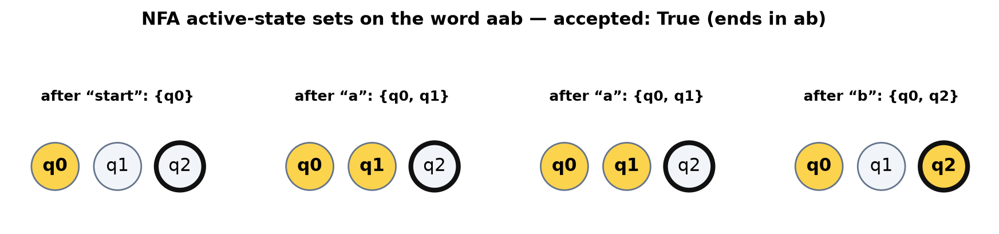

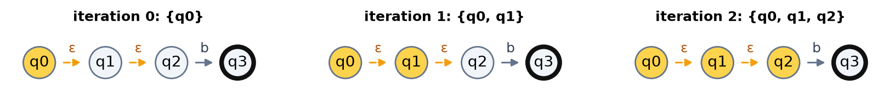


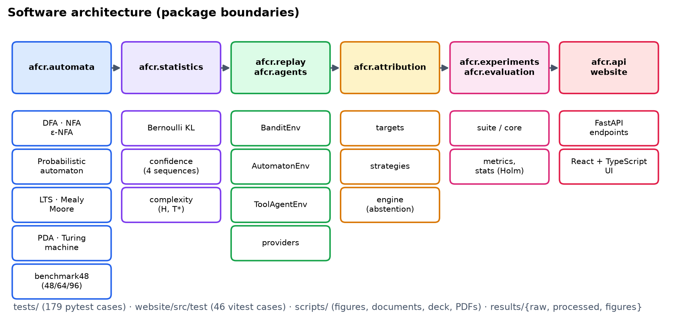

