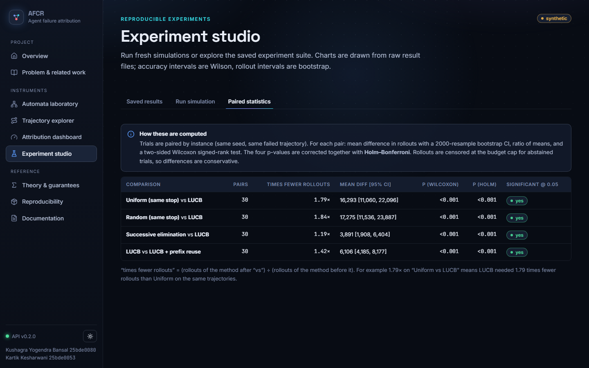

<h1 style="font-size:30px;border:0;margin-top:0">Understanding and demonstrating AFCR</h1>
<p style="font-size:17px"><b>A step-by-step guide for a reader who has not read the papers</b><br/>Sample-Optimal Culprit Identification for Agent Failures: Fixed-Confidence Attribution with Automata-Aware Sequential Replay<br/>Kushagra Yogendra Bansal (25bde0080) · Kartik Kesharwani (25bde0053)</p>

# How to read this guide

This guide is written for a reader who has **not** read the research papers and knows nothing about the project. It explains, in plain language and in this order:

1. what the review asks for (the seven items), and where each one is answered;
2. the *actual problem* — with a small story, then the precise statement;
3. every idea of the method, one at a time, with a real worked example;
4. a **minute-by-minute demonstration script** for the website, with screenshots of what the audience will see;
5. the questions a reviewer is likely to ask, with honest answers;
6. what is proved, what is only measured, and what is **not** done.

> **Honesty box.** Every experiment in this project is *synthetic* (simulated agents whose ground truth is known exactly). ALFWorld and HotpotQA are **not** run. We prove that the stopping rule is δ-correct and give a sample-complexity bound for one algorithm; we do **not** claim that any algorithm is optimal — “sample-optimal” in the title names the research *objective*. The novelty claim is provisional (finite literature search).

## The seven items of the review and where they are answered

| # | The review asks for | Section of this guide | Where in the project |
|---|---|---|---|
| 1 | Title | Part 3 | paper title page; website *Overview*; slide 1 |
| 2 | Research gap identified in the paper | Part 4 | website *Problem & related work*; `research/`; slides 4–6 |
| 3 | Problem statement | Part 2 | website *Overview → 3 · Problem*; paper §3; slides 2–4, 6 |
| 4 | Methods used in the paper to address the gap | Part 5 | website *Theory*; paper §6–8; slides 7–11 |
| 5 | Input to the proposed method | Part 6 | website *Overview → 5 · Input*, *Dashboard* configuration; `docs/io_specification.md` |
| 6 | Output of the proposed method | Part 7 | website *Dashboard* result; `docs/io_specification.md` |
| 7 | Steps converting the input into the output | Part 8 | website *Overview → 7 · Steps*; paper §6.1; slide 8 |

Parts 9–10 explain the nine formal machines and the experiments; Part 11 is the live demo script; Part 12 the question bank.

# Part 1 — The story, with no jargon

Imagine you ask an assistant program (an “agent”) to book a trip. It reads your request, searches the web, picks a hotel, writes down notes, double-checks, and finally answers. The answer is **wrong**: the hotel is in the wrong city. You have the full log of everything it did — maybe 12 steps — and one question:

> **Which step is the one that really caused the failure?**

The obvious guess is “the last step”, but that is usually only where the mistake became visible. The real cause might be step 4, where the agent quietly chose the wrong sub-goal, and every later step then faithfully built on that mistake.

How do you find the cause? Ask: *“If the agent had done something different at this step, would the run have succeeded?”* We can actually try it: restore the agent to exactly how it was just before step *t*, change that one decision, and let it run again to the end. This is called a **counterfactual replay** — “what would have happened if…”. Because the agent is partly random (it is built from a language model that samples answers), one replay is only one possible future. To estimate the *chance of success* after fixing step *t* we must replay many times. Replays are **expensive** (each costs a full run of the agent).

So the real problem is about **spending replays wisely**:

* some steps are obviously unimportant — we should stop replaying them early;
* the important steps need more replays;
* and we want a **guarantee**: “with probability at least 90 %, if the system names a culprit, it is the right one” — or else it must **say it does not know** instead of guessing.

That is exactly what this project builds: a method that decides *which step to replay next*, *when it is certain enough to stop*, and *when to admit it cannot decide* — plus a laboratory of simple machines (automata) where we know the right answer in advance, so we can test whether the method is honest.

## Glossary — the 20 words you need

| Word | Plain meaning | Example in this project |
|---|---|---|
| Agent | a program that acts in several steps (plan, search, use tools, answer) | the 48-state agent |
| Trajectory | the log of one run: the states visited and actions taken | 5 steps from `PLAN_START` to `PLAN_SUBGOAL_WRONG` |
| Step / candidate | one position of the log that might be the cause | “step 4: choose subgoal” |
| Failure | the run ends with the wrong outcome (Y = 0) | the wrong hotel |
| Intervention | changing one decision of the run | **repair**: force the correct action; **resample**: draw the action again |
| Replay (rollout) | restore the run just before a step, intervene, run to the end | one *pull* |
| Outcome Y | 1 if the replay succeeds, 0 if it fails | a coin flip with unknown bias |
| μₜ | probability that a replay at step *t* succeeds | step 4: 0.62 |
| Culprit | the step with the highest μₜ (the best place to repair) | step 4 |
| Confidence interval | a range that contains μₜ with high probability | [0.56, 0.68] |
| δ (delta) | the allowed probability of a **wrong** certified answer | 0.1 = 10 % |
| Stopping rule | the test that says “certain enough, stop” | best interval clearly above all others |
| Abstention | “budget used up, I cannot certify” — never a guess presented as an answer | 20 000 replays spent |
| Arm | one candidate step seen as a slot machine whose payout is unknown | 5 arms for 5 steps |
| Best-arm identification | find the best slot machine with a guaranteed confidence | the statistical core |
| Prefix reuse | one replay that happens to pass through another step’s starting point also tells us about that step | saves replays |
| Automaton | a machine with a finite set of states and rules for moving between them | q0, q1, … |
| Ground truth | the exactly known right answer (possible because we built the agent) | computed by dynamic programming |
| Synthetic | simulated, not a real benchmark | everything in this project |
| Pending | designed but not run | ALFWorld, HotpotQA |

# Part 2 — Problem statement (review item 3)

**Informal.** Given **one failed run** of a multi-step agent, find the **step whose repair most increases the chance of success**, using **as few expensive replays as possible**, and with a **statistical guarantee** about the answer.

**Why not the simple approaches?**

| Approach | Why it is not enough |
|---|---|
| Blame the last action | the last action is the *symptom*; causes are often many steps earlier |
| Ask a language model to read the log and guess | correlational; on the Who&When benchmark the best step-level accuracy reported is about 14 % (Zhang et al., 2025) |
| Replay every step the same fixed number *K* of times (e.g. the CAR method) | *K* is chosen in advance: too small → unreliable, too large → wasteful; no statement of confidence; no stopping rule |
| Replace an action by a gold action once (AgenTracer) | needs gold actions; a single sample of a random process |

**Formal.** A failed trajectory τ = (q₀, a₁, q₁, …, a_T, q_T) ends with Y = 0. For each candidate step *t* and intervention *g_t* (repair or resample) define

> μₜ = Pr( the replay that intervenes at step *t* succeeds ).

Each replay returns one Bernoulli sample (0 or 1). The goal is a **sampling rule** (which step to replay next), a **stopping rule** (when to stop) and a **recommendation** (a step, or *abstain*) such that, for every instance,

> Pr( the system certifies a step that is not within ε of the best ) ≤ δ.

Three targets are supported: the **best repair step** (argmax μₜ, with tolerance ε), the **first** step with μₜ ≥ θ, and the **last** step with μₜ ≥ θ. Association, prediction, interventional effect, unique responsibility and joint causes are different notions; this work targets the **interventional effect of a repair**.

## A real example, step by step

The failed run used throughout this guide (seed 5, fault probability 0.6) has **5 steps**. Because the agent is a known Markov chain, we can compute the *exact* μₜ without sampling:

| step (arm) | exact μₜ | estimate after the run | interval | replays of this step |
|---|---|---|---|---|
| t=1: PLAN_START | 0.462 | 0.482 | [0.401, 0.568] | 1,285 |
| t=2: PLAN_PARSE | 0.462 | 0.476 | [0.396, 0.568] | 1,100 |
| t=3: PLAN_DECOMP | 0.462 | 0.433 | [0.313, 0.568] | 460 |
| t=4: PLAN_SUBGOAL | 0.620 | 0.624 | [0.568, 0.678] | 3,030 |
| t=5: PLAN_SUBGOAL_WRONG | 0.356 | 0.379 | [0.229, 0.567] | 214 |

The planted fault is at **t=4: PLAN_SUBGOAL**. Notice that the earlier steps are *not* zero — merely re-running the agent re-rolls the fault, so they look slightly useful. Only at the decisive step does a repair *always* avoid the fault.

<figure><figcaption>The Trajectory explorer shows the same failed run: the exact μₜ curve (blue) and the planted cause (red ring).</figcaption></figure>

# Part 3 — Title (review item 1)

**Sample-Optimal Culprit Identification for Agent Failures: Fixed-Confidence Attribution with Automata-Aware Sequential Replay**

| Words | Meaning |
|---|---|
| **Culprit identification** | find the one step that caused the failure |
| **Agent failures** | the object studied: runs of multi-step AI agents that end wrongly |
| **Fixed-confidence** | the user fixes the confidence 1 − δ (e.g. 90 %); the method decides how many replays it needs |
| **Attribution** | assigning the failure to a cause |
| **Sequential replay** | replays are done one after another, each chosen using the results so far |
| **Automata-aware** | the agent is modelled as an automaton (states and transitions); this gives structure (exact ground truth, valid reuse of replays) |
| **Sample-optimal** | the *goal*: fewest possible replays. **We do not prove optimality.** We prove correctness of the stopping rule, a sample bound for one algorithm, and compare with the theoretical lower bound |

Short name used in the code and on the website: **AFCR** (Automata-aware Fixed-Confidence Replay). Authors: Kushagra Yogendra Bansal (25bde0080) and Kartik Kesharwani (25bde0053).

# Part 4 — Research gap (review item 2)

## What already exists (read from the papers themselves)

| Work | What it does | Replay | Adaptive | Confidence stop | δ-guarantee | Prefix reuse | Real benchmarks |
|---|---|---|---|---|---|---|---|
| Garivier-Kaufmann 2016 | Bandit paper not an agent paper. Thm 1 lower bound E[tau]>=T*(mu)kl(delta,1-delta); Track-and-Stop; Prop 12 delta-PAC fo… | No | Yes | Yes | Yes | No | No |
| Who&When | LLM-judge methods (all-at-once / step-by-step / binary search over the log); no replay; binary search is LLM-driven halv… | No | No | No | No | No | Yes |
| Causal Agent Replay | Same-policy do_resample interventions; fixed K rollouts per step; Wilson+bootstrap CIs; latest-step-with-CI-excluding-ze… | Yes | No | No | No | No | No |
| AgenTracer | Oracle-guided counterfactual replay per step (analyzer agent proposes corrected action with access to ground truth); ear… | Yes | No | No | No | No | Yes |
| Conformal Agent Error Attribution | Contiguous step SETS; split-conformal marginal coverage 1-a<=P<1-a+1/(n+1) under exchangeability (Thm 3.4); needs labell… | No | No | No | Partial | No | Yes |
| Ma et al. causal attribution | Shapley + causal discovery (CDC-MAS) on static logs; Who&When and TRAIL; counterfactual simulation used for optimisation… | Partial | No | No | No | No | Yes |

## The gap

* **Already done by others:** counterfactual replay for step attribution (AgenTracer, CAR, CausalFlow, REFLECT, DoVer); same-policy resampling with confidence intervals (CAR); fixed-confidence best-arm identification, LUCB, KL bounds (bandit literature, 2012–2016); pure exploration with side observations (Russo et al., 2025).
* **Not found in the papers we read:** fixed-confidence **stopping with an explicit abstention** for *stochastic* replay, a **proved validity condition for sharing** one replay among several candidate steps, on an **automaton** where the right answer is known exactly.
* Our assessment is **outcome B**: *“the gap exists only in a narrower formulation.”* It is provisional — some neighbouring papers were read at abstract level only, and later postings cannot be excluded.

<figure><figcaption>Website → Problem & related work: the timeline of the literature (the axis is broken between 2017 and 2025; CAR, the closest work, is marked red).</figcaption></figure>

# Part 5 — Methods used to address the gap (review item 4)

## 5.1 Turn the problem into a “slot machine” problem (best-arm identification)

Each candidate step is an **arm**. Pulling the arm means doing one counterfactual replay and seeing success or failure. The unknown success probability of arm *t* is μₜ. Finding the best step with a guaranteed confidence is a classical problem called **best-arm identification**, for which tools exist (Garivier & Kaufmann 2016; Kaufmann & Kalyanakrishnan 2013).

## 5.2 Confidence intervals that stay valid while we peek

If you flip a coin 50 times you can say “the bias is in [0.35, 0.65] with 95 % confidence”. But our algorithm *looks at the data after every replay and decides what to do next*; naive intervals are then wrong. We use a **confidence sequence** (stack-KL):

> after *n* replays of an arm, the interval is { q : n·kl(μ̂, q) ≤ x_n }, with x_n = ln( 2Kn(n+1) / δ ),

where kl is the Bernoulli KL divergence. **Theorem 1:** with probability ≥ 1 − δ *all* intervals of *all* arms contain the truth at *all* times — whatever sampling rule is used. Intervals are intersected over time so they never widen.

## 5.3 Where to sample next (LUCB)

Replay the step that currently looks best and its strongest challenger (the other step with the highest upper bound). Steps that are clearly worse stop receiving replays. Alternatives implemented for comparison: successive elimination (which has a proved sample bound, **Theorem 2**), uniform, random, equal-budget.

## 5.4 When to stop — and when to refuse

> **Stop and certify step *h* when lo_h + ε ≥ max over other steps of hi.**

That is: the lowest plausible value of the best step is above the highest plausible value of every other step (within tolerance ε). If the replay budget is used up first, the system **abstains**: it reports its best guess *and* the steps it could not rule out, clearly marked as *not certified* — a timeout is never presented as a δ-guaranteed answer.

<figure><figcaption>Website → Attribution dashboard: the forest plot of confidence intervals (cyan = best, amber = strongest challenger, red ring = planted cause, white diamond = true value).</figcaption></figure>
<figure><figcaption>The stopping-rule panel: the separation margin lo_h + ε − hi_ℓ and the budget used.</figcaption></figure>

## 5.5 Reusing replays (prefix reuse — Theorem 3)

A replay that restores step *i* and then runs on may, by chance, pass exactly through the starting state of step *j* at the right time and take the repair action there. From that moment on it is *distributed exactly like* a replay of step *j*, so it can be counted for step *j* as well. This saves rollouts. **It is valid only for an exact match of (time, state, action)**; counting a replay for *every* later step (“naive sharing”) is statistically wrong, and the project includes it only as a **negative control**: in the experiment it reaches 47 % accuracy against 97 % for valid sharing, and uses 5,355 rollouts (it stops early and wrongly).

## 5.6 Why automata?

The agent is modelled as a **48-state automaton** (6 groups of 8: plan, observe, tool, memory, validate, terminal; 7 decision states carry planted faults). Because the model is a Markov chain on (time, state), we can compute the **exact** μₜ by dynamic programming — the ground truth against which every method is judged — and Theorem 3 holds. Eight further formal models (DFA, NFA, ε-NFA, probabilistic automaton, LTS, Mealy, Moore, pushdown automaton, Turing machine) are implemented to show what each can and cannot express (Part 9).

## 5.7 What is proved and what is not

| Statement | Status |
|---|---|
| The stopping rule is δ-correct for *any* sampling rule (Thm 1) | **proved** |
| Successive elimination needs O(Σ Δₐ⁻² log(K/(δΔₐ))) rollouts (Thm 2) | **proved** (this algorithm only) |
| Exact-match prefix reuse is valid (Thm 3) | **proved**, and checked numerically |
| LUCB with our bound is sample-efficient | **measured**, not proved |
| Any algorithm is sample-optimal | **not claimed** (the Garivier–Kaufmann lower bound is a yardstick) |
| Benefit on real LLM agents | **hypothesis** (ALFWorld / HotpotQA not run) |

# Part 6 — Input (review item 5)

| Input | Meaning | Example |
|---|---|---|
| Failed trajectory | the states, actions and outcome of one failed run | the 5-step run above |
| Task specification | what the agent was supposed to do | “answer correctly” (success = reaching a success terminal) |
| Candidate steps and an intervention per step | where we may intervene, and how | all steps; **repair** = force the reference action |
| Replay environment and outcome evaluator | the machine that re-runs the agent from a restored state and judges the result | `AutomatonEnv` (also a tool-using agent and a bandit model) |
| Confidence parameter δ | tolerated chance of a wrong certified answer | 0.1 |
| Maximum rollout budget | upper limit of replays | 20 000 |
| Target | best repair step (ε), first/last step ≥ θ | best, ε = 0 |
| Random seed | makes the run reproducible | 5 |
| Automaton configuration | number of states, fault probability, noise | 48 states, fault probability 0.6 |

The same inputs as one JSON file (`configs/spec_automaton_prefix.json`):

```
{ "kind": "automaton", "n_states": 48, "eps_plan": 0.6, "method": "lucb_prefix",
   "delta": 0.1, "budget": 60000, "eps": 0.0, "target": "argmax", "conf": "stack_kl",
   "intervention": "repair", "recon_noise": 0.0, "seed": 20000 }
```

<figure><figcaption>Website → Attribution dashboard, configuration panel. An invalid value (δ = 0) is flagged and the Run button is disabled.</figcaption></figure>

# Part 7 — Output (review item 6)

The method returns **one of two things**: a certified culprit, or an abstention with the candidate set. Always together with the evidence:

| Output | Meaning | In the running example |
|---|---|---|
| status | `identified` (certified) or `budget_exhausted` (abstention) | **identified** |
| culprit step | the certified step | **t=4: PLAN_SUBGOAL** |
| per-step estimates and intervals | the evidence | table in Part 2 |
| rollouts used | total replay cost | **6,089** (of 20 000) |
| guarantee flag | whether the δ-guarantee applies, and why not otherwise | **True** — δ-correct under assumptions A1–A6 (paper Thm 1) |
| comparison with the planted cause | possible because the ground truth is known | matches the exact best step |
| traces | the original failed run and the counterfactual replays | Explorer page |
| machine-readable record | JSON/CSV export | Dashboard → Export |

<figure><figcaption>Website → Attribution dashboard after “Run attribution”: outcome, rollouts, shared observations and the δ-guarantee.</figcaption></figure>
<figure><figcaption>When the budget is too small the system abstains — “Abstention, not a verdict” — and lists the steps it could not eliminate.</figcaption></figure>

# Part 8 — Steps from input to output (review item 7)

| # | Step | What happens | In the running example |
|---|---|---|---|
| 1 | Parse the task and the failed trajectory | read states, actions, outcome | 5 steps, outcome = failure |
| 2 | Validate the structure | ids, probability distributions, reachability, terminals | 48 states, all reachable |
| 3 | Convert to an automaton / LTS | time-augmented states (state, time) | views: LTS, DFA, NFA, ε-NFA, PA |
| 4 | Identify eligible candidate steps | all steps (or only decision states) | 5 arms |
| 5 | Construct an intervention per candidate | repair = force the reference action | arm *t* = “restore before step *t*, force ρ(q)” |
| 6 | Define the estimand | μₜ = Pr(success after the intervention) | Part 2 |
| 7 | Initialise estimates and the confidence procedure | empty counts, x_n = ln(2Kn(n+1)/δ) | δ = 0.1, K = 5 |
| 8 | Select the next candidate | LUCB: best + strongest challenger | first all arms once |
| 9 | Execute the counterfactual rollout | re-simulate from the restored state | returns 0 or 1 |
| 10 | Record the result and the prefix | remember the visited (time, state, action) path | enables reuse |
| 11 | Update the estimates | own sample + validly matched shared samples | counts per arm |
| 12 | Apply the stopping rule | lo_h + ε ≥ max hi ? | repeated after every round |
| 13 | Return the culprit, the uncertainty or an abstention | certified step or candidate set | **t=4: PLAN_SUBGOAL** after 6,089 rollouts |
| 14 | Compare with the planted cause | exact ground truth | correct |
| 15 | Export traces, estimates and metrics | CSV / JSON | Dashboard / Studio |

<figure><figcaption>Website → Overview → “7 · Steps”: the 15-step pipeline, each step with its module and endpoint.</figcaption></figure>
<figure><figcaption>Steps 5 and 9 made visible: one real counterfactual replay on the Trajectory explorer (the original run on the left, the re-simulated continuation on the right).</figcaption></figure>

# Part 9 — The formal models (the “Models of Computation” part)

All nine families are implemented, tested and shown in the **Automata laboratory**. Every state is named q0, q1, …; the meaning is written beside it. Each machine has *example cases* you can press: accepted, rejected, empty word, trap state, invalid symbol, unknown.

| Model | One-sentence idea | What the laboratory shows |
|---|---|---|
| DFA | exactly one next state for each symbol; every move defined | a **dead (trap) state** you can never leave |
| NFA | several possible next states; a word is accepted if *some* path accepts | the **set of active states** after each symbol; *Show as → DFA* = subset construction |
| ε-NFA | an NFA that may also move silently (ε) | the **ε-closure** at the start |
| Probabilistic automaton | each move has probabilities | the **probability** a word is accepted (no yes/no verdict) |
| LTS | labelled moves between states | **blocked** actions (a label that is not enabled) |
| Mealy | output depends on state *and* input | the output word |
| Moore | output depends on the state only | n+1 outputs for n inputs |
| Pushdown automaton | an automaton with a stack: unlimited nesting | the **stack**; rejection with a reason (underflow, unclosed call) |
| Turing machine | tape + head: general computation | the **tape**; a machine that never halts gives **unknown**, never “reject” |

<figure><figcaption>DFA: the word “a b b a” is accepted (q0 → q1 → q3 → q1 → q1). q2 is the dead state.</figcaption></figure>
<figure><figcaption>DFA: the word “b a” falls into the dead state and is rejected, with the reason shown.</figcaption></figure>
<figure><figcaption>NFA: the amber rings are the active states after each step.</figcaption></figure>
<figure><figcaption>Probabilistic automaton: a probability, not a verdict.</figcaption></figure>
<figure><figcaption>Pushdown automaton: “call ret ret” is rejected — the second ret finds only the bottom marker Z.</figcaption></figure>
<figure><figcaption>Turing machine that never halts: after the step limit the answer is “unknown”, which must not be read as “reject”.</figcaption></figure>
<figure><figcaption>The 48-state agent automaton in its DFA view: the grey sink is drawn but is not counted — the logical states are exactly 48.</figcaption></figure>

# Part 10 — The experiments (what we measured, honestly)

All numbers are **synthetic**; 6,518 simulated trials in 12 experiment groups, 30 paired trials per method, δ = 0.1. “Rollouts” of trials that reached the budget cap are censored (the true cost is higher). Accuracy is the answer’s agreement with the exact best step.

| Method (48-state automaton) | accuracy | abstained | mean rollouts |
|---|---|---|---|
| LUCB + valid prefix reuse | 93 % | 10 % | 14,530 |
| LUCB (adaptive) | 93 % | 17 % | 20,637 |
| Successive elimination | 93 % | 20 % | 24,528 |
| Uniform (same stopping rule) | 93 % | 43 % | 36,929 |
| Random (same stopping rule) | 97 % | 50 % | 37,911 |

**Paired statistics** (same failed trajectories, Wilcoxon signed-rank, Holm-corrected):

| comparison | mean rollouts | times fewer | p (Holm) |
|---|---|---|---|
| lucb vs uniform_fc | 20,637 vs 36,929 | 1.79× | 4.2e-05 |
| lucb vs random_fc | 20,637 vs 37,911 | 1.84× | 4.2e-05 |
| lucb vs successive_elim | 20,637 vs 24,528 | 1.19× | 7.3e-04 |
| lucb_prefix vs lucb | 14,530 vs 20,637 | 1.42× | 3.1e-05 |

**What to conclude:** on these simulations adaptive allocation needs about **1.8×** fewer rollouts than uniform allocation at the same confidence, and valid prefix reuse a further **1.4×**. Cost grows like gap⁻² as the best step gets closer to the runner-up, and stays above the theoretical lower bound. **What not to conclude:** nothing here says how real agents behave.

<figure><figcaption>Website → Experiment studio: saved results (main comparison), computed from the raw CSV files.</figcaption></figure>
<figure><figcaption>Paired statistics with multiple-comparison correction.</figcaption></figure>

# Part 11 — Live demonstration script

**Preparation (5 min before).** In PowerShell, from the project folder:

```
$env:PYTHONPATH = "src"
python -m uvicorn afcr.api.app:app --port 8000
```

Open <http://localhost:8000>. The bottom of the left sidebar must say **API v0.2.0** with a green dot. (If a page says “Request failed” the API is not running.) Have the PDF of the paper and the slides open as backup. Total time: 25 minutes (a 10-minute version uses steps 1, 3, 5, 6, 9).

| # | Say | Do | The audience sees | If something goes wrong |
|---|---|---|---|---|
| 1 | “An AI agent failed; which step caused it?” (Part 1) | open **Overview** | the title, the 48-state graph with a failure path, the four counters | counters show exact numbers, no animation |
| 2 | “These are the seven sections the review asks for.” | Overview → tabs 1…7 | Title, Research gap, Problem, Methods, Input, Output, Steps | all tabs work with keyboard arrows |
| 3 | “Here is what exists and what is missing.” | **Problem & related work** | outcome card **B**, timeline, evidence matrix | filter “car” to show the closest paper |
| 4 | “Our machines, with states q0, q1, …” | **Automata laboratory** → DFA → press “accepted”, “dead state”, “invalid symbol” | graph, active path, result with the reason | each case is one click |
| 5 | “Other models behave differently: sets, probabilities, stack, tape.” | NFA, PA, PDA “underflow”, Turing “loops” | active sets, probability, stack, **unknown** | — |
| 6 | “The 48-state agent: exact ground truth.” | lab → 48-state → step through → *Counterfactual branch* | the planted culprit ring, violet repair edge | press *Fit to view* |
| 7 | “A replay is a real re-simulation.” | **Trajectory explorer** → *Sample failed trajectory* → *Run one counterfactual replay* → *Estimate μₜ* | original vs counterfactual, estimate vs exact value | keep seed 5 |
| 8 | “Now the algorithm decides.” | **Attribution dashboard** → *Run attribution* → *Replay run* | intervals shrinking round by round, culprit certified | open with `?autorun=1` |
| 9 | “It can also refuse.” | budget 2000 → Run | **Abstention, not a verdict** | — |
| 10 | “It beats uniform sampling — on this instance and on average.” | *Run uniform on this instance*; then **Experiment studio** → Paired statistics | rollout bars; paired table | the studio is from saved results, always works |
| 11 | “What is proved.” | **Theory & guarantees** → open Theorem 1 | assumptions A1–A6, claims ledger | — |
| 12 | “Everything is reproducible and honestly labelled.” | **Reproducibility** | commands, test status (179/179 backend, 46/46 frontend), checklist with the *not done* items | — |

<figure><figcaption>Step 6: the 48-state agent automaton in the laboratory.</figcaption></figure>
<figure><figcaption>A failed run played to step 3; the trace is highlighted on the graph.</figcaption></figure>
<figure><figcaption>Counterfactual branch: the violet edge is the repair action an intervention at the chosen step would force.</figcaption></figure>
<figure><figcaption>Step 7: μ̂ with a 95 % interval next to the exact μ.</figcaption></figure>
<figure><figcaption>Step 10: the same instance with uniform allocation.</figcaption></figure>
<figure><figcaption>A threshold target (“latest step ≥ θ”) has its own panel: each step is certified above θ, below θ, or still undecided.</figcaption></figure>
<figure><figcaption>Step 11: the theory page.</figcaption></figure>
<figure><figcaption>Step 12: the reproducibility page.</figcaption></figure>

## Mobile / small screens

<figure><figcaption>On a phone the laboratory opens in table mode (Graph ⇄ Table switch); the menu is a drawer that closes with Escape.</figcaption></figure>

# Part 12 — Questions a reviewer may ask

| Question | Honest answer |
|---|---|
| **Why can’t you just look at the last step?** | The last step is usually the symptom. In our example the cause is step 4 of 5 (see Part 2); in longer runs it is far earlier. |
| **How is this different from CAR / AgenTracer?** | They replay every step a fixed number of times (CAR) or once with a gold action (AgenTracer). We choose replays adaptively, stop with a **proved** error probability ≤ δ, and **abstain** when undecided. We do not claim replay itself is new. |
| **Is “sample-optimal” proved?** | No. It is the objective. We prove δ-correctness and a bound for successive elimination, and compare with the Garivier–Kaufmann lower bound (we stay above it; we do not match it). |
| **What does δ = 0.1 mean?** | If the system certifies a culprit, the probability that it is not within ε of the best is at most 10 %, **under the replay model’s assumptions A1–A6**. |
| **What if the budget runs out?** | The system **abstains** and lists the steps it could not eliminate. That is reported separately from errors. |
| **Why an automaton?** | It gives an exactly computable ground truth (dynamic programming) and makes prefix reuse provably valid (Markov property). |
| **Is prefix reuse safe?** | Only for an exact (time, state, action) match (Theorem 3). Counting a replay for every later step is wrong; we include it as a negative control: accuracy 47 % vs 97 %. |
| **Did you test on real agents?** | **No.** ALFWorld and HotpotQA adapters exist and are unit-tested with a scripted mock agent; they were not run. All results are synthetic. |
| **Do the results transfer to LLM agents?** | Only if assumptions A1–A6 hold (restorable state, Markov abstraction, stationary policy, independent randomness, local intervention). Production agents often violate them; the website lists this per assumption. |
| **Why are some methods “abstained” so often?** | Uniform/random allocation waste replays on hopeless steps and hit the cap; their rollout means are therefore lower bounds. |
| **What is the CAR-style row with 0 % accuracy?** | It estimates a *different* quantity (latest step whose effect excludes zero), so comparing it with the argmax-repair target is not like for like. It does not mean CAR is wrong. |
| **How do you know the code is right?** | 179 backend tests (statistics, coverage under adaptive sampling, automata, API) and 46 frontend tests, plus a test that recomputes every reported summary from the raw CSV files, and end-to-end browser checks. |
| **Can I reproduce a single number?** | `python -m afcr.experiments.run_one configs/spec_automaton_prefix.json --seed 7` runs one trial from a JSON file. |
| **What would you do next?** | Run ALFWorld/HotpotQA, instance-optimal allocation (Track-and-Stop), direct-effect estimands, joint (Shapley) credit. |

# Part 13 — Status, limits, and what is not done

* **Done and verified:** the method, three theorems with proofs, nine formal models, a 48/64/96-state benchmark, 6,518 simulated trials, a 9-page website, 225 automated tests, a paper (26 pp.), a technical report, a 30-slide deck, this guide.
* **Not done:** ALFWorld (Stage C) and HotpotQA (Stage D) — adapters only; real LLM-provider evaluation (the OpenAI-compatible provider is implemented and untested); human-validated culprit labels.
* **Not claimed:** minimax or instance optimality; results on real agents; that counterfactual replay is new.
* **Quality log:** a full audit of the website and API found 39 issues; all are fixed and verified (`qa/FIX_REPORT.md`). One of them is the “I must refresh to open a tab” problem (pages were waiting for an animation before becoming visible).

# Part 14 — Appendix

## Where things are

| Path | Contents |
|---|---|
| `src/afcr/` | backend: `automata`, `statistics`, `replay`, `attribution`, `agents`, `benchmarks`, `experiments`, `evaluation`, `api` |
| `website/` | React + TypeScript site (9 pages) |
| `results/` | raw CSV, processed JSON, 21 figures |
| `paper/`, `report/` | the paper, the technical report, this guide (PDF + Markdown) |
| `presentation/` | 30 slides with speaker notes |
| `docs/`, `qa/` | documentation; quality audit and fix log |
| `configs/` | JSON specs for single trials and whole suites |

## Command cheat-sheet (PowerShell)

```
pip install -e ".[dev,docs]"                         # once
cd website; npm install; npm run build; cd ..        # once
$env:PYTHONPATH = "src"; python -m uvicorn afcr.api.app:app --port 8000     # the demo
python -m pytest                                      # 179 backend tests
cd website; npm test                                  # 46 frontend tests
python -m afcr.experiments.suite --config configs/suite_quick.json   # a quick experiment run
```

## Slide map

| Slides | Topic | Guide part |
|---|---|---|
| 1–4 | title, motivation, trajectory, why simple debugging fails | 1–3 |
| 5–6 | related work, formal problem | 2, 4 |
| 7–11 | replay mechanism, algorithm, confidence sequences, theory, prefix reuse | 5 |
| 12–16 | automata and architecture | 9 |
| 17–25 | evaluation and results | 10 |
| 26–28 | website demonstration, testing | 11 |
| 29–30 | limitations, conclusions | 13 |

## Main references

Garivier & Kaufmann (2016), *Optimal best arm identification with fixed confidence*; Kaufmann & Kalyanakrishnan (2013), *Information complexity in bandit subset selection*; Zhang et al. (2025), *Which agent causes task failures and when? (Who&When)*; Shah (2026), *Causal Agent Replay*; *AgenTracer* (2025); Ma et al. (2025); Russo, Song & Pacchiano (2025). Full records with reading depth: `research/related_work.md` and the website’s *Problem & related work* page.
