<div style="text-align:center;margin-top:40px">
<h1 style="font-size:34px;border:0">AFCR — The Complete Handbook<br/>and Demonstration Manual</h1>
<p style="font-size:18px"><b>Sample-Optimal Culprit Identification for Agent Failures</b><br/>Fixed-Confidence Attribution with Automata-Aware Sequential Replay</p>
<p style="font-size:16px">For a reader who has never seen the project and has not read the research papers.<br/>Theory from zero · worked examples with real numbers · every screen of the website · a complete demo script.</p>
<p style="font-size:17px"><b>Kushagra Yogendra Bansal (25bde0080)</b> · <b>Kartik Kesharwani (25bde0053)</b></p>
</div>

# How to use this handbook

This is a long document on purpose. It is written so that somebody who knows **nothing** about the project can read it from the first page to the last and then explain the project to others, and so that the two of us can use it as the script of the demonstration for the reviewer.

**It is organised in the order of the seven items the review asks for** (title, research gap, problem statement, methods, input, output, steps), preceded by the background that makes those items understandable, and followed by the demonstration manual.

| If you have… | Read | What you will be able to say |
|---|---|---|
| **5 minutes** | “The project in one minute”, then Part 2 (the seven items) | what the problem is and what we built |
| **30 minutes** | Parts 1, 3, 5 and the demo script of Part 11 | the whole story and a live demo |
| **2 hours** | everything except the appendices | a complete, defensible explanation, including the statistics and the automata |

**Every number in this handbook was produced by the code in this repository** (a live run of the engine, real traces of every machine, the stored experiment files). Where something is a *toy* example invented to explain an idea, it is labelled “toy”.

> **Honesty box — read this first.**
> * Every experiment is **synthetic**: simulated agents whose correct answer we know exactly. **We did not run ALFWorld or HotpotQA** (the adapters exist and are tested with a scripted mock, nothing more).
> * We **prove** that the stopping rule is δ-correct (Theorem 1), a sample bound for **one** algorithm (Theorem 2) and that reusing replays is valid under an exact condition (Theorem 3). We do **not** prove any algorithm is *optimal*: “sample-optimal” in the title names the research **objective**.
> * The novelty claim is **provisional**: it rests on a finite reading of the literature.

# The project in one minute

*An AI agent did a long task and got the wrong answer. We have the log of its 12 steps. Which step is to blame?*

The honest way to find out is to **try again from just before a step, change that one decision, and see whether the agent now succeeds** — a *counterfactual replay*. But the agent is random, so one replay proves nothing; we need many, and every replay costs a full run of the agent. Our method decides **which step to replay next**, **when it has seen enough to be sure** (with a stated error probability, e.g. 10 %) and **when it must admit that it cannot decide**. It never presents a guess as a certified answer.

To test the method honestly we built a laboratory of machines (automata) whose correct answer is known exactly, a website to explore them, a statistical engine, 21 figures, a paper and a technical report. The result on our simulations: about **1.79 times fewer replays** than the naive strategy, and **1.42 times fewer** again when replays are reused correctly.

# Contents

* **Part 1** — The story and the vocabulary (no mathematics)
* **Part 2** — The seven items of the review, at a glance
* **Part 3** — Background from zero: probability, samples, confidence, slot machines, automata
* **Part 4** — Item 1: the title, word by word
* **Part 5** — Item 2: the research gap (all papers we read)
* **Part 6** — Item 3: the problem statement, with a real example
* **Part 7** — Item 4: the method, idea by idea, with worked numbers
* **Part 8** — Items 5, 6, 7: input, output and the 15 steps — one real run, step by step
* **Part 9** — The 48-state agent automaton in detail (all 48 states)
* **Part 10** — The nine formal machines, with real traces and screenshots
* **Part 11** — The website: every page, every control
* **Part 12** — The experiments and what they show
* **Part 13** — The demonstration manual (scripts for 10, 25 and 45 minutes)
* **Part 14** — Questions and answers, limits, glossary, appendices


# Part 1 — The story and the vocabulary

## 1.1 A story with no mathematics

You ask a helper program to **plan a holiday**. A modern “AI agent” does this in many small **steps**:

1. read your request;
2. split it into sub-tasks (“find a flight”, “find a hotel”);
3. **choose** which sub-task to do first;
4. search the web;
5. read the results;
6. write notes into its memory;
7. check its own work;
8. answer.

At the end the answer is **wrong** — the hotel is in the wrong city. You have the complete **log** (we call it a *trajectory*) and you want to *fix the agent so that this never happens again*. To fix it you must know **where it went wrong**.

The tempting answer is “the last step — that is where the wrong hotel appeared”. But look at the log: in step 3 the agent *chose the wrong sub-goal* (“cheapest hotel anywhere” instead of “hotel in the right city”). Steps 4 to 8 then did their job **perfectly well**, but on the wrong goal. The last step is only where the earlier mistake became **visible**. Fix step 8 and nothing improves; fix step 3 and everything does.

> **The cause of a failure is usually not where it shows up.** Finding the real cause automatically is what this project is about.

## 1.2 How can a program find the cause?

By asking, for each step, a *what-if* question:

> “If the agent had decided **differently** at this step, would the whole run have **succeeded**?”

We can really test this. We **restore** the agent to exactly the situation just before the step (that is why a *simulator* or recorded state is needed), **force a different decision**, and **let it run to the end** again. This is called a **counterfactual replay** (“counterfactual” = “contrary to fact”).

<figure><figcaption>Illustrated with a real sampled trajectory: the original run (top) is restored up to the chosen step, one action is forced to the reference action, and the continuation (bottom) is re-simulated. One replay is one sample of the outcome distribution.</figcaption></figure>

There is a catch: the agent is **partly random**. Language models sample their answers, so the same situation can lead to different futures. One replay is therefore only *one possible future*. To learn the **chance of success** after changing step *t* we have to replay it **many times** and look at the fraction that succeeded.

## 1.3 The problem is about cost and certainty

* Each replay costs a **full run** of the agent (time, money, tokens).
* A run has many steps (here 5, in real agents 20–100), so replaying *every* step *many* times is expensive.
* Some steps are obviously unimportant: after a few replays we already know that changing them does not help. Spending more replays on them is a waste.
* We want a **guarantee** — “if the method names a culprit, it is wrong with probability at most 10 %” — **or** an honest “I could not decide”.

So the research question is **not** “can replay find the cause?” (it can; others did that). It is: **how few replays are enough, how do we know when to stop, and what do we do when we cannot be sure?**

## 1.4 Vocabulary (the words used from here on)

| Word | Plain meaning | In our running example |
|---|---|---|
| **Agent** | a program that acts in several steps | the 48-state automaton agent |
| **Trajectory** | the log of one run | 5 steps: `PLAN_START` … `PLAN_SUBGOAL_WRONG` |
| **Step / candidate** | one position of the log that might be the cause | step 4 |
| **Failure** | the run ends with the wrong result (Y = 0) | the agent ends in a failure state |
| **Intervention** | changing one decision | *repair*: do the right action; *resample*: draw the action again |
| **Replay / rollout / pull** | restore, intervene, run to the end | one sample of 0 or 1 |
| **μₜ** | the chance that a replay at step *t* succeeds | 0.62 for the decisive step 4 (exact value, Part 6) |
| **Culprit** | the step with the highest μₜ — the best place to repair | step 4 |
| **Confidence interval** | a range that contains the truth with high probability | [0.57, 0.68] |
| **δ (delta)** | the error probability we accept | 0.1 |
| **Stopping rule** | the test “certain enough — stop” | best step clearly above all others |
| **Abstain** | “budget used up; I cannot certify” | reported, never hidden |
| **Arm** | one candidate step viewed as a slot machine | 5 arms |
| **Prefix reuse** | one replay counted for several steps — only when valid | saves replays |
| **Automaton** | a machine with states and rules | q0, q1, … |
| **Ground truth** | the right answer, known exactly because we built the agent | computed by dynamic programming |
| **Synthetic** | simulated, not a real benchmark | everything here |

The complete glossary (about 60 terms) is in Part 14.

### Key takeaways of Part 1
* The cause of a failure is rarely the last step.
* The what-if test is a **replay**; because agents are random, we need **many** replays.
* The research question is about **how many are enough, when to stop, and when to admit doubt**.


# Part 2 — The seven items of the review, at a glance

The review asks for seven things. This table says, for each, **what the answer is in one sentence** and **where to find the details**.

| # | Item | One-sentence answer | Details |
|---|---|---|---|
| 1 | **Title** | *Sample-Optimal Culprit Identification for Agent Failures: Fixed-Confidence Attribution with Automata-Aware Sequential Replay* — find the failure-causing step with a stated confidence, using few, adaptively chosen replays, on an automaton model. | Part 4 |
| 2 | **Research gap** | Replay-based blame exists and “best-arm” statistics exist, but nobody combined them into a method with a stopping rule, an error guarantee, an honest abstention and *valid* sharing of replays. | Part 5 |
| 3 | **Problem statement** | Given one failed run, find the step whose repair most raises the chance of success, with as few replays as possible and a guaranteed error probability. | Part 6 |
| 4 | **Methods used** | Treat steps as slot-machine arms; confidence sequences; LUCB sampling; a separation stopping rule with abstention; valid prefix reuse; automata with exact ground truth. | Part 7 |
| 5 | **Input** | A failed trajectory, the replay environment and evaluator, candidate steps and interventions, δ, a budget, a target, a seed. | Part 8 |
| 6 | **Output** | A certified culprit step **or** an abstention with the unresolved candidates — always with estimates, intervals, cost and a “guarantee applies?” flag. | Part 8 |
| 7 | **Steps** | Fifteen steps from parsing the trajectory to exporting the evidence (the loop: pick a step → replay → update → test the stopping rule). | Part 8 |

<figure><figcaption>A failed trajectory and an intervention protocol define candidate arms; each pull replays the agent from the intervened state and returns an outcome. Confidence sequences and the stopping rule decide when to certify or abstain, the allocation rule chooses the next arm, and valid prefix reuse supplies extra observations.</figcaption></figure>


# Part 3 — Background from zero

You do **not** need any prior knowledge. Each idea is explained with an everyday example, then with numbers. Skip a section if it is already familiar.

## 3.1 Probability and the idea of a “success chance”

If you toss a fair coin, the **probability** of heads is 0.5: in the long run half of the tosses are heads. A *biased* coin might give heads with probability 0.62. In this project every counterfactual replay is such a coin toss:

* **1** = the replay **succeeded** (the repaired agent reached the right result);
* **0** = it **failed**.

The unknown probability of 1 for step *t* is called **μₜ**. We never see μₜ directly; we only see the results of the tosses. (In our simulations we *do* know μₜ exactly because we built the agent — that is the “ground truth” used to check the method.)

## 3.2 Estimating the chance from samples

Toss the coin 30 times and get 18 heads. A natural estimate is **18 ÷ 30 = 0.60**. But with only 30 tosses the true probability could easily be 0.5 or 0.7. How *sure* can we be?

A **confidence interval** answers this: a range that contains the true value with a stated probability. More tosses make the range **narrower**; asking for more confidence makes it **wider**.

**Worked example (real numbers).** After n = 30 replays with 18 successes (estimate 0.60) and confidence parameter δ = 0.1:

| Interval type | Result |
|---|---|
| Simple Hoeffding interval (fixed number of tosses) | [0.377, 0.823] |
| Our KL-based sequential interval (valid even if we peek) | [0.223, 0.905] |

The two differ because the second one is built to stay valid when we **look at the data and decide what to do next** — the next section explains why that matters.

## 3.3 Why “peeking” breaks ordinary intervals

Ordinary confidence intervals assume you decide in advance how many tosses to make, then look **once**. Our algorithm looks **after every replay** and stops as soon as the evidence looks good enough. That is like a gambler who keeps flipping until the result looks favourable — you will eventually find a moment when it does, even for a fair coin.

**Simulation (real).** We tossed a **fair** coin 400 times in each of 4 000 experiments and, after every toss from the 10th on, asked “is the 90 % interval for the coin’s bias *not* containing 0.5?” — which would be a false alarm because the coin is fair.

| Method | Experiments with at least one false alarm |
|---|---|
| Ordinary interval, checked after every toss | **62 %** (instead of the promised 10 %) |
| Sequential (anytime-valid) interval, as used in AFCR | **0.0 %** (below the promised 10 %) |

This is the reason for **confidence sequences**: intervals that are valid at **all times simultaneously**. They are slightly wider, and in exchange the guarantee survives adaptive stopping.

## 3.4 Slot machines: the “bandit” view

A casino has several slot machines (“one-armed bandits”). Each pays out with its own unknown probability. You want to find the **best machine** with as few pulls as possible. Statisticians call this **best-arm identification**. There are two flavours:

* **Fixed budget:** you may pull 1 000 times; find the best machine as well as you can.
* **Fixed confidence:** you demand “I want to be 90 % sure”; the algorithm keeps pulling until it is sure, however long that takes. **← this is our setting.**

Our candidate steps are the machines, a replay is one pull, and “success” is the payout. The best machine = the best step to repair. The reason this view helps is that *decades of theory* exist for it: how to choose the next machine, how to compute a valid stopping time and what the theoretical minimum number of pulls is (the Garivier–Kaufmann lower bound).

<figure><figcaption>One round of AFCR. The sampling rule is interchangeable: δ-correctness depends only on the confidence sequence and the stopping rule. Budget exhaustion is an abstention, never a certified answer.</figcaption></figure>

## 3.5 Automata: machines made of states

An **automaton** is a very simple machine: it is always in exactly one **state**, and when it **reads a symbol** it moves to another state according to fixed rules. Examples from daily life:

* a **traffic light**: states *red, green, yellow*; the symbol “timer” moves it on;
* a **vending machine**: states “waiting”, “has 10 rupees”, “dispensing”; symbols are coins and buttons;
* a **turnstile**: *locked* ⇄ *unlocked*.

We draw an automaton as a graph: circles are states, arrows are rules labelled with the symbol. The state where it starts has an arrow from nowhere; **accepting** states (double or green) mean “this is a good ending”. In this project the states are always named **q0, q1, q2, …** (q0 is the start) and the meaning of each state is written beside it.

An agent is an automaton too: its *state* is “what it is doing and what it knows”, a *symbol* is “the action it takes”, and the *probabilities* of moving on describe its randomness. Modelling the agent as an automaton gives us three things:

1. we can compute the **exact** success chance of every step (so we can grade the method);
2. we can state **precisely** when a replay may be reused for another step (Theorem 3);
3. we can compare the *kinds* of machines (Part 10) and say what each can and cannot express.

### Key takeaways of Part 3
* A replay is a coin toss with unknown success probability μₜ.
* Intervals must stay valid when we peek (confidence sequences). The simulation shows what goes wrong otherwise: 62 % false alarms instead of 10 %.
* Our setting is **fixed-confidence best-arm identification**; an agent is an automaton.


# Part 4 — Item 1: the title, word by word

**Sample-Optimal Culprit Identification for Agent Failures: Fixed-Confidence Attribution with Automata-Aware Sequential Replay**

| Words | What they mean here |
|---|---|
| **Sample** | one replay (one sample of the random outcome); “sample cost” = number of replays |
| **Optimal** | the *goal* is to use as few replays as possible. **We do not prove optimality**; we compare with the theoretical lower bound and stay above it |
| **Culprit identification** | name the one step that caused the failure |
| **Agent failures** | runs of a multi-step AI agent that end in the wrong result |
| **Fixed-confidence** | the user chooses the confidence (1 − δ); the number of replays is **not** fixed — it adapts |
| **Attribution** | assigning the failure to a cause |
| **Automata-aware** | the agent is modelled as an automaton; we exploit its structure (exact answers, valid replay reuse) |
| **Sequential** | replays are done one after another; each choice uses what was learned before |
| **Replay** | the counterfactual re-run of the agent from a restored state |

Short name used in the code and on the website: **AFCR** (Automata-aware Fixed-Confidence Replay).

> **If the reviewer asks “is it really optimal?”** — Say: *“The title names the objective. We prove correctness of the stopping rule and a sample bound for one algorithm, we measure the others, and we compare with the Garivier–Kaufmann lower bound as a yardstick; we do not claim to match it.”*

<figure>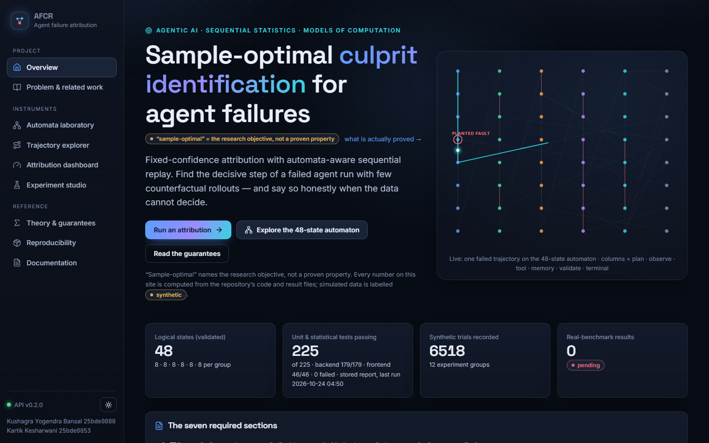<figcaption><b>Screenshot.</b> The website’s Overview page: the title, the explicit note that “sample-optimal” is the objective, and the four live counters.</figcaption></figure>


# Part 5 — Item 2: the research gap

A **research gap** is something the existing papers do not do. To state it honestly we first say what they *do*. We read the papers themselves (not only abstracts where possible); the column “read” records how deeply.

## 5.1 The related work at a glance

| Work | Read | Step-level | Replay | Adaptive | Fixed-conf. stop | δ-guarantee | Prefix reuse | Automata | Real benchmarks |
|---|---|---|---|---|---|---|---|---|---|
| Garivier-Kaufmann 2016 | FULL-THM | – | – | ● | ● | ● | – | – | – |
| Who&When | KEY | ● | – | – | – | – | – | – | ● |
| Causal Agent Replay | FULL | ● | ● | – | – | – | – | – | – |
| AgenTracer | KEY | ● | ● | – | – | – | – | – | ● |
| Conformal Agent Error Attribution | KEY | ◐ | – | – | – | ◐ | – | – | ● |
| Ma et al. causal attribution | KEY | ● | ◐ | – | – | – | – | – | ● |

● yes · ◐ partial · – no. “Read”: FULL = whole paper, THM = theorems checked, KEY = full text keyword-scanned.

**How to read this table.** Garivier & Kaufmann have the statistics (adaptive, fixed-confidence, δ-guarantee) but are not about agents. Who&When defines the task but uses language models as judges (no replay). CAR and AgenTracer replay, but with a fixed number of replays and no stopping guarantee. Nobody in our reading has all columns.

<figure>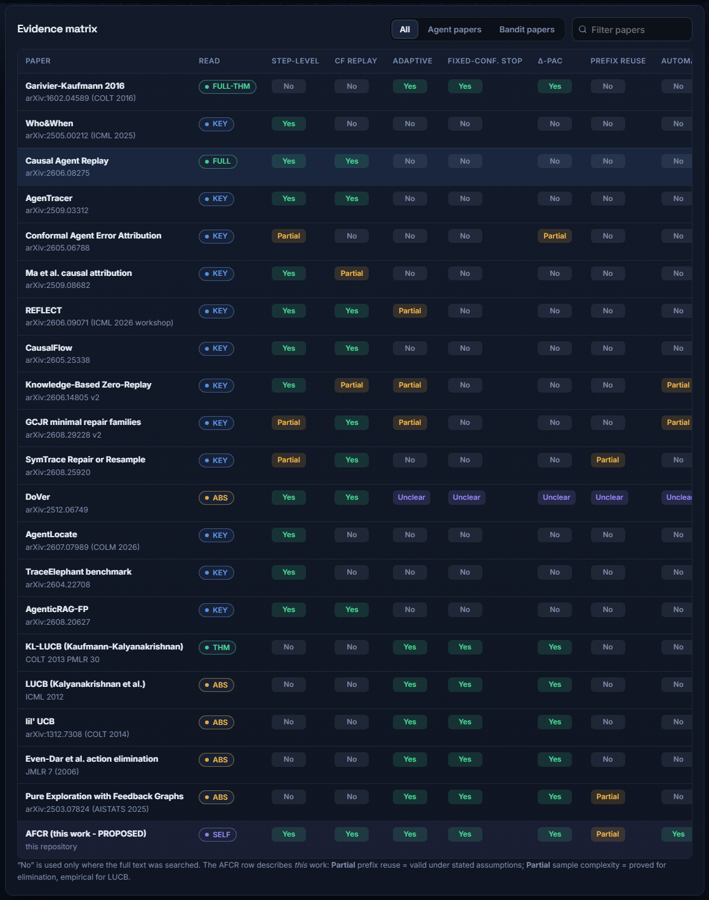<figcaption><b>Screenshot.</b> The same evidence matrix on the website (Problem & related work page), built from research/novelty_matrix.csv.</figcaption></figure>

## 5.2 What each paper does (from our reading notes)

### GK2016 — Optimal Best Arm Identification with Fixed Confidence

*Aurélien Garivier; Emilie Kaufmann · first posted 2016-02-15 · COLT 2016 · how closely we read it: **FULL-THM***

* **Problem:** Fixed-confidence best-arm identification, one-parameter bandit models with a unique best arm; delta-PAC strategies.
* **Replay / intervention:** n/a
* **How it decides / stops:** Chernoff stopping rule with threshold beta(t,delta)=log(r(t)/delta); Bernoulli: log(2(K-1)t/delta) is delta-PAC (Thm 10)
* **Guarantee:** delta-PAC for any sampling rule (Prop 12, exp. families, C=C(alpha,K))
* **Overlap with our work:** Statistical template for AFCR; our guarantee uses simpler union-bound bounds, NOT Track-and-Stop; we do not claim asymptotic optimality.

### WW2025 — Which Agent Causes Task Failures and When? On Automated Failure Attribution of LLM Multi-Agent Systems

*Shaokun Zhang; Ming Yin; Jieyu Zhang; Jiale Liu; Zhiguang Han; Jingyang Zhang; Beibin Li; Chi Wang; Huazheng Wang; Yiran Chen; Qingyun Wu · first posted 2025-04-30 · ICML 2025 (per citation in arXiv:2606.08275) · how closely we read it: **KEY***

* **Problem:** Identify failure-responsible agent i* and decisive error step t* from a failure log.
* **Replay / intervention:** None (LLM judges read the log)
* **How it decides / stops:** n/a
* **Guarantee:** None
* **Overlap with our work:** Defines the task and benchmark; no overlap in method. Does NOT use Shapley estimation (that is CAR).

### CAR2026 — Causal Agent Replay: Counterfactual Attribution for LLM-Agent Failures

*Jaineet Shah · first posted 2026-06-06 · arXiv preprint (cs.LG) · how closely we read it: **FULL***

* **Problem:** Which step caused the failure of an LLM-agent run; agent run as an SCM tau=(s0,(a1,o1),...,(an,on),y), y in [0,1].
* **Replay / intervention:** Five do-operations: do_resample (null), do_action, do_observation, do_context, do_policy; run forward K times from the intervened state.
* **How it decides / stops:** None (fixed K); locus = latest step whose effect CI excludes zero
* **Guarantee:** Per-estimate CIs only; no delta-PAC or sequential guarantee stated
* **Overlap with our work:** HIGH on estimand/replay (same-policy resampling, outcome distributions, run-forward confound); NONE on fixed-confidence stopping, adaptivity, prefix reuse, automata. Its no-cache rule motivates our validity conditions.

### AT2025 — AgenTracer: Who Is Inducing Failure in the LLM Agentic Systems?

*Guibin Zhang; Junhao Wang; Junjie Chen; Wangchunshu Zhou; Kun Wang; Shuicheng Yan · first posted 2025-09-03 · ICLR 2026 (per citation in arXiv:2608.29228) · how closely we read it: **KEY***

* **Problem:** Failure attribution; decisive step = earliest step whose oracle rectification flips failure to success.
* **Replay / intervention:** Counterfactual replay with analyzer-agent corrections (has access to ground truth) + programmatic fault injection on successful trajectories
* **How it decides / stops:** Earliest flipping step
* **Guarantee:** None
* **Overlap with our work:** Replay as annotation oracle; second culprit definition (earliest). AFCR's first_above rule formalises it under sampling noise.

### CP2026 — Conformal Agent Error Attribution

*Naihe Feng; Yi Sui; Shiyi Hou; Ga Wu; Jesse C. Cresswell · first posted 2026-05-07 · arXiv preprint · how closely we read it: **KEY***

* **Problem:** Predict a contiguous set of steps containing the decisive error with finite-sample coverage.
* **Replay / intervention:** None (scoring functions: LLM judges, role prompting, fine-tuned Qwen3-1.7B)
* **How it decides / stops:** n/a
* **Guarantee:** Marginal coverage 1-alpha <= P[y* in C] < 1-alpha+1/(n+1) (Thm 3.4) over trajectories
* **Overlap with our work:** Orthogonal; marginal coverage vs per-trajectory identification; complementary (set -> replay).

### MA2025 — Automatic Failure Attribution and Critical Step Prediction Method for Multi-Agent Systems Based on Causal Inference

*Guoqing Ma; Jia Zhu; Hanghui Guo; Weijie Shi; Jiawei Shen; Jingjiang Liu; Yidan Liang · first posted 2025-09 (arXiv:2509.08682) · arXiv preprint · how closely we read it: **KEY***

* **Problem:** Failure attribution via causal inversion + Shapley (agents) and CDC-MAS causal discovery (critical steps).
* **Replay / intervention:** Counterfactual simulation used for optimisation suggestions
* **How it decides / stops:** n/a
* **Guarantee:** None found
* **Overlap with our work:** Low (static-log causal discovery).

### REFLECT2026 — REFLECT: Intervention-Supported Error Attribution for Silent Failures in LLM Agent Traces

*Xiaofeng Lin; Yunxi Wang; Tung Sum Thomas Kwok; Daniel Guo; Sahil Arun Nale; Charles Fleming; Guang Cheng · first posted 2026-06-09 · ICML 2026 Workshop on Failure Modes in Agentic AI · how closely we read it: **KEY***

* **Problem:** Localize errors in silent-failure traces using intervention outcomes as evidence.
* **Replay / intervention:** Controlled replay with diagnosis-specific patch; multi-rollback
* **How it decides / stops:** Heuristic
* **Guarantee:** None
* **Overlap with our work:** Replay-based; no sequential statistics.

### CF2026 — CausalFlow: Causal Attribution and Counterfactual Repair for LLM Agent Failures

*Akash Bonagiri; Devang Borkar; Gerard Janno Anderias; Setareh Rafatirad; Houman Homayoun · first posted 2026-05 (arXiv:2605.25338) · arXiv preprint · how closely we read it: **KEY***

* **Problem:** Causal Responsibility Scores via step-level counterfactual intervention, then minimal repairs.
* **Replay / intervention:** Step-level interventions and edited repairs validated by outcome flip
* **How it decides / stops:** not verified
* **Guarantee:** None found
* **Overlap with our work:** Replay-based; no sequential statistics.

### ZR2026 — Knowledge-Based Zero-Replay Debugging of Multi-Agent LLM Traces

*Hyeonjeong Cha; Daein Weon; Dong Ho Kang · first posted 2026-06 (arXiv:2606.14805) · arXiv preprint (cs.SE) · how closely we read it: **KEY***

* **Problem:** Predict which events a replay oracle would mark high-effect, without replaying (zero-replay counterfactual-effect prediction).
* **Replay / intervention:** Remove-event interventions in a deterministic oracle used only for calibration/evaluation
* **How it decides / stops:** n/a
* **Guarantee:** Calibration of predictor; no statistical stopping guarantee
* **Overlap with our work:** Same cost motivation, different mechanism (prediction vs adaptive stochastic replay).

### GCJR2026 — Localizing Emergent Failures in Agentic AI: Recovering Minimal Repair Families via Counterfactual Replay

*Bingjie Li; Yumeng Song; Zhongming Yao; Tianyi Li · first posted 2026-08 (arXiv:2608.29228) · arXiv preprint · how closely we read it: **KEY***

* **Problem:** Minimal Repair Family Recovery: all inclusion-minimal event sets whose replay restores success within a size bound.
* **Replay / intervention:** Graph-constrained singleton and pair candidates verified by replay with paired clean counterparts
* **How it decides / stops:** Exhaustion of graph-feasible candidates
* **Guarantee:** Exact within declared graph domain for fixed replay outcomes (no probabilistic guarantee)
* **Overlap with our work:** Handles joint causes (we do not); different cost-reduction route.

### SYM2026 — Repair or Resample? Rethinking Failure Debugging in LLM Multi-Agent Systems

*Zhongwen Luan; Xiaoyu Zhang; Yue Yang; Jiongchi Yu; Xiaohong Chen; Ming Hu · first posted 2026-08 (arXiv:2608.25920) · arXiv preprint · how closely we read it: **KEY***

* **Problem:** Do MAS repair methods causally repair or stochastically resample? SymTrace framework + SymFail dataset (536 annotated failures).
* **Replay / intervention:** Snapshot + replay mode: reinject recorded results up to the anchor, regenerate downstream
* **How it decides / stops:** n/a
* **Guarantee:** None for the debugger
* **Overlap with our work:** Prefix reconstruction for replay FIDELITY; no cross-candidate reuse of rollouts found.

### DOVER2025 — DoVer: Intervention-Driven Auto Debugging for LLM Multi-Agent Systems

*Ming Ma; Jue Zhang; Fangkai Yang; et al. · first posted 2025-12-07 · arXiv preprint · how closely we read it: **ABS***

* **Problem:** Validate or refute failure hypotheses by interventions.
* **Replay / intervention:** Interventions in Magentic-One and AG2
* **How it decides / stops:** not verified
* **Guarantee:** not verified
* **Overlap with our work:** Unclear; read full text before submission.

### KK2013 — Information Complexity in Bandit Subset Selection

*Emilie Kaufmann; Shivaram Kalyanakrishnan · first posted 2013 · COLT 2013, PMLR 30:228-251 · how closely we read it: **THM***

* **Problem:** Explore-m (PAC/fixed-budget subset selection) with KL confidence regions.
* **Replay / intervention:** n/a
* **How it decides / stops:** Stop when L(selected) >= U(non-selected) - epsilon
* **Guarantee:** Thm 1: delta-PAC with beta=log(k1 K t^alpha/delta)+loglog(...), alpha>1, k1>2e+1+e/(alpha-1)+(e+1)/(alpha-1)^2
* **Overlap with our work:** Source of the KL-LUCB baseline implemented in this repo.

## 5.3 The gap, stated carefully

**Already done by others (we do not claim these):**
* counterfactual replay for step attribution — AgenTracer, CAR, CausalFlow, REFLECT, DoVer;
* resampling under the same policy with confidence intervals and the “run-forward confound” — CAR;
* fixed-confidence best-arm identification, LUCB, KL confidence bounds, tracking-based optimality — 2012–2016;
* pure exploration with side observations — Russo, Song & Pacchiano (2025), the generic template for sharing.

**What we found no paper doing together:**
1. **fixed-confidence stopping with an explicit abstention** under **stochastic replay**;
2. a **proved condition** under which one replay may be counted for **several** candidate steps;
3. an **automaton substrate** with **exactly computable ground truth** to test all of this.

**Our assessment — “outcome B”:** *the gap exists only in a narrower formulation.* It is **provisional**: some neighbouring papers were read at abstract level only, and later postings cannot be excluded.

<figure>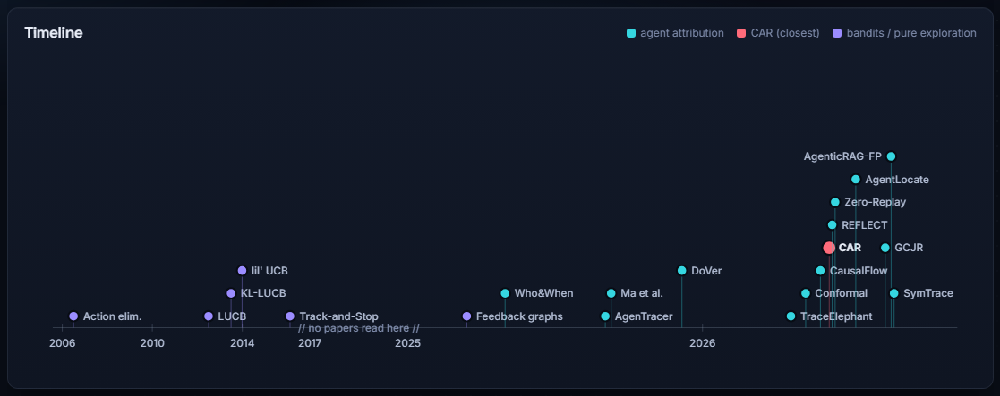<figcaption><b>Screenshot.</b> Timeline of the papers (the axis is broken between 2017 and 2025 because almost all agent-attribution work appeared in 2025–26). CAR, the closest work, is red.</figcaption></figure>
<figure>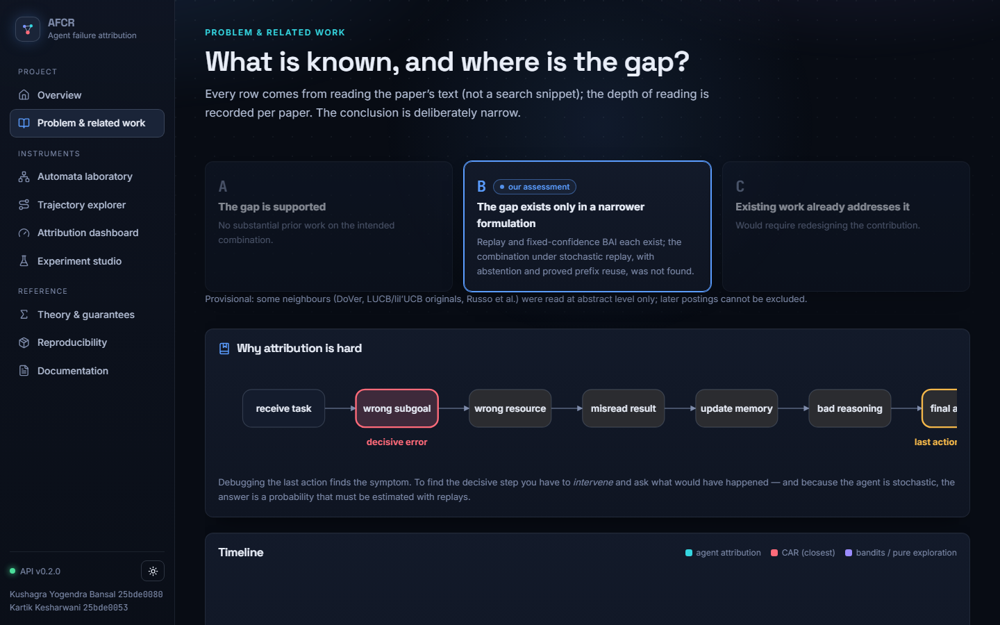<figcaption><b>Screenshot.</b> The three possible outcomes of a novelty check (A: gap supported, B: narrower formulation, C: already done). We select B.</figcaption></figure>


# Part 6 — Item 3: the problem statement

## 6.1 In one sentence

> Given **one failed run** of a multi-step agent, find the **step whose repair most increases the chance of success**, using **as few expensive replays as possible**, with a **guaranteed bound on the probability of naming the wrong step** — and **say so honestly** when the replays cannot decide.

## 6.2 Why the obvious answers are not enough

| Approach | Why it falls short |
|---|---|
| **Blame the last action** | it is the symptom, not the cause (Part 1) |
| **Ask a language model to read the log** | correlational; the best step-level accuracy reported on the Who&When benchmark is about 14 % (Zhang et al., 2025) |
| **Replay every step *K* times** (CAR-style) | *K* must be chosen in advance: too small → unreliable, too large → wasteful; no confidence statement; no stopping rule |
| **Swap in one gold action** (AgenTracer-style) | needs gold actions; a single sample of a random process |

## 6.3 The precise statement

A failed trajectory is τ = (q₀, a₁, q₁, …, a_T, q_T) with outcome Y = 0. For each candidate step *t* and an intervention *g_t* (repair or resample) the replay restores the state just before step *t*, applies *g_t* and lets the agent continue under its own random policy. Its outcome is one Bernoulli sample (0 or 1) with unknown mean

> **μₜ = Pr( the replay with intervention at step t succeeds ).**

We want a **sampling rule** (which step to replay next), a **stopping rule** (when to stop) and a **recommendation** (a step, or *abstain*) such that for every instance

> **Pr( the method certifies a step whose μ is more than ε below the best ) ≤ δ.**

Three **targets** are supported: the best repair step (argmax μₜ, tolerance ε); the **first** step with μₜ ≥ θ; the **last** step with μₜ ≥ θ. (Different authors define “the culprit” differently; we make each explicit.)

What the work does **not** try to determine: temporal association, predictive power, unique responsibility or joint causes. It estimates **the interventional effect of a repair**.

## 6.4 The running example: a real failed run

We use one concrete failed run (random seed 5, fault probability 0.6) for the whole handbook.

| step | state | action taken | note |
|---|---|---|---|
| 1 | `PLAN_START` | `start` |  |
| 2 | `PLAN_PARSE` | `parse` |  |
| 3 | `PLAN_DECOMP` | `decompose` |  |
| 4 | `PLAN_SUBGOAL` | `select_wrong` | **fault action** |
| 5 | `PLAN_SUBGOAL_WRONG` | `propagate` |  |

The run has **5 steps**. The agent chose `select_wrong` at step 4 (probability 0.6 for that mistake) and then propagated it. Because the agent is a known Markov chain we can compute the **exact** μₜ for each step without sampling:

| step (arm) | exact μₜ | estimate by AFCR | interval | replays spent on this step |
|---|---|---|---|---|
| t=1: PLAN_START | 0.462 | 0.482 | [0.401, 0.568] | 1,285 |
| t=2: PLAN_PARSE | 0.462 | 0.476 | [0.396, 0.568] | 1,100 |
| t=3: PLAN_DECOMP | 0.462 | 0.433 | [0.313, 0.568] | 460 |
| t=4: PLAN_SUBGOAL | 0.620 | 0.624 | [0.568, 0.678] | 3,030 |
| t=5: PLAN_SUBGOAL_WRONG | 0.356 | 0.379 | [0.229, 0.567] | 214 |

The planted cause is **t=4: PLAN_SUBGOAL**. Look at the exact column: the early steps are not zero — merely re-running the agent re-rolls the dice and may avoid the fault by luck (≈ 0.46 is the success chance of the untouched agent). Only at the decisive step does a repair **always** avoid the fault, so μ jumps up (0.62 here).

<figure><figcaption>Exact μ_t (dynamic programming, no sampling) for one failed trajectory (seed 5, fault probability 0.6). Steps before the planted fault only exceed the baseline slightly: re-running re-rolls the fault. After the fault the state is corrupted and μ_t falls.</figcaption></figure>

<figure>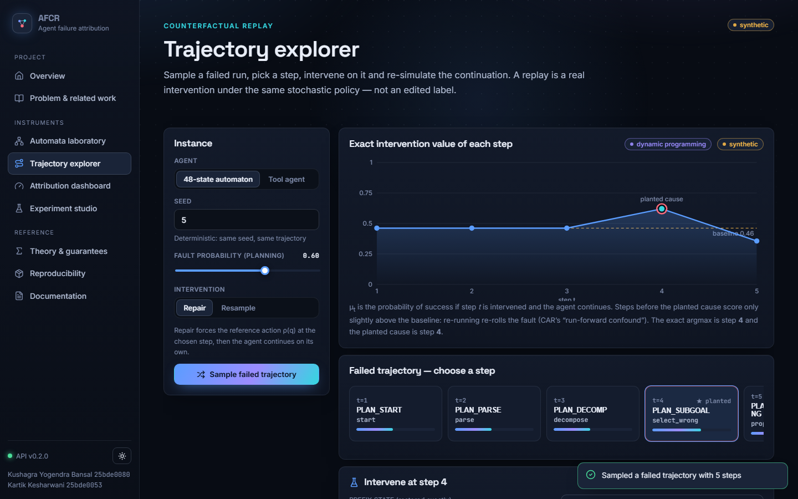<figcaption><b>Screenshot.</b> The Trajectory explorer shows this run: the exact μₜ for every step (blue curve), the baseline (dashed amber) and the planted cause (red ring).</figcaption></figure>

### Key takeaways of Part 6
* The task: pick the best step to repair, cheaply, with a guarantee or an honest “don’t know”.
* The exact μₜ values above are what the method must discover from noisy replays.


# Part 7 — Item 4: the methods, idea by idea

Eight ideas, in the order in which they are used. Each has: **the idea in words → how it works → a real example → why it matters**.

## 7.1 Turn the problem into slot machines

**Idea.** Candidate step ⇒ arm. One replay ⇒ one pull. Success ⇒ payout 1. The best step ⇒ the best arm.
**Why it matters.** The bandit literature provides valid statistics, allocation rules and a lower bound.

## 7.2 Confidence sequences (intervals that survive peeking)

After *n* replays of an arm with empirical success rate μ̂, the plausible values of the true μ are

> { q : n · kl(μ̂, q) ≤ x_n },   x_n = ln( 2·K·n·(n+1) / δ ),

where **kl(p, q)** measures how surprising it is to see frequency p when the truth is q (the Bernoulli “KL divergence”; for example kl(0.60, 0.45) = 0.0452) and **K** is the number of arms. The threshold grows only logarithmically with *n*, which is what makes the intervals valid at **all** times. We also intersect the intervals over time so that they never widen.

**Theorem 1 (δ-correctness).** With probability at least 1 − δ **every** interval of **every** arm contains its true mean at **every** time — *whatever rule chooses the next arm*. Consequently a stopping rule built on these intervals errs with probability at most δ.
*Proof idea:* the *n*-th replay of an arm gives a fixed “reward stack” entry no matter when it is drawn; for each (arm, n) the Chernoff bound gives error ≤ δ/(K·n·(n+1)); the union bound over arms and over *n* sums to ≤ δ because Σ 1/(n(n+1)) = 1.

## 7.3 Where to sample next: LUCB

**Idea.** Replay the step that currently *looks best* **and** the *strongest challenger* (the other step with the highest upper bound). They are the two that decide the answer; steps that are clearly worse stop receiving replays.

**Real example.** In our run the history of the first rounds and a few later ones looks like this (arms are steps 1…5; means and intervals shown for the eventual winner, step 4):

| round | replays so far | replays per arm | empirical means | interval of step 4 | highest upper bound of the others | decision |
|---|---|---|---|---|---|---|
| 1 | 0 | 1, 1, 1, 1, 1 | 1.00, 1.00, 0.00, 1.00, 0.00 | [0.01, 1.00] | 1.00 | continue |
| 2 | 5 | 2, 2, 1, 1, 1 | 1.00, 0.50, 0.00, 1.00, 0.00 | [0.01, 1.00] | 1.00 | continue |
| 3 | 7 | 3, 2, 1, 2, 1 | 0.67, 0.50, 0.00, 1.00, 0.00 | [0.04, 1.00] | 1.00 | continue |
| 10 | 21 | 9, 3, 2, 8, 1 | 0.67, 0.33, 0.50, 0.62, 0.00 | [0.11, 0.99] | 0.99 | continue |
| 100 | 201 | 27, 27, 38, 87, 24 | 0.44, 0.44, 0.50, 0.63, 0.42 | [0.39, 0.86] | 0.84 | continue |
| 500 | 1,001 | 70, 196, 190, 487, 60 | 0.37, 0.49, 0.48, 0.63, 0.35 | [0.50, 0.75] | 0.68 | continue |
| 2000 | 4,001 | 843, 756, 322, 1987, 95 | 0.49, 0.49, 0.44, 0.62, 0.33 | [0.56, 0.69] | 0.60 | continue |
| 3043 | 6,087 | 1285, 1100, 460, 3030, 214 | 0.48, 0.48, 0.43, 0.62, 0.38 | [0.57, 0.68] | 0.57 | **stop** |

Reading the table: at the start the intervals are huge (we have seen almost nothing). After ~6 000 replays the lower end of step 4’s interval (0.57) has risen above the highest upper end of all other steps (0.57…) and the rule says **stop**. Notice also how unevenly the replays were spent: step 4 received about half of them because it was the leader in almost every round.

<figure><figcaption>One LUCB run (seed 5, status: identified). The run stops the first time the lower bound of the best arm exceeds the largest upper bound of all other arms (running-intersection intervals, x_n = ln(2Kn(n+1)/δ)).</figcaption></figure>

## 7.4 The stopping rule — and the right to refuse

> **Stop and certify step h when lo_h + ε ≥ max over all other steps of hi.**

In words: the lowest believable value of the best step is at least as high as the highest believable value of any other step (up to the tolerance ε). If the replay **budget** is exhausted before that happens, the system **abstains**: it reports its best guess **and** the steps it could not rule out, clearly marked as **not certified**. A timeout is never presented as a δ-guaranteed answer.

<figure>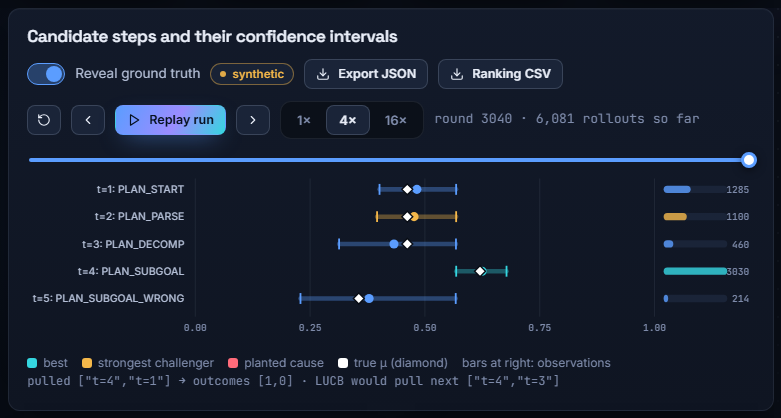<figcaption><b>Screenshot.</b> The Attribution dashboard’s forest plot: one row per step with its confidence interval (bar), estimate (dot), true value (white diamond) and the number of replays (bars on the right). Cyan = leader, amber = strongest challenger, red = planted cause.</figcaption></figure>
<figure>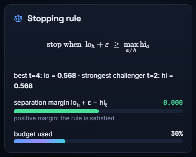<figcaption><b>Screenshot.</b> The stopping-rule panel: separation margin lo_h + ε − hi_ℓ and the share of the budget used.</figcaption></figure>
<figure>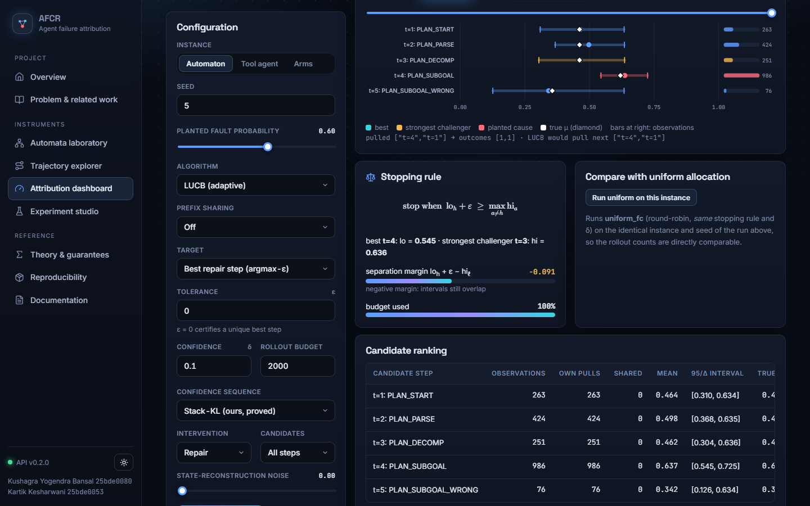<figcaption><b>Screenshot.</b> When the budget is far too small (2 000 replays) the system **abstains**: “Abstention, not a verdict”.</figcaption></figure>

## 7.5 Other ways to sample (the baselines)

| Method | Rule | Purpose |
|---|---|---|
| **LUCB** | leader + challenger | our default adaptive rule |
| **Successive elimination** | replay all surviving steps equally; drop a step when it is clearly worse | the rule for which we **prove** a sample bound (Theorem 2) |
| **Uniform** | round-robin over all steps | the natural naive baseline (same stopping rule) |
| **Random** | a random step each time | sanity baseline |
| **Equal budget** | fixed number of replays per step, no early stop | what a fixed-*K* method does |
| **CAR-style fixed K** | re-implementation of the “latest step whose effect excludes zero” rule | a *different question*; not a like-for-like comparison |

**Theorem 2 (successive elimination).** With probability ≥ 1 − δ it stops after at most Σₐ nₐ replays, where nₐ ≈ (8/Δₐ²)·ln(2Knₐ(nₐ+1)/δ) and Δₐ is the gap between the best step and step a. In big-O: **O(Σₐ Δₐ⁻² · log(K/(δΔₐ)))** — *harder* (closer) steps cost quadratically more. (Full proof in the paper’s Appendix A.) For LUCB with our bound we give **no** theorem; it is measured.

## 7.6 Reusing replays (prefix reuse) — and why naive reuse is wrong

**Idea.** A replay of step *i* starts from the state before step *i* and runs on. By chance it may arrive, at the *right time*, in exactly the state where step *j* would start **and** take the repair action there. From that moment on it behaves **exactly like** a replay of step *j* — so its final result is a valid sample for step *j*, free of charge.

<figure><figcaption>Union of 60 real replays started at the first candidate step (node size = visit count; x = time since the intervention). Green nodes are exactly the (time, state) pairs at which another candidate would start; a rollout through a green node that also takes that candidate’s reference action is a valid sample for it (Theorem 3).</figcaption></figure>

**Theorem 3.** If the process is Markov on (time, state) pairs and the match is exact — same time, same state, the repair action — then the outcome is a Bernoulli(μⱼ) sample independent of the earlier history. (Proof: strong Markov property.)

**The trap.** If instead you count *every* replay for *every* later step “because they come later”, the samples are biased. We keep this wrong version as a **negative control** and the experiment confirms the damage:

| Sharing | mean replays | accuracy |
|---|---|---|
| none | 18,448 | 93 % |
| **valid** (exact match, Theorem 3) | 12,693 | 97 % |
| naive (wrong) | 5,355 | 47 % |

Naive sharing is “cheap” only because it stops early with a **wrong** answer. On our running instance: no sharing needs **6,089** replays, valid sharing only **3,003** (it received 4,182 free observations), naive sharing stops after 7,873 replays with the answer “t=4: PLAN_SUBGOAL”.

<figure><figcaption>Same instances, same stopping rule and δ. Means include trials that stopped at the budget cap (censored), so the gaps between methods are conservative; the right panel shows how often each method certified at all.</figcaption></figure>

## 7.7 Why an automaton

* **Exact ground truth.** The agent is a Markov chain on (time, state). Define V_t(q) = the probability of reaching success from state q at time t. It follows by *backward induction*: V_T(q) = 1 if q is a success state; otherwise V_t(q) = Σ_a π(a|q) Σ_q′ P(q′|q,a) V_{t+1}(q′). The exact value of a **repair at step t** is then μₜ = Σ_q′ P(q′ | q_{t−1}, ρ(q_{t−1})) · V_t(q′) (ρ = the reference action). No sampling needed.
* **Valid reuse** (Theorem 3 needs the Markov property).
* **Comparability**: eight further machine types are implemented to show what each can express (Part 10).

## 7.8 What is proved, what is measured, what is not claimed

| Statement | Status |
|---|---|
| The stopping rule is δ-correct for any sampling rule (Theorem 1) | **proved** |
| Successive elimination’s sample bound (Theorem 2) | **proved** (this algorithm only) |
| Exact-match prefix reuse is valid (Theorem 3) | **proved**, and checked numerically (matched samples agree with the exact value; naive ones do not) |
| LUCB’s efficiency with our bound | **measured** |
| Any algorithm is sample-optimal | **not claimed** |
| Benefit on real LLM agents | **hypothesis** (not run) |

### The assumptions behind the guarantee (A1–A6)
The guarantee concerns the **replay model**. It needs: (A1) the replay restarts from *exactly* the original state; (A2) the process is Markov on time-augmented states; (A3) the policy is fixed (stationary); (A4) fresh independent randomness per replay; (A5) the intervention changes only the chosen step; (A6) the target is the declared interventional quantity. In our simulations all hold; real production agents often violate them — which is why we do not claim real-world results.


# Part 8 — Items 5, 6 and 7: input, output and the steps — one real run

## 8.1 Item 5 — the input

| Input | What it is | In the running example |
|---|---|---|
| **Failed trajectory** | states, actions, outcome of one failed run | the 5-step run of Part 6 |
| **Task specification** | what “success” means | reaching a success terminal state |
| **Candidate steps and an intervention for each** | where we may change the run, and how | all 5 steps; **repair** = force the reference action |
| **Replay environment and outcome evaluator** | the machine that restores a state, re-runs and judges | `AutomatonEnv` (also a tool agent, a bandit model) |
| **Confidence parameter δ** | tolerated chance of a wrong certified answer | 0.1 |
| **Maximum rollout budget** | the most replays we will pay for | 20 000 |
| **Target** | best repair step (tolerance ε) / first or last step ≥ θ | best step, ε = 0 |
| **Random seed** | makes the run reproducible | 5 |
| **Automaton configuration** | number of states, fault probability, noise | 48 states, 0.6, none |

The same input as a file (`configs/spec_automaton_prefix.json`):

```
{ "kind": "automaton", "n_states": 48, "eps_plan": 0.6, "method": "lucb_prefix",
  "delta": 0.1, "budget": 60000, "eps": 0.0, "target": "argmax", "conf": "stack_kl",
  "intervention": "repair", "recon_noise": 0.0, "seed": 20000 }
```

<figure>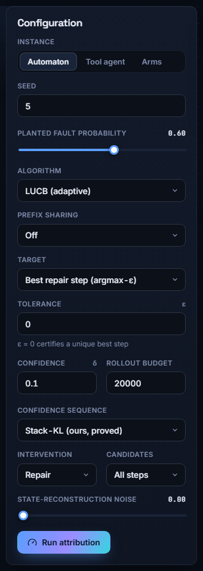<figcaption><b>Screenshot.</b> The website’s configuration panel: instance type, seed, fault probability, algorithm, prefix sharing, target, ε/θ, δ, budget, confidence sequence, intervention, candidates, noise.</figcaption></figure>
<figure>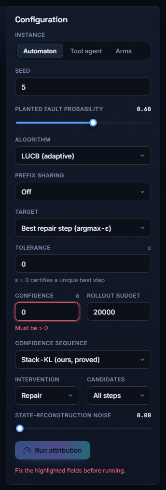<figcaption><b>Screenshot.</b> An invalid value (δ = 0) is flagged and the Run button is disabled — nothing is sent to the server.</figcaption></figure>

## 8.2 Item 6 — the output

The method returns **one of two things**, always with its evidence:

| Output | Meaning | In the running example |
|---|---|---|
| status | `identified` (certified) or `budget_exhausted` (abstention) | **identified** |
| culprit step | the certified step | **t=4: PLAN_SUBGOAL** |
| per-step means and intervals | the evidence | table in Part 6 |
| replays used | the total cost | **6,089** (of 20 000) in **3,043** rounds; ≈ 113,532 simulated agent steps |
| guarantee flag | does the δ-guarantee apply, and if not why not | **True — δ-correct under assumptions A1–A6 (paper Thm 1)** |
| comparison with the planted cause | possible because the truth is known | matches |
| traces | the original run and the counterfactual replays | Explorer page |
| machine-readable record | JSON / CSV | Dashboard → Export |

<figure>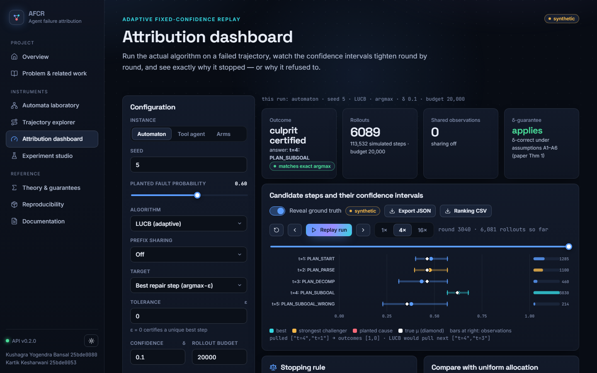<figcaption><b>Screenshot.</b> The Attribution dashboard after “Run attribution”: outcome (culprit certified), replays, shared observations and the δ-guarantee box.</figcaption></figure>
<figure>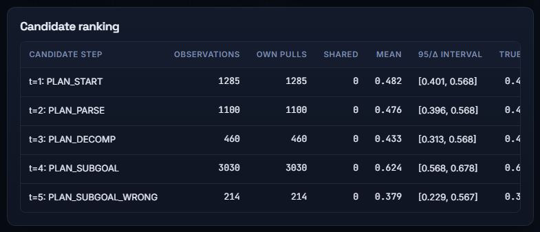<figcaption><b>Screenshot.</b> The candidate ranking: every step with its observations, estimate, interval and (optionally revealed) true value and whether the truth lies inside the interval.</figcaption></figure>

## 8.3 Item 7 — the fifteen steps, with what happens in the real run

| # | Step | What happens | In the running example |
|---|---|---|---|
| 1 | **Parse the task and the failed trajectory** | read states, actions and the final outcome | 5 steps; outcome = failure |
| 2 | **Validate the structure** | unique ids, probabilities add to 1, all states reachable, terminals absorbing | the 48-state model passes `validate()` |
| 3 | **Convert to an automaton / LTS** | states become (state, time) pairs, so the process is Markov | five views available: LTS, DFA, NFA, ε-NFA, PA |
| 4 | **Identify the eligible candidate steps** | all steps, or only decision states (a prior) | 5 arms |
| 5 | **Construct an intervention for each candidate** | repair = at step *t* force the reference action ρ(q) | arm 4: “restore before step 4, force `select_good`” |
| 6 | **Define the estimand** | μₜ = Pr(success after the intervention) | exact values in Part 6 |
| 7 | **Initialise estimates and the confidence procedure** | counts = 0; threshold x_n = ln(2Kn(n+1)/δ) | K = 5, δ = 0.1 |
| 8 | **Select the next candidate** | first every arm once; then leader + strongest challenger | round 1 replays all five arms |
| 9 | **Execute the counterfactual rollout** | restore, intervene, simulate to the end | one 0/1 result |
| 10 | **Record the result and the prefix** | remember the (time, state, action) path | enables valid reuse |
| 11 | **Update the estimates** | own sample + validly matched shared samples | counts per arm grow |
| 12 | **Apply the stopping rule** | lo_h + ε ≥ max hi ? | tested after every round |
| 13 | **Return the culprit, the uncertainty, or an abstention** | certified step or candidate set | **t=4: PLAN_SUBGOAL** after 6,089 replays |
| 14 | **Compare with the planted cause** | exact ground truth | correct |
| 15 | **Export traces, estimates and metrics** | CSV / JSON | Dashboard export, Studio |

<figure><figcaption>One round of AFCR. The sampling rule is interchangeable: δ-correctness depends only on the confidence sequence and the stopping rule. Budget exhaustion is an abstention, never a certified answer.</figcaption></figure>

<figure>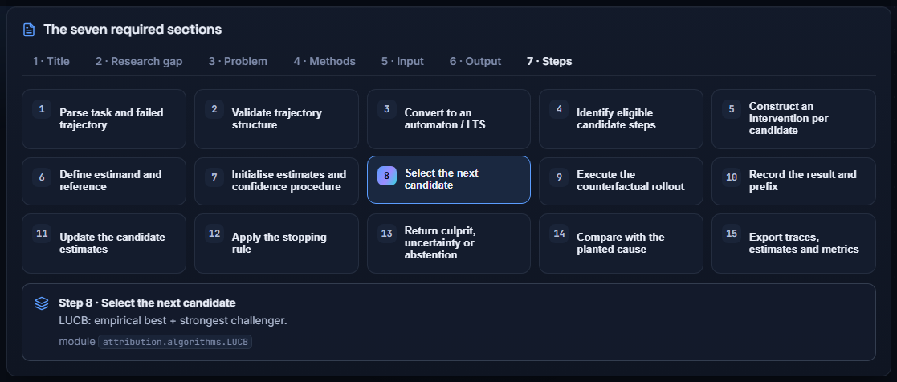<figcaption><b>Screenshot.</b> The Overview page, tab “7 · Steps”: the fifteen steps as clickable cards, each with the module and the API endpoint that implements it.</figcaption></figure>
<figure>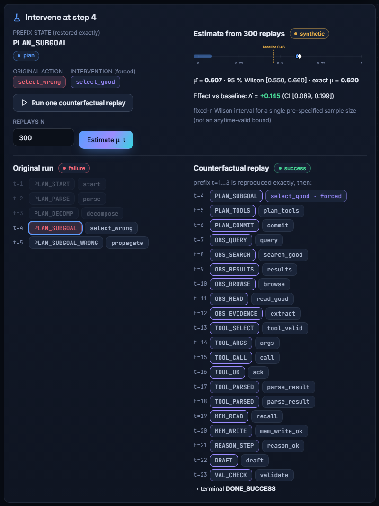<figcaption><b>Screenshot.</b> Steps 5 and 9 made visible: a single real counterfactual replay on the Trajectory explorer. Left: the original run. Right: the re-simulated continuation after forcing the reference action (violet “forced”).</figcaption></figure>
<figure>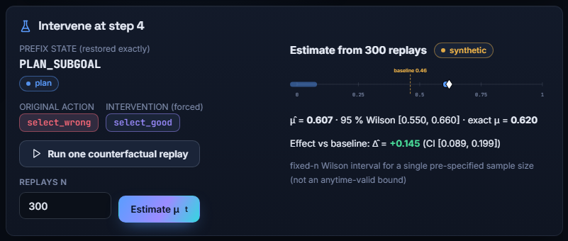<figcaption><b>Screenshot.</b> Many replays of one step give an estimate with a 95 % interval (blue) next to the exact value (white diamond) and the baseline (amber).</figcaption></figure>

### Key takeaways of Part 8
* **Input**: a failed run + how to replay it + δ + budget + target. **Output**: a certified step or an honest abstention, with evidence and cost.
* The **loop** (steps 8–12) is the heart: choose → replay → update → test.


# Part 9 — The 48-state agent automaton in detail

## 9.1 Structure

The main benchmark is a hand-designed agent with **exactly 48 logical states**, arranged in six groups of eight:

| Group | What the group stands for |
|---|---|
| **PLAN** | read the task, decompose it, choose a sub-goal, plan tool use, revise, commit |
| **OBSERVE** | form a query, choose a resource, search, browse, read, interpret |
| **TOOL** | choose a tool, build arguments, call it, receive the result |
| **MEMORY** | read and write memory, handle corrupted memory |
| **VALIDATE** | validate the answer, collect feedback, diagnose, replan |
| **TERMINAL** | the end states: 2 success states and 6 failure states |

Roles of the states: benign 19, decision 7, fault entry 7, recovery 4, corridor 3, terminal success 2, terminal failure 6. **Seven decision states** carry a *planted fault*: a choice where the wrong option has some probability (e.g. at `PLAN_SUBGOAL` the agent picks the wrong sub-goal with probability 0.6). A wrong choice leads into a **corridor** of corrupted states that ends in failure unless a rare recovery edge is taken.

<figure><figcaption>All 48 logical states grouped into plan / observe / tool / memory / validate / terminal; edges are all positive-probability transitions of the model, fault actions in red. Drawn from build_agent_model(48), so state count and structure are those of the tested object.</figcaption></figure>

## 9.2 Why exactly 48?

The brief required at least 48 states. The model has **48 distinct logical states** (unique ids *and* unique labels — checked by the code). Larger versions with 64 and 96 states are produced by adding harmless benign steps, to study longer trajectories. In the DFA view an extra *sink* state is drawn to make the machine total; it is a drawing aid and **not** counted as a logical state — the website says so on the page.

## 9.3 Exact answers by backward induction (how the ground truth is computed)

*Toy illustration (not the real model).* A tiny agent has states A → B → Done/Fail. From A it chooses “good” (prob 0.4) or “bad” (prob 0.6). Good leads to Done with prob 1; bad leads to Done with prob 0.1 and Fail with prob 0.9. Success value of A = 0.4·1 + 0.6·0.1 = 0.46. A **repair** at A (force “good”) gives success value **1.0** — the gain 1.0 − 0.46 is the “effect” of repairing A. The real model does the same computation for every state and every time step with a table V[t, q] (97 time steps × 48 states).

For the real model, the success probability of the untouched agent is **0.462**, the same for every start time before the first decision, which is why all early steps share the same baseline.

## 9.4 The complete list of states

| id | name | group | role | meaning |
|---|---|---|---|---|
| q0 | `PLAN_START` | PLAN | benign | Initial state: task received, nothing decided yet. |
| q1 | `PLAN_PARSE` | PLAN | benign | Read and normalise the task specification. |
| q2 | `PLAN_DECOMP` | PLAN | benign | Split the task into subgoals. |
| q3 | `PLAN_SUBGOAL` | PLAN | decision | Choose which subgoal to pursue next. DECISION POINT: choosing the wrong subgoal corrupts everything downstream. |
| q4 | `PLAN_SUBGOAL_WRONG` | PLAN | fault entry | The agent committed to an irrelevant or incorrect subgoal. |
| q5 | `PLAN_TOOLS` | PLAN | benign | Decide which tools will be needed. |
| q6 | `PLAN_REVISE` | PLAN | benign | Minor plan revision before committing. |
| q7 | `PLAN_COMMIT` | PLAN | benign | Freeze the plan and start gathering information. |
| q8 | `OBS_QUERY` | OBSERVE | benign | Turn the current subgoal into a search query. |
| q9 | `OBS_SEARCH` | OBSERVE | decision | Choose where to search. DECISION POINT: a wrong resource yields misleading evidence. |
| q10 | `OBS_WRONG_RESOURCE` | OBSERVE | fault entry | Evidence is being gathered from a resource that cannot contain the answer. |
| q11 | `OBS_RESULTS` | OBSERVE | benign | Results returned; may be empty (search again). |
| q12 | `OBS_BROWSE` | OBSERVE | benign | Open the most promising result. |
| q13 | `OBS_READ` | OBSERVE | decision | Interpret the retrieved document. DECISION POINT: misreading corrupts the evidence the agent reasons over. |
| q14 | `OBS_MISREAD` | OBSERVE | fault entry | The agent holds a wrong interpretation of the evidence. |
| q15 | `OBS_EVIDENCE` | OBSERVE | benign | Evidence extracted; move to tool use. |
| q16 | `TOOL_SELECT` | TOOL | decision | Pick a tool. DECISION POINT: an invalid tool choice produces garbage that is written to memory. |
| q17 | `TOOL_INVALID` | TOOL | fault entry | A tool that cannot serve the subgoal was invoked. |
| q18 | `TOOL_ARGS` | TOOL | benign | Construct the tool-call arguments. |
| q19 | `TOOL_CALL` | TOOL | benign | Execute the tool call (may fail transiently). |
| q20 | `TOOL_OK` | TOOL | benign | The tool returned a result. |
| q21 | `TOOL_ERROR` | TOOL | benign | The tool returned an error. |
| q22 | `TOOL_RETRY` | TOOL | recovery | Retry or re-select; retry budget may be exhausted. |
| q23 | `TOOL_PARSED` | TOOL | benign | Extract the useful content from the tool result. |
| q24 | `MEM_READ` | MEMORY | benign | Recall relevant facts from memory. |
| q25 | `MEM_WRITE` | MEMORY | decision | Store the new fact. DECISION POINT: a corrupted write silently poisons later reasoning. |
| q26 | `MEM_CORRUPT` | MEMORY | fault entry | A wrong value now sits in memory. |
| q27 | `REASON_STEP` | MEMORY | decision | Combine evidence into an answer. DECISION POINT: stopping too early skips needed verification. |
| q28 | `REASON_FLAWED` | MEMORY | corridor | Reasoning proceeds from corrupted inputs. |
| q29 | `DRAFT` | MEMORY | benign | Write the candidate answer. |
| q30 | `DRAFT_FLAWED` | MEMORY | corridor | A candidate answer built on corrupted state. |
| q31 | `EARLY_STOP` | MEMORY | fault entry | The agent stopped before gathering enough evidence. |
| q32 | `VAL_CHECK` | VALIDATE | benign | Check the draft against the task; may wrongly reject a good draft. |
| q33 | `VAL_FAIL` | VALIDATE | recovery | The check reported a problem. |
| q34 | `VAL_FEEDBACK` | VALIDATE | benign | Gather the validator's error report before choosing a recovery. |
| q35 | `VAL_DIAGNOSE` | VALIDATE | decision | Decide how to recover. DECISION POINT: an incorrect recovery wastes the last chance. |
| q36 | `VAL_REPLAN` | VALIDATE | recovery | Return to subgoal selection. |
| q37 | `VAL_RETRY_TOOL` | VALIDATE | recovery | Return to tool selection. |
| q38 | `VAL_RECOVER_BAD` | VALIDATE | fault entry | The chosen recovery is ineffective. |
| q39 | `VAL_CHECK_FLAWED` | VALIDATE | corridor | Validation of a draft built on corrupted state: usually fails, sometimes caught (diagnose), rarely wrongly accepted. |
| q40 | `DONE_SUCCESS` | TERMINAL | terminal success | Task solved and validated. |
| q41 | `DONE_PARTIAL` | TERMINAL | terminal success | Accepted answer (possibly by validator error). |
| q42 | `FAIL_PLAN` | TERMINAL | terminal failure | Failure attributable to planning. |
| q43 | `FAIL_EVIDENCE` | TERMINAL | terminal failure | Failure attributable to evidence gathering/interpretation. |
| q44 | `FAIL_TOOL` | TERMINAL | terminal failure | Failure attributable to tool handling. |
| q45 | `FAIL_MEMORY` | TERMINAL | terminal failure | Failure attributable to memory corruption. |
| q46 | `FAIL_EARLY_STOP` | TERMINAL | terminal failure | The agent stopped before it should. |
| q47 | `FAIL_TIMEOUT` | TERMINAL | terminal failure | Retry budget or horizon exhausted. |

<figure>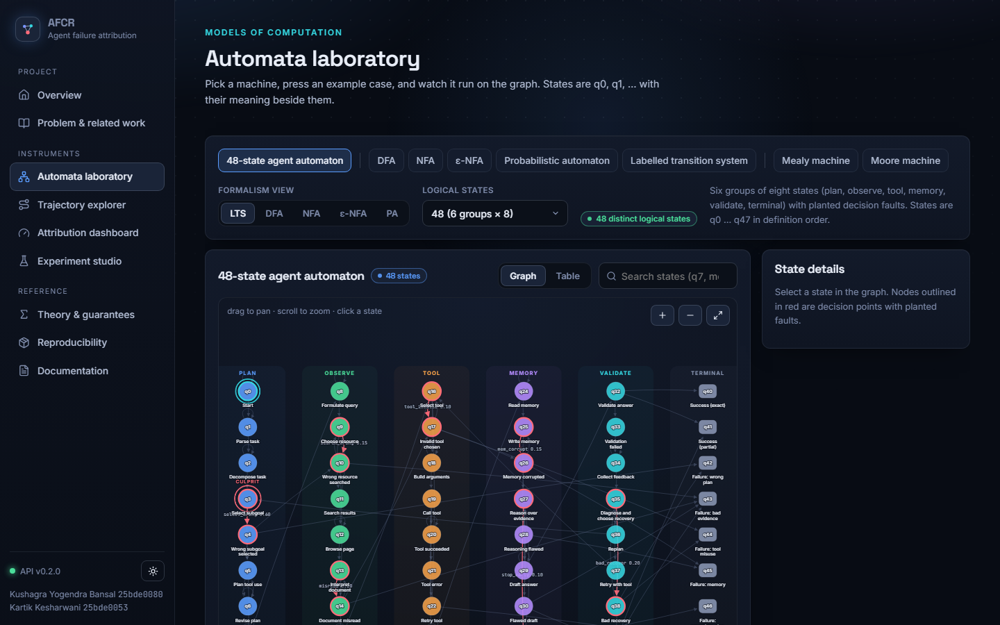<figcaption><b>Screenshot.</b> The laboratory shows the same 48 states, columns = groups. Red outlines = decision points with planted faults. States are labelled q0 … q47.</figcaption></figure>
[[shot:14_lab_state_details|Clicking a state (here q3 = Select subgoal) shows its role, description, the policy π(a|q) with the faulty action in red, the reference (repair) action and its incoming/outgoing edges.|95]]


# Part 10 — The nine formal machines, with real traces

“Models of Computation” asks us to use and compare formal machines. We implemented nine families and use each for what it can express. In the **Automata laboratory** every machine has **example cases** you can press: accepted, rejected, empty word, a trap state, an invalid symbol, “unknown”. The tables below are **real traces** produced by the code.

> **Naming.** States are **q0, q1, …**; q0 is the start. The meaning is written beside it.

## 10.1 DFA — Deterministic Finite Automaton

**Idea.** For every state and every symbol there is *exactly one* next state. No choices, no randomness. A word is *accepted* if the machine ends in an accepting state.
**Everyday example.** A turnstile or a vending machine.
**Our machine.** Words over {a, b} that **start with a** and contain an **even** number of b’s. q0 = start, q1 = “ok, even b’s” (accepting), q3 = “ok, odd b’s”, q2 = **dead (trap) state**: once you enter it you can never accept.

<figure><figcaption>A total deterministic automaton (states e = even, o = odd); bold outline = start state, green = accepting. The agent model’s DFA view is the same kind of object built from the 48-state spec (most-likely successors, explicit sink).</figcaption></figure>

**Case 1 — accepted:** the word `a b b a`

| step | from | reads | to |
|---|---|---|---|
| 1 | q0 | `a` | q1 |
| 2 | q1 | `b` | q3 |
| 3 | q3 | `b` | q1 |
| 4 | q1 | `a` | q1 |

**Case 2 — the trap:** the word `b a` (starts with b) falls into the dead state.

| step | from | reads | to |
|---|---|---|---|
| 1 | q0 | `b` | q2 |
| 2 | q2 | `a` | q2 |

<figure>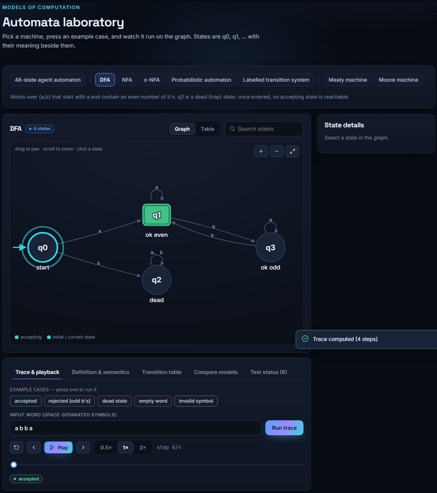<figcaption><b>Screenshot.</b> Laboratory: DFA, example “accepted”. The graph highlights the path; the result panel says “accepted”.</figcaption></figure>
<figure>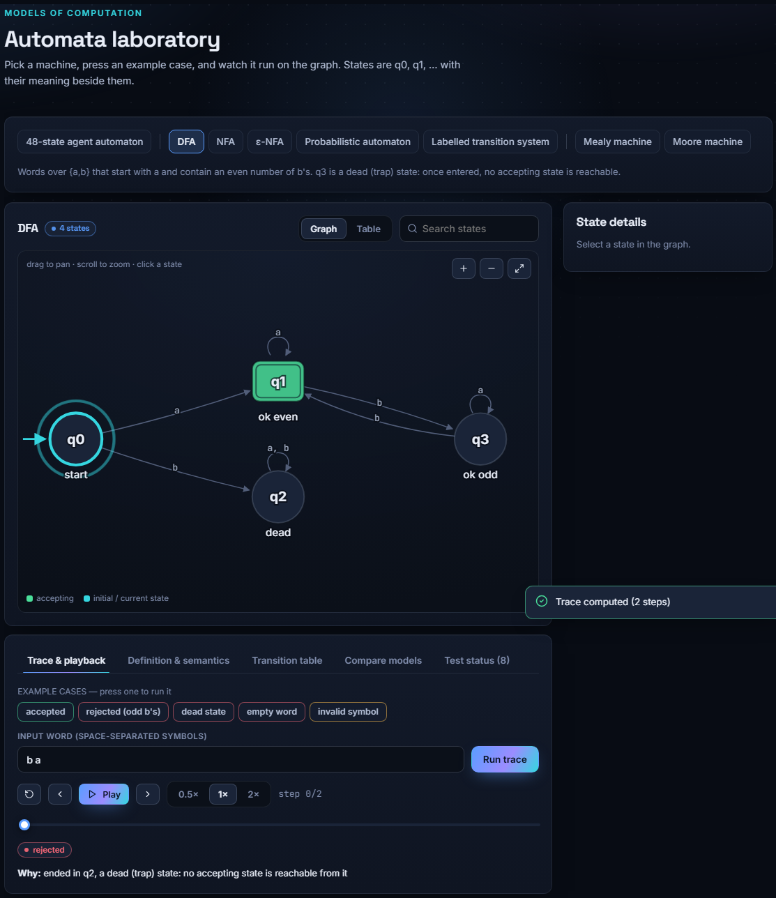<figcaption><b>Screenshot.</b> Example “dead state”: rejected, with the reason “ended in q2, a dead (trap) state: no accepting state is reachable from it”.</figcaption></figure>
<figure>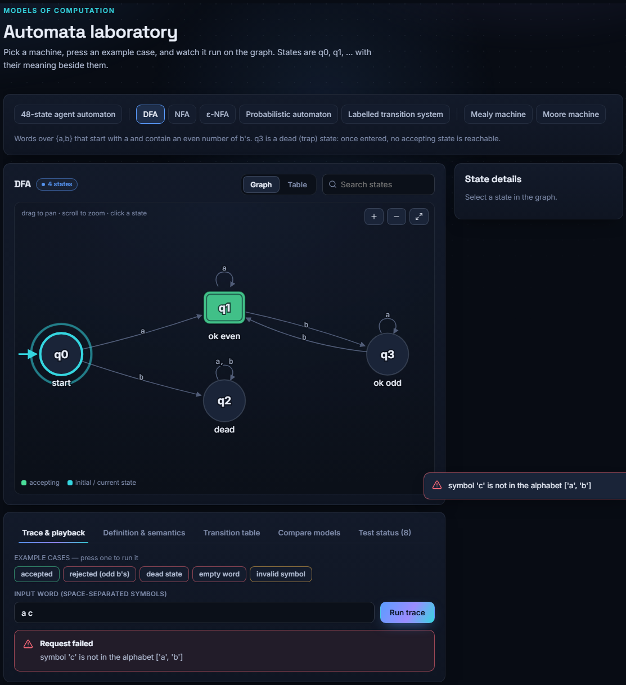<figcaption><b>Screenshot.</b> Example “invalid symbol”: the symbol c is not in the alphabet, so the server answers with an error and the page shows it — nothing is silently ignored.</figcaption></figure>
<figure>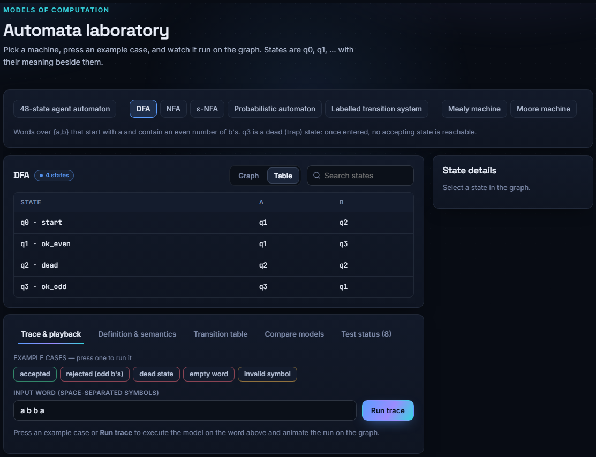<figcaption><b>Screenshot.</b> The same DFA as a transition table (Graph ⇄ Table switch; on phones the table is the default).</figcaption></figure>

## 10.2 NFA — Nondeterministic Finite Automaton

**Idea.** From a state, a symbol may lead to **several** states (or none). A word is accepted if **some** path ends in an accepting state. The machine is imagined to follow *all* paths at once; the set of states it could be in is the **active set**.
**Important:** this “nondeterminism” is a *formal* device, **not** the randomness of an AI model. Randomness belongs to the probabilistic automaton.
**Our machine.** Words that **end in “ab”**: in q0, on `a` it may stay or go to q1 (“maybe this is the start of the suffix”).

<figure><figcaption>The NFA of words ending in “ab” run on “aab”: yellow = active states. The word is accepted because the final active set contains the accepting state q2 (thick outline). Nondeterminism here is formal, not LLM sampling.</figcaption></figure>

Word `a a b` (accepted):

| step | from | reads | to |
|---|---|---|---|
| 1 | ['q0'] | `a` | ['q0', 'q1'] |
| 2 | ['q0', 'q1'] | `a` | ['q0', 'q1'] |
| 3 | ['q0', 'q1'] | `b` | ['q0', 'q2'] |

<figure>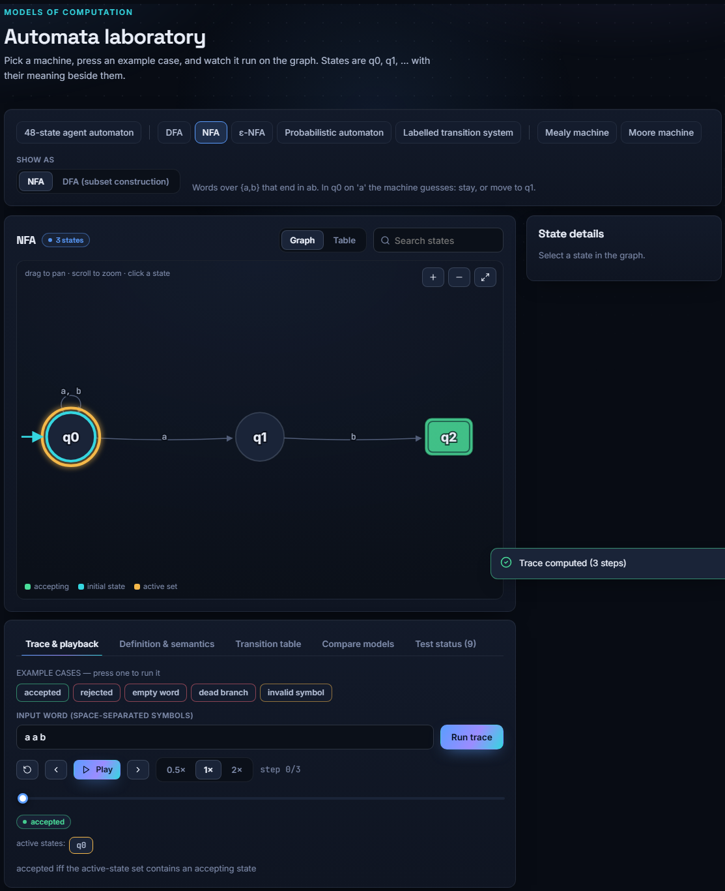<figcaption><b>Screenshot.</b> NFA: the amber rings are the active states after each step (here {q0,q1} then {q0,q2}); accepted because q2 is active at the end.</figcaption></figure>
<figure>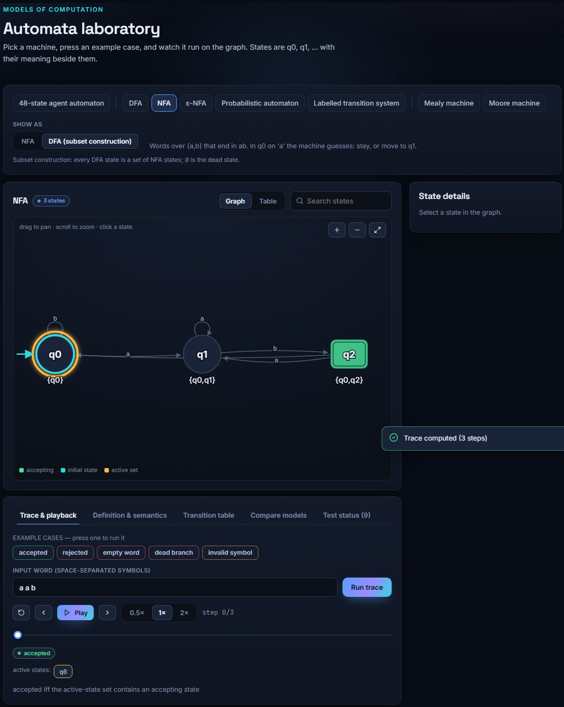<figcaption><b>Screenshot.</b> “Show as → DFA (subset construction)”: every DFA state is a *set* of NFA states. Every NFA has an equivalent DFA (possibly larger).</figcaption></figure>

## 10.3 ε-NFA — NFA with silent moves

**Idea.** The machine may move without reading anything (an ε-move). Before reading and after each symbol it takes all such moves: the **ε-closure**. In agents, a silent *self-correction* is modelled as an ε-move.
**Our machine.** The language a*b; silent moves q0 → q1 → q2, so the machine **starts** in the closure {q0, q1, q2}.

<figure><figcaption>Computing the ε-closure of {q0} (dashed amber = ε-moves): the set grows until a fixed point, here {q0, q1, q2}. The agent model’s heal edges are ε-moves in its ε-NFA view.</figcaption></figure>

Word `a b` (accepted):

| step | from | reads | to |
|---|---|---|---|
| 1 | ['q0', 'q1', 'q2'] | `a` | ['q1', 'q2'] |
| 2 | ['q1', 'q2'] | `b` | ['q3'] |

<figure>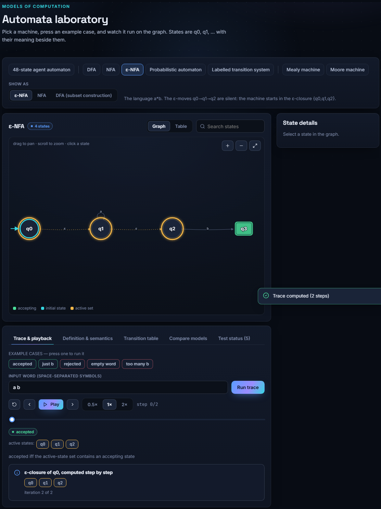<figcaption><b>Screenshot.</b> ε-NFA: the three amber rings at the start are the ε-closure of q0. “Show as” also offers the equivalent NFA (ε-removal) and DFA.</figcaption></figure>

## 10.4 Probabilistic automaton

**Idea.** Each move has a probability. A word has an **acceptance probability** — there is no yes/no. This is the natural model of a *random agent*.
**Our machine.** A stochastic tool: `go` succeeds (reaches q2 = goal) with probability 0.7, fails with 0.1, else stays. q1 is absorbing failure.

<figure><figcaption>Each (state, symbol) carries a distribution over successors (edge labels). P(accept after n steps) is exact by matrix products; runs can be sampled. This is the natural formalism for a stochastic agent.</figcaption></figure>

For the word `go go go` the **exact** acceptance probability is **0.868** (computed by matrix multiplication); one *sampled* run is shown below — a different sample may end elsewhere, which is why the page never calls it “accepted”.

| step | from | reads | to |
|---|---|---|---|
| 1 | q0 | `go` | q2 p=0.7 |
| 2 | q2 | `go` | q2 p=1.0 |
| 3 | q2 | `go` | q2 p=1.0 |

<figure>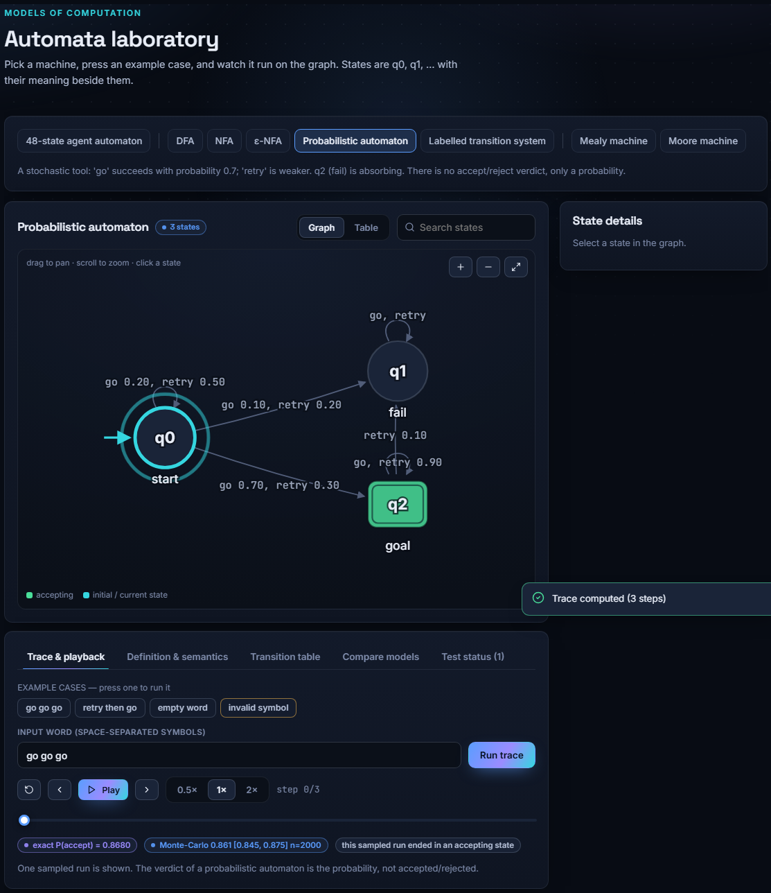<figcaption><b>Screenshot.</b> Probabilistic automaton: the exact probability, a Monte-Carlo estimate with its interval, and a description of the one sampled run — no accepted/rejected verdict.</figcaption></figure>

## 10.5 LTS — Labelled Transition System

**Idea.** States connected by **labelled actions** (plan, call_tool, observe, answer, …). It describes *what can happen*, supports reachability and deadlock questions, and is our main view of the agent.
**Our machine.** q0 idle → q1 thinking → q2 calling → q3 done (accepting) / q4 failed (rejecting). A **deadlock** would be a non-terminal state with no action; there is none.

Word `plan answer plan` — the third action is **blocked** because nothing can happen after `done`:

| step | from | reads | to |
|---|---|---|---|
| 1 | q0 | `plan` | q1 |
| 2 | q1 | `answer` | q3 |
| 3 | q3 | `plan` | — (blocked) |

<figure>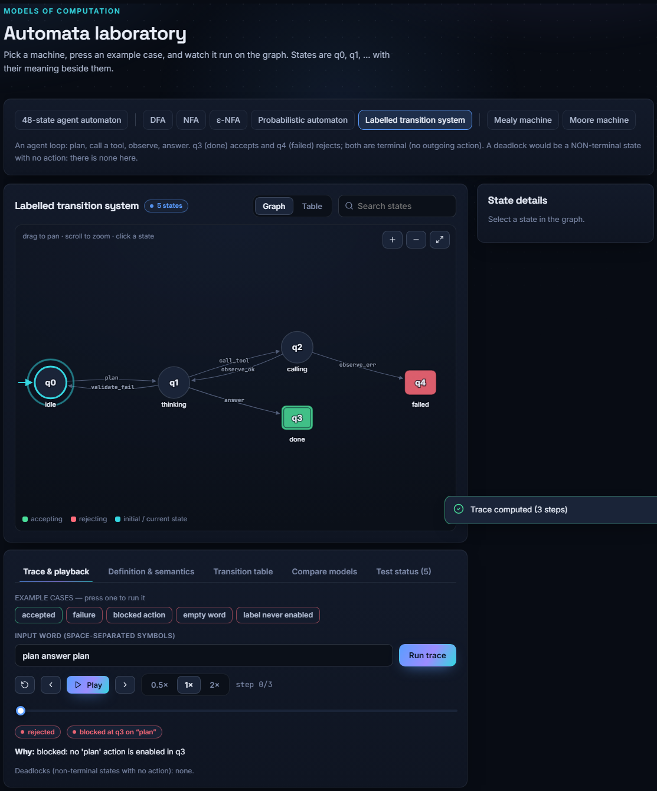<figcaption><b>Screenshot.</b> LTS: “blocked at q3 on plan” — shown as a badge with the reason.</figcaption></figure>

## 10.6 Mealy and Moore machines (transducers)

**Idea.** They *output* something while running. **Mealy:** the output depends on the state **and** the input (output on the transition). **Moore:** the output depends only on the state. They have **no accepting states** — their result is the *output word*.
**Our machine.** A tool-call controller; from “calling” the input `ok` outputs `proceed`, `error` outputs `retry`.

Mealy on `task error ok`:

| step | from | reads | to |
|---|---|---|---|
| 1 | q0 | `task` | q1 out call_tool |
| 2 | q1 | `error` | q2 out retry |
| 3 | q2 | `ok` | q0 out proceed |

<figure>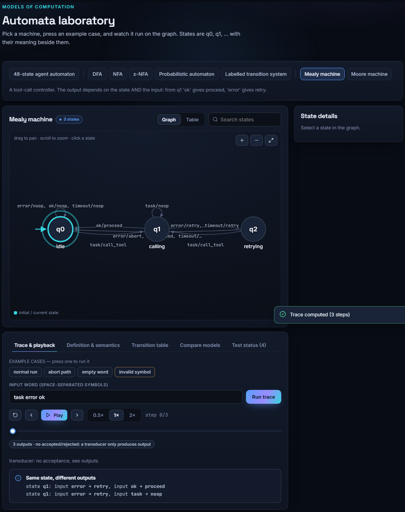<figcaption><b>Screenshot.</b> Mealy: transition labels are input/output. The page shows the output word and explicitly says there is no accepted/rejected verdict.</figcaption></figure>
<figure>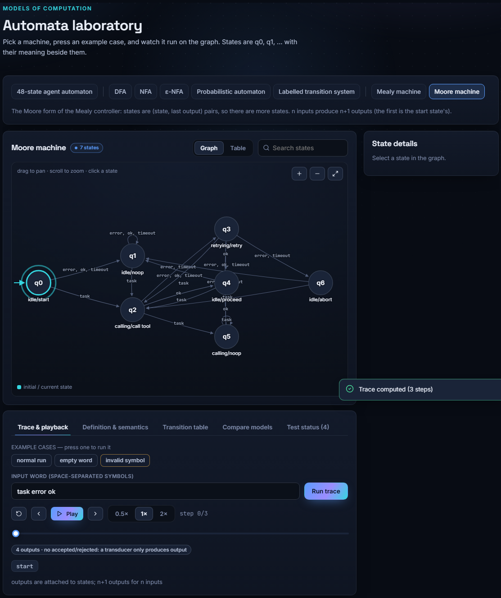<figcaption><b>Screenshot.</b> The Moore form of the same controller has more states (state + last output) and n+1 outputs for n inputs.</figcaption></figure>

## 10.7 Pushdown automaton (PDA) — an automaton with a stack

**Idea.** A finite machine **plus a stack** (last-in, first-out memory). This lets it count and match nested things — like brackets, or a tool call opened inside another. A finite automaton **cannot** do this for unlimited depth (the “pumping lemma”): our tests show a depth-3 DFA failing on depth 5 where the PDA succeeds.
**Our machines.** `call` pushes a marker C; `ret` pops it; at the end only the bottom marker Z may remain. The typed version remembers *which* tool was opened.

Balanced word `call call ret ret` (accepted):

| step | from | reads | to |
|---|---|---|---|
| 1 | q0 | `call` | q0 stack CZ |
| 2 | q0 | `call` | q0 stack CCZ |
| 3 | q0 | `ret` | q0 stack CZ |
| 4 | q0 | `ret` | q0 stack Z |
| 5 | q0 | `ε` | q1 stack  |

Unbalanced word `call ret ret` (rejected: the second `ret` finds only the bottom marker):

| step | from | reads | to |
|---|---|---|---|
| 1 | q0 | `call` | q0 stack CZ |
| 2 | q0 | `ret` | q0 stack Z |

<figure>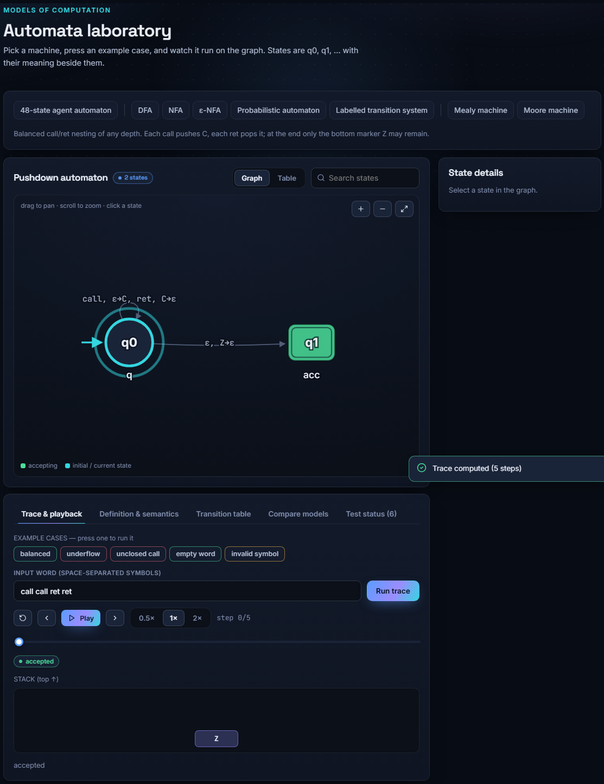<figcaption><b>Screenshot.</b> PDA: the stack panel shows the stack after each step (top ↑); accepted.</figcaption></figure>
<figure>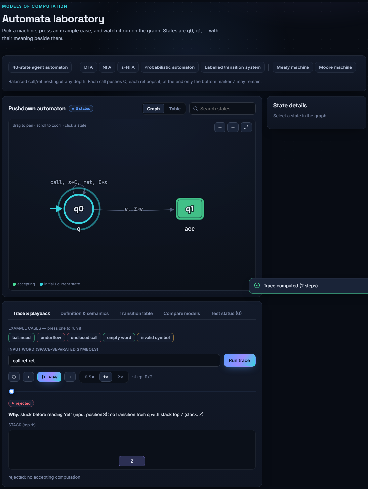<figcaption><b>Screenshot.</b> “underflow” example: rejected, with the reason; the run still shows how far the machine got, so you can see where it broke.</figcaption></figure>
<figure>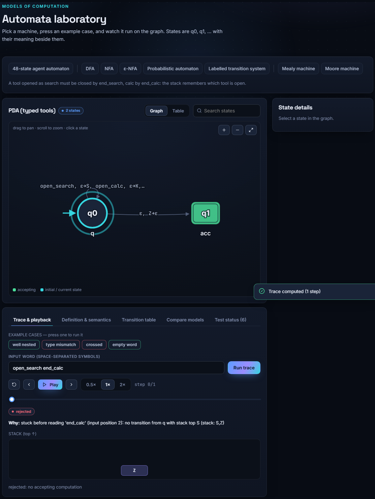<figcaption><b>Screenshot.</b> Typed PDA: opening search and then closing calc is a type mismatch (the stack top is S, not K).</figcaption></figure>

## 10.8 Turing machine — tape and head

**Idea.** A finite control that reads and **writes** on an unbounded tape and moves a head left or right. It is the model of general computation. Our simulator limits steps and tape (so it always stops) — **hitting a limit means “unknown”, never “rejected”.**
**Our machines.** (1) *Binary increment:* 1011₂ + 1 = 1100₂. (2) *Palindrome decider.* (3) A machine that **never halts**.

Binary increment on `1011` — output **1100** after **9** steps (first rows shown in the website’s step list).

<figure>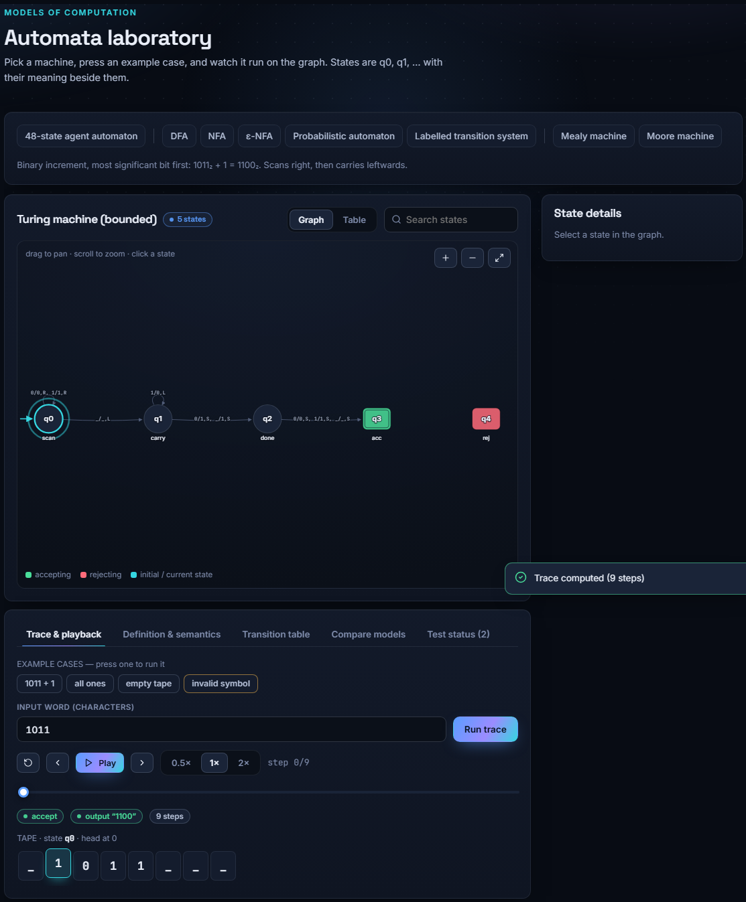<figcaption><b>Screenshot.</b> Turing machine: the tape with the head cell highlighted, the current state and the output.</figcaption></figure>
<figure>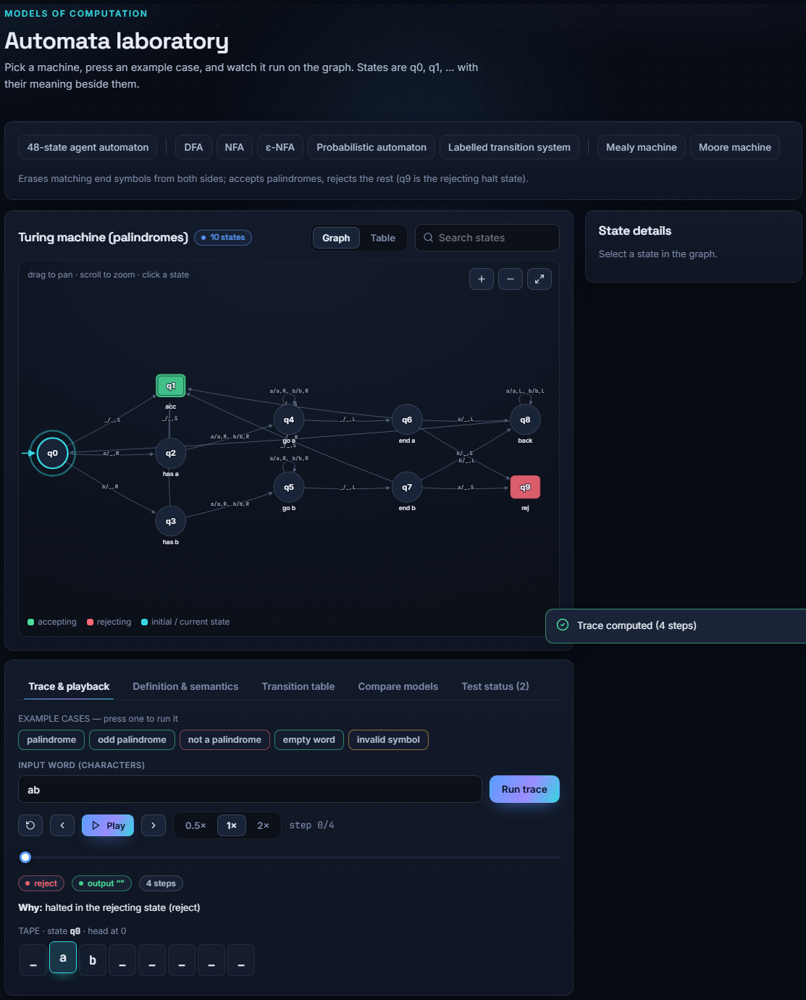<figcaption><b>Screenshot.</b> The palindrome machine rejects “ab” and says so (status reject).</figcaption></figure>
<figure>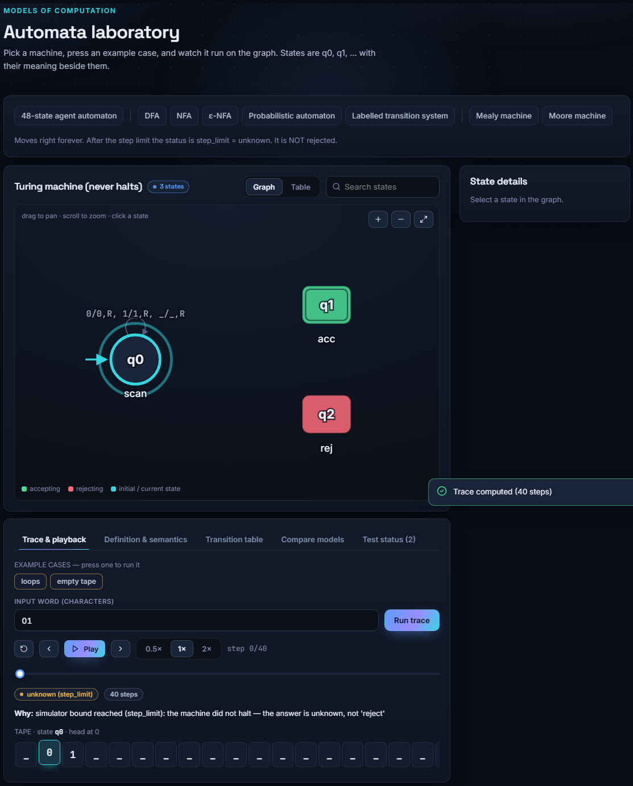<figcaption><b>Screenshot.</b> A machine that never halts: after 40 steps the result is “unknown (step_limit)” and the page explains that this is **not** a rejection.</figcaption></figure>

## 10.9 Comparison table

| Machine | Memory | Output | Randomness | What it is good for here |
|---|---|---|---|---|
| DFA | finite | accept/reject | none | the nominal skeleton of an agent |
| NFA / ε-NFA | finite | accept/reject | formal choice | possible environment outcomes; silent self-correction |
| Probabilistic automaton | finite | probability | **yes** | the random agent itself |
| LTS | finite | reachability | optional | actions with meaning (reason, tool use, observe, recover) |
| Mealy / Moore | finite | output word | none | controllers |
| PDA | **stack** | accept/reject | none | nested tool calls |
| Turing machine | **tape** | halts/output | none | general computation; limits of bounded simulation |

<figure>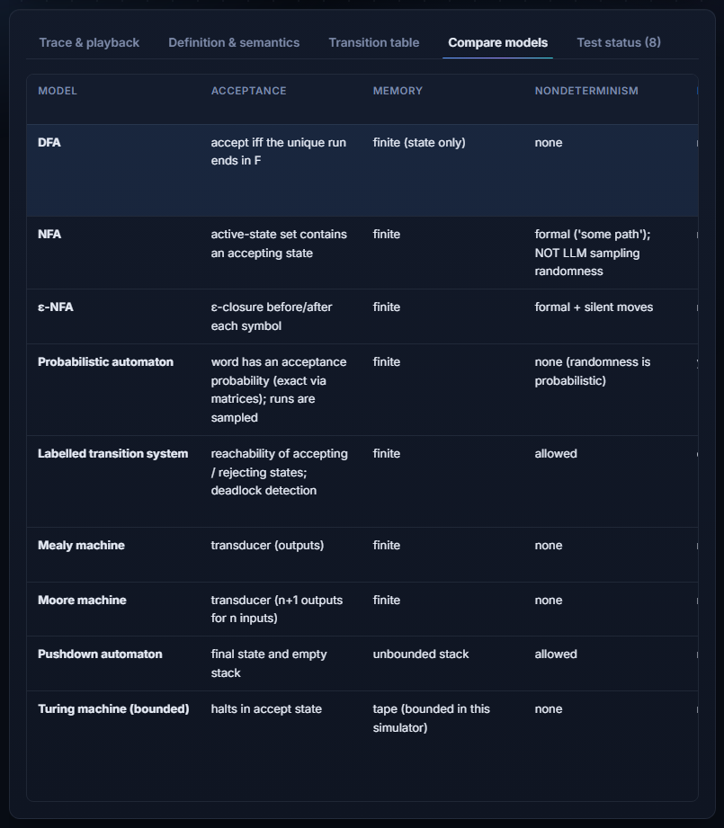<figcaption><b>Screenshot.</b> The laboratory’s “Compare models” tab (acceptance, memory, nondeterminism, probability, fit for agent traces, limits for causal attribution).</figcaption></figure>
<figure>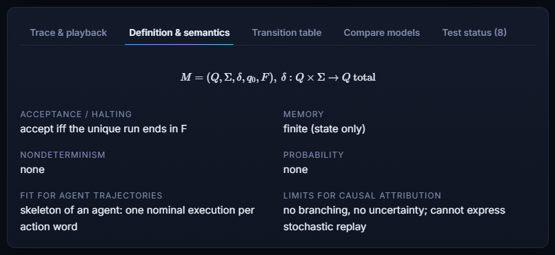<figcaption><b>Screenshot.</b> “Definition & semantics” tab: the formal definition (typeset), acceptance rule, memory, limits.</figcaption></figure>

<figure><figcaption>One round of AFCR. The sampling rule is interchangeable: δ-correctness depends only on the confidence sequence and the stopping rule. Budget exhaustion is an abstention, never a certified answer.</figcaption></figure>


# Part 11 — The website: every page and every control

The website is served by the same program as the statistics (`python -m uvicorn afcr.api.app:app --port 8000`). Every number on it is computed by the backend, and results that come from simulations carry a **synthetic** badge. Navigation is on the left; the green dot at the bottom says whether the API is reachable. *(If a page shows “Request failed”, the API is not running.)*

## 11.1 Overview (`/`)

Shows the title, an honest note about “sample-optimal”, a live picture of one failed run travelling through the 48-state automaton, **four live counters** (logical states, passing tests, simulated trials, real-benchmark results = 0 pending), the seven review sections as tabs (1 Title … 7 Steps), the system architecture and the δ-PAC statement.

<figure><figcaption><b>Screenshot.</b> Overview.</figcaption></figure>
<figure>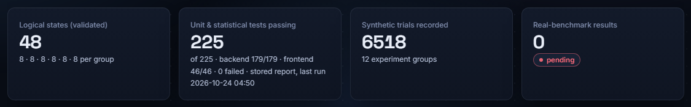<figcaption><b>Screenshot.</b> The four counters are exact numbers (48 states, 225 tests, 6,518 trials, 0 real-benchmark results — pending).</figcaption></figure>
<figure>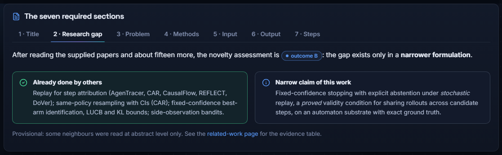<figcaption><b>Screenshot.</b> Tab “2 · Research gap”.</figcaption></figure>

## 11.2 Problem & related work (`/related`)

Outcome cards A/B/C, an illustration “why attribution is hard”, the timeline, the **evidence matrix** (sortable by family, filterable — try typing “car”), and a detail card for the selected paper with all fields of our reading notes.

<figure>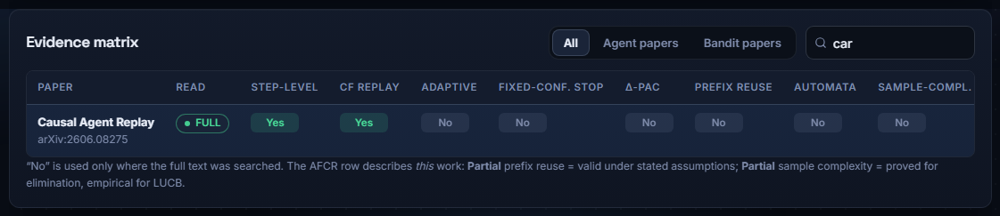<figcaption><b>Screenshot.</b> Filtering the evidence matrix: typing “car” finds Causal Agent Replay.</figcaption></figure>

## 11.3 Automata laboratory (`/lab`)

| Control | What it does |
|---|---|
| **Model buttons** (top row) | choose one of 13 machines |
| **Formalism view** (48-state only) | the same agent as LTS, DFA, NFA, ε-NFA or PA |
| **Show as** (NFA, ε-NFA) | the machine itself, its ε-free form, or its subset-construction DFA |
| **Logical states** | 48, 64 or 96 |
| **Graph ⇄ Table** | draw the machine or list its transitions |
| **Search states** | highlight states by q-number or name |
| **Zoom / fit / minimap** | navigate large graphs |
| **Example cases** | one-click accepted / rejected / empty / trap / invalid / unknown |
| **Input word + Run trace** | run any word you type |
| **Play / step / speed / slider** | replay the run on the graph |
| **State details** (right) | role, meaning, policy, reference action, in/out edges |
| **Tabs** | Trace, Definition, Transition table, Counterfactual branch (48-state), Compare models, Test status |

<figure><figcaption><b>Screenshot.</b> The laboratory with the 48-state agent.</figcaption></figure>
<figure>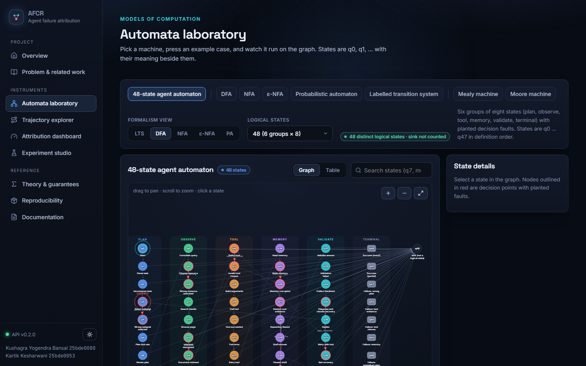<figcaption><b>Screenshot.</b> DFA view of the agent: the grey node is the **sink**; it is drawn but not counted — the badge still says 48 distinct logical states.</figcaption></figure>
<figure>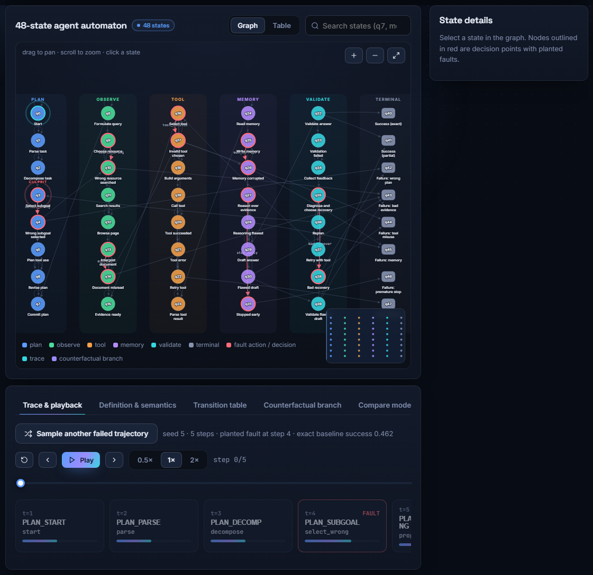<figcaption><b>Screenshot.</b> PA view: the same agent with the environment’s transition probabilities.</figcaption></figure>
<figure>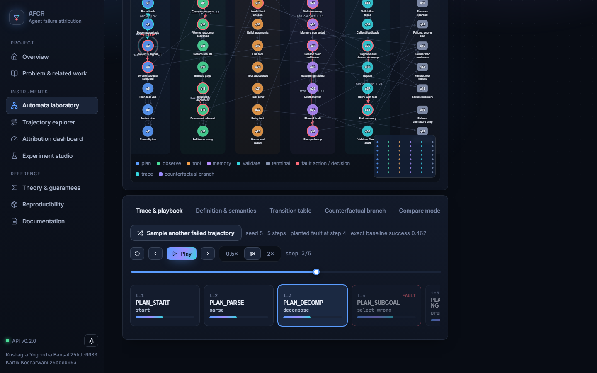<figcaption><b>Screenshot.</b> A failed run played to step 3: the cyan path on the graph; below, the step cards with the exact μ bar of each step.</figcaption></figure>
<figure>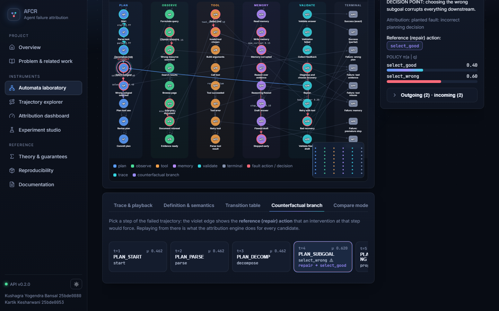<figcaption><b>Screenshot.</b> “Counterfactual branch”: pick a step; the violet edge is the repair action that an intervention there would force.</figcaption></figure>
<figure>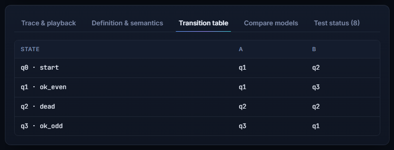<figcaption><b>Screenshot.</b> The transition table tab.</figcaption></figure>

## 11.4 Trajectory explorer (`/explorer`)

Choose the agent (48-state automaton or a tool-using agent), a seed, the fault probability and the intervention (repair or resample); **Sample failed trajectory**; click a step (or the chart); **Run one counterfactual replay** (one sample, shown against the original); **Estimate μₜ** (n replays with a Wilson interval and the exact value). If you change the settings *after* sampling, a yellow notice says the displayed trajectory is still the old one and the replay keeps using it. A button opens the Dashboard with exactly these settings.

<figure>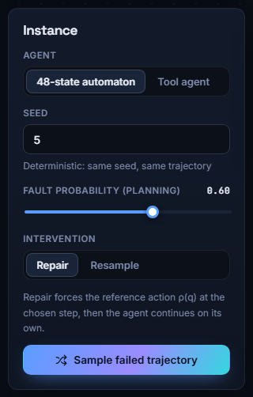<figcaption><b>Screenshot.</b> The explorer’s instance panel.</figcaption></figure>
<figure><figcaption><b>Screenshot.</b> A sampled failed trajectory with the exact μₜ curve and the step cards.</figcaption></figure>

## 11.5 Attribution dashboard (`/dashboard`)

The real algorithm on a chosen instance. You can choose the instance, algorithm, prefix sharing, target, δ, budget, confidence sequence, intervention, candidates and noise; **Run attribution** (a **Cancel** button appears while it runs); watch the intervals shrink with **Replay run**; compare with uniform sampling on *the same instance*; export JSON or the ranking as CSV. If you change the form after a run, a notice says the results still belong to the earlier configuration.

<figure><figcaption><b>Screenshot.</b> Result of a run.</figcaption></figure>
<figure>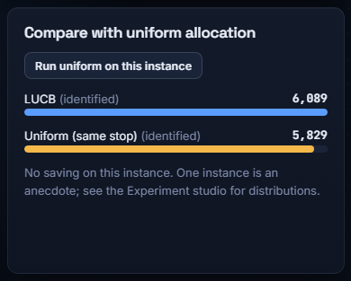<figcaption><b>Screenshot.</b> “Run uniform on this instance”: the same trajectory and seed with round-robin sampling. On this single instance uniform used 5,829 replays versus 6,089 for LUCB — honestly, **one instance is an anecdote**; the averages are in Part 12.</figcaption></figure>
<figure>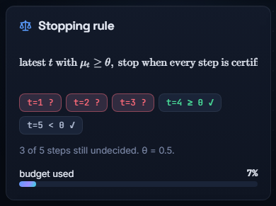<figcaption><b>Screenshot.</b> A threshold target (“latest step ≥ θ”) has its own panel: each step is certified above θ, below θ, or still undecided.</figcaption></figure>

## 11.6 Experiment studio (`/studio`)

*Saved results* (all 12 experiment groups, drawn from the raw CSV files), *Run simulation* (a live experiment on the server, with CSV/JSON export), *Paired statistics*.

<figure>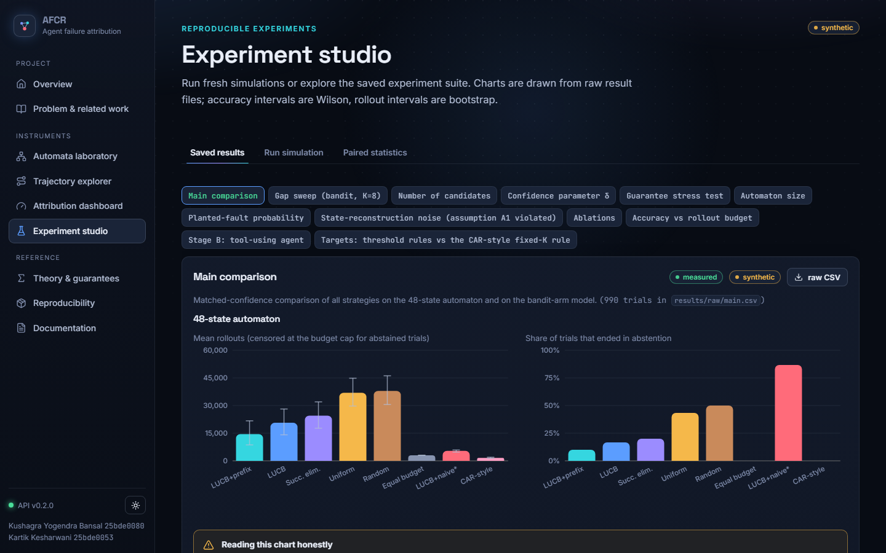<figcaption><b>Screenshot.</b> Studio: main comparison.</figcaption></figure>
<figure>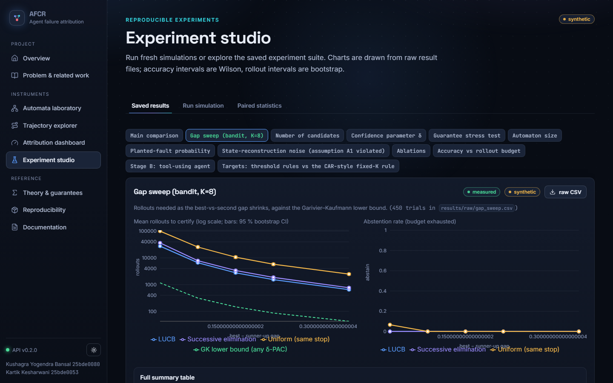<figcaption><b>Screenshot.</b> Cost against the gap, with the theoretical lower bound (green dashed).</figcaption></figure>
<figure>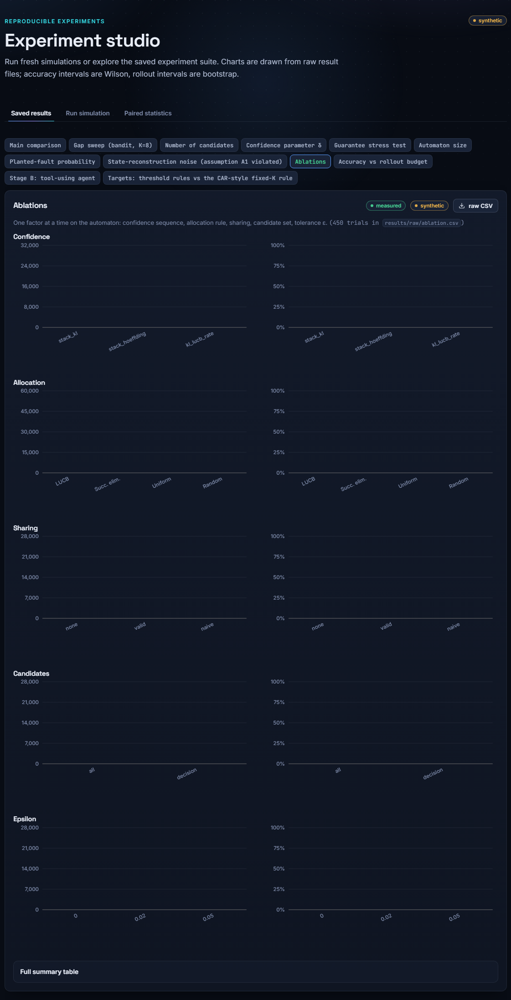<figcaption><b>Screenshot.</b> Ablations: one design choice at a time.</figcaption></figure>
<figure>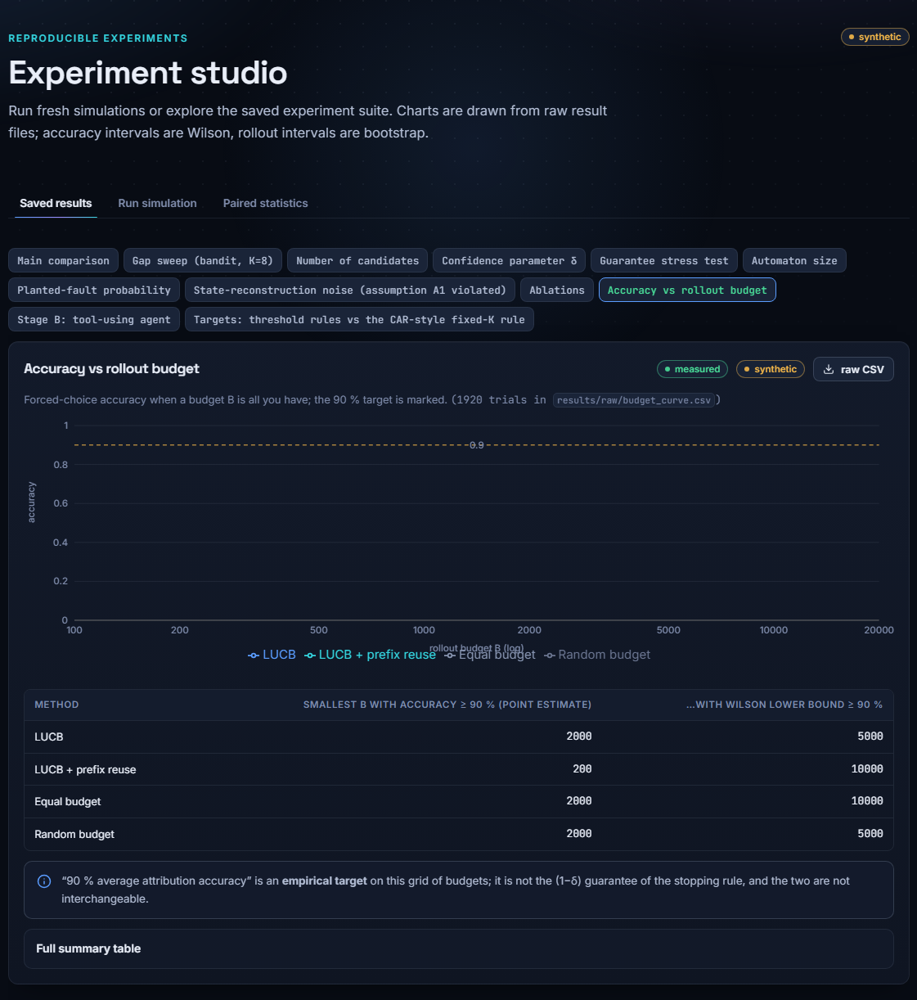<figcaption><b>Screenshot.</b> Accuracy against rollout budget and the smallest budget that reaches 90 %.</figcaption></figure>
<figure><figcaption><b>Screenshot.</b> A live simulation.</figcaption></figure>

## 11.7 Theory & guarantees (`/theory`), Reproducibility (`/reproducibility`), Documentation (`/docs`)

Theory: the formal problem, assumptions A1–A6 per setting, the algorithm, three theorems with expandable proofs, the claims ledger (proved / cited / empirical / hypothesis). Reproducibility: install commands, the checklist (including what is **not** done), live test status, artifacts, the 21 figures. Documentation: input/output specification, architecture, API reference generated from the server, glossary, limitations, troubleshooting — with search.

<figure><figcaption><b>Screenshot.</b> Theory & guarantees.</figcaption></figure>
<figure><figcaption><b>Screenshot.</b> Reproducibility.</figcaption></figure>
<figure><figcaption><b>Screenshot.</b> Documentation.</figcaption></figure>

## 11.8 Accessibility and phones

One `h1` per page, a “Skip to content” link, tab/arrow-key navigation, the page title changes with the page, Escape closes the mobile menu, graphs have a table alternative.

<figure><figcaption><b>Screenshot.</b> On a phone the laboratory opens in table mode.</figcaption></figure>


# Part 12 — The experiments and what they show

**Setup.** 6,518 simulated trials in 12 groups. In the main comparison each method is run on the same 30 failed trajectories (paired design), δ = 0.1, budget cap 60 000. “Replays” of trials that hit the cap are **censored** (the real cost is higher). “Abstained” = budget exhausted without certification.

<figure><figcaption>Trials are plain-dict specs; every number in the paper, report, website and slides is computed from the raw CSV rows by the aggregation layer.</figcaption></figure>

## 12.1 Main comparison (48-state automaton)

| Method | accuracy | abstained | mean replays | median |
|---|---|---|---|---|
| LUCB + valid prefix reuse | 93 % | 10 % | 14,530 | 4,281 |
| LUCB | 93 % | 17 % | 20,637 | 8,328 |
| Successive elimination | 93 % | 20 % | 24,528 | 12,320 |
| Uniform (same stopping rule) | 93 % | 43 % | 36,929 | 34,274 |
| Random (same stopping rule) | 97 % | 50 % | 37,911 | 46,100 |
| Equal budget (never stops early) | 80 % | 0 % | 3,000 | 3,000 |
| LUCB + naive sharing (invalid, negative control) | 47 % | 87 % | 5,396 | 6,000 |
| CAR-style fixed K (different question) | 0 % | 0 % | 1,607 | 1,300 |

*Reading it.* All adaptive and uniform methods are right about as often (they all certify with the same guarantee); the difference is **cost**. “Equal budget” spends 3 000 replays and never certifies. The **CAR-style** row has 0 % “accuracy” because it answers a *different question* (the latest step whose effect is significant), so it is **not** a like-for-like comparison. **Naive sharing** is fast and wrong.

**Paired statistics** (same trajectories; Wilcoxon signed-rank test with Holm correction):

| Comparison | mean replays | factor | 95 % CI of the difference | p (Holm) |
|---|---|---|---|---|
| lucb vs uniform fc | 20,637 vs 36,929 | 1.79× | [11,060, 22,096] | 4.2e-05 |
| lucb vs random fc | 20,637 vs 37,911 | 1.84× | [11,536, 23,887] | 4.2e-05 |
| lucb vs successive elim | 20,637 vs 24,528 | 1.19× | [1,908, 6,404] | 7.3e-04 |
| lucb prefix vs lucb | 14,530 vs 20,637 | 1.42× | [4,185, 8,177] | 3.1e-05 |

<figure><figcaption>Forced-choice accuracy when only B rollouts are available (adaptive methods return their best guess if they cannot certify). The dashed 90% line is an empirical target, not the (1−δ) guarantee.</figcaption></figure>
<figure><figcaption>Each marker is one method (mean rollouts with 95% bootstrap CI vs accuracy with Wilson CI). The certifying adaptive methods and the uniform/random baselines overlap in accuracy, so the separation is along the cost axis. Fixed-budget methods (equal budget, CAR-style) never certify; the CAR-style point scores against the planted step with resample arms (a different target) and is not comparable.</figcaption></figure>

## 12.2 Cost grows as the gap shrinks (and stays above the lower bound)

The **gap** is the difference between the best step’s μ and the runner-up’s. Hard instances (small gap) cost more — roughly with the inverse **square** of the gap, as the theory predicts (Theorem 2, Garivier–Kaufmann).

| gap | LUCB | successive elimination | uniform |
|---|---|---|---|
| 0.05 | 27,515 | 36,381 | 100,600 |
| 0.10 | 6,609 | 7,837 | 25,481 |
| 0.15 | 2,769 | 3,384 | 10,660 |
| 0.20 | 1,537 | 1,867 | 5,781 |
| 0.30 | 648 | 765 | 2,471 |

<figure><figcaption>Every measured method lies above the lower bound T*(μ)·kl(δ,1−δ) (necessarily, for δ-PAC methods); the vertical distance shows that our algorithms are far from asymptotically optimal — which is why the word ‘optimal’ is not claimed.</figcaption></figure>

## 12.3 More candidate steps

| number of candidates K | LUCB | uniform |
|---|---|---|
| 4 | 1,416 | 2,808 |
| 8 | 1,565 | 5,526 |
| 16 | 1,812 | 11,676 |
| 32 | 2,391 | 22,869 |
| 64 | 3,362 | 49,713 |

Adaptive methods grow slowly because hopeless candidates stop receiving replays; uniform allocation grows roughly linearly.

<figure><figcaption>Cost grows with K for every method; adaptive allocation spends its budget on the few ambiguous arms while uniform spends it on all of them.</figcaption></figure>

## 12.4 Does the error stay below δ?

| δ | mean replays | accuracy | wrong among certified |
|---|---|---|---|
| 0.01 | 3,221 | 100 % | 0 % |
| 0.05 | 2,935 | 100 % | 0 % |
| 0.1 | 2,784 | 100 % | 0 % |
| 0.2 | 2,688 | 100 % | 0 % |
| 0.4 | 2,531 | 100 % | 0 % |

0 wrong certified answers is **consistent with** — it does not prove — δ-correctness (the bound is conservative; we also ran a hard two-arm stress test). A smaller δ costs more replays.

<figure><figcaption>Observed errors among certified trials on very hard 2-arm instances, with Wilson 95% intervals. Zero errors in all trials is consistent with Theorem 1 but also shows the stack bound is conservative; this is a bug-detector, not a proof.</figcaption></figure>

## 12.5 Ablations — one design choice at a time

| factor | mean replays | accuracy | abstained |
|---|---|---|---|
| confidence = stack_kl | 18,448 | 93 % | 17 % |
| confidence = stack_hoeffding | 22,764 | 93 % | 17 % |
| confidence = kl_lucb_rate | 19,831 | 93 % | 17 % |
| allocation = lucb | 18,448 | 93 % | 17 % |
| allocation = successive_elim | 20,944 | 93 % | 17 % |
| allocation = uniform_fc | 36,493 | 97 % | 33 % |
| allocation = random_fc | 36,397 | 100 % | 37 % |
| sharing = none | 18,448 | 93 % | 17 % |
| sharing = valid | 12,693 | 97 % | 13 % |
| sharing = naive | 5,355 | 47 % | 80 % |
| candidates = all | 18,448 | 93 % | 17 % |
| candidates = decision | 6,578 | 100 % | 3 % |
| epsilon = 0.0 | 18,448 | 93 % | 17 % |
| epsilon = 0.02 | 14,222 | 100 % | 3 % |
| epsilon = 0.05 | 7,203 | 100 % | 0 % |

<figure><figcaption>Confidence sequence (stack-KL vs stack-Hoeffding vs the KL-LUCB rate), allocation rule, prefix sharing (valid vs invalid naive), candidate set (all steps vs decision states only — a domain prior) and tolerance ε. Naive sharing is shown in red: it is invalid and rarely certifies.</figcaption></figure>

## 12.6 Longer agents (48 / 64 / 96 states)

| states | method | mean replays | accuracy | abstained |
|---|---|---|---|---|
| 48 | lucb | 22,634 | 100 % | 13 % |
| 48 | lucb prefix | 14,282 | 100 % | 3 % |
| 48 | uniform fc | 40,204 | 97 % | 43 % |
| 64 | lucb | 28,140 | 93 % | 20 % |
| 64 | lucb prefix | 14,416 | 97 % | 10 % |
| 64 | uniform fc | 44,908 | 100 % | 53 % |
| 96 | lucb | 35,263 | 90 % | 23 % |
| 96 | lucb prefix | 13,860 | 93 % | 10 % |
| 96 | uniform fc | 50,354 | 93 % | 50 % |

Prefix reuse keeps the cost almost flat while plain methods grow with the trajectory length.

## 12.7 When an assumption is violated: noisy state reconstruction (A1)

If the replay cannot restore the exact original state, the target changes and sharing is switched off automatically. The cost rises and the system abstains more rather than certifying wrongly.

| reconstruction noise | mean replays | abstained | accuracy (vs noisy target) |
|---|---|---|---|
| 0.00 | 11,908 | 3 % | 97 % |
| 0.10 | 23,514 | 23 % | 97 % |
| 0.25 | 31,055 | 30 % | 100 % |
| 0.50 | 54,780 | 70 % | 80 % |

## 12.8 Accuracy against a fixed budget (the “90 %” target)

Smallest budget at which the forced-choice accuracy reaches 90 %:

| method | smallest budget with ≥ 90 % accuracy |
|---|---|
| lucb prefix | 200 |
| lucb | 2000 |
| equal budget | 2000 |
| random budget | 2000 |

This empirical target is **not** the (1 − δ) guarantee; the two answer different questions.

## 12.9 A second, different world: the tool-using agent

| variant | method | mean replays | accuracy | abstained |
|---|---|---|---|---|
| stochastic | lucb | 6,623 | 100 % | 17 % |
| stochastic | lucb prefix | 5,578 | 100 % | 17 % |
| stochastic | uniform fc | 11,612 | 100 % | 53 % |
| stochastic | equal budget | 3,000 | 97 % | 0 % |
| stochastic | oracle | 0 | 100 % | 0 % |
| deterministic_phase0 | lucb | 92 | 100 % | 0 % |
| deterministic_phase0 | uniform fc | 121 | 100 % | 0 % |
| deterministic_phase1 | lucb | 92 | 100 % | 0 % |
| deterministic_phase1 | uniform fc | 122 | 100 % | 0 % |
| deterministic_phase4 | lucb | 92 | 100 % | 0 % |
| deterministic_phase4 | uniform fc | 125 | 100 % | 0 % |
| deterministic_phase5 | lucb | 92 | 100 % | 0 % |
| deterministic_phase5 | uniform fc | 126 | 100 % | 0 % |

## 12.10 Other targets

| target | method | mean replays | accuracy | abstained |
|---|---|---|---|---|
| last_above | lucb | 34,333 | 100 % | 53 % |
| last_above | car fixed k | 1,320 | 3 % | 0 % |
| last_above | car fixed k500 | 6,600 | 3 % | 0 % |
| first_above | lucb | 32,362 | 100 % | 0 % |
| first_above | uniform fc | 60,000 | 100 % | 100 % |

<figure><figcaption>Left: what happened in every trial. Middle: abstentions occur on instances whose best arm is (almost) exactly tied with another — there is nothing to certify, so abstaining is the correct behaviour — and cost rises as the gap shrinks. Right: sharing every rollout with all later candidates produces wrong certified answers; exact-match reuse does not.</figcaption></figure>

### What to conclude — and what not to
**Conclude:** on these simulations adaptive allocation needs about 1.79× fewer replays than uniform at the same guarantee, valid prefix reuse a further 1.42×; cost scales as predicted; abstention behaves as designed; naive reuse is demonstrably wrong.
**Do not conclude:** anything about real language-model agents.


# Part 13 — The demonstration manual

## 13.1 Before you start (5 minutes)

**Checklist**
1. Open PowerShell in the project folder.
2. Start the server:
   ```
   $env:PYTHONPATH = "src"
   python -m uvicorn afcr.api.app:app --port 8000
   ```
3. Open **http://localhost:8000** in Chrome or Edge. The **green dot** at the bottom of the left sidebar must say “API v0.2.0”.
4. Have these open as backup: the paper PDF (`paper/main.pdf`), the slides (`presentation/research_presentation.pptx`), this handbook.
5. Close other windows; set the browser zoom to 100 %.
6. If a page says **“Request failed”**: the server is not running (step 2).

**Three versions of the talk**

| Version | Steps | Use when |
|---|---|---|
| **10 minutes** | 1, 3, 5, 8, 9 | short slot |
| **25 minutes** | 1–12 | normal review |
| **45 minutes** | all, with the extra questions of Part 14 | detailed viva |

## 13.2 The script

For each step: **Say** (what to tell the reviewer), **Do** (exactly what to click), **See** (what appears), **If it goes wrong**.

### Step 1 — The problem (2 min) · page: Overview
* **Say:** “An AI agent finished a task wrongly. We have its log. Which step is to blame? The last step is only where the mistake showed; the cause is usually earlier. To find it we test what-ifs: restore the agent before a step, change one decision, replay. But the agent is random and replays are expensive, so the real question is how few replays are enough and how sure we can be.”
* **Do:** show the Overview; point at the failure path on the 48-state graph and at the red “planted fault”.
* **See:** the title; the badge saying “sample-optimal” is the objective; four exact counters.
* **If it goes wrong:** counters show “—” → the API is down; start it.

### Step 2 — The seven items (2 min) · Overview tabs
* **Say:** “These are the seven things the review asked for.”
* **Do:** click the tabs 1 … 7 (arrow keys also work).
* **See:** Title, Research gap, Problem, Methods, Input, Output, Steps.

### Step 3 — What exists and the gap (3 min) · Problem & related work
* **Say:** “Replay-based blame exists (CAR, AgenTracer); optimal best-arm statistics exist; nobody combined them with a stopping rule, an abstention and valid sharing. We judge this ‘outcome B’ — provisional.”
* **Do:** scroll to the timeline; type **car** in the filter; click the CAR row.
* **See:** the matrix reduces to Causal Agent Replay; its card with all fields.

### Step 4 — Machines you can touch (3 min) · Automata laboratory
* **Say:** “To test honestly we need machines whose right answer we know. States are q0, q1, …”
* **Do:** click **DFA** → press **accepted**, then **dead state**, then **invalid symbol**.
* **See:** the path on the graph; “rejected — ended in q2, a dead (trap) state”; the error for the invalid symbol.

### Step 5 — Different machines, different results (3 min) · Laboratory
* **Do:** **NFA** (examples → amber active sets; *Show as → DFA*), **Probabilistic automaton** (a probability, no verdict), **Pushdown automaton → underflow** (stack and reason), **Turing machine (never halts) → loops** (“unknown”).
* **Say:** “Each result is specific to the machine: a probability, a stack, a tape — and a bounded simulator must say ‘unknown’, not ‘no’.”

### Step 6 — The agent we study (2 min) · Laboratory, 48-state
* **Do:** **48-state agent automaton**; click **q3**; open **Counterfactual branch** and click step 4; try the **DFA** view (the sink).
* **See:** the planted culprit (red ring), the policy with the faulty action, the violet repair edge.

### Step 7 — A replay is real (3 min) · Trajectory explorer
* **Do:** **Sample failed trajectory** → select step 4 → **Run one counterfactual replay** → **Estimate μₜ** (n = 300).
* **See:** the original run next to the re-simulated continuation (forced action in violet); μ̂ with its interval beside the exact value.
* **Say:** “One replay is one random future; to compare steps we need an estimate with uncertainty.”

### Step 8 — The algorithm decides (4 min) · Attribution dashboard
* **Do:** **Attribute this trajectory adaptively** (button on the explorer) or open the Dashboard → **Run attribution** → **Replay run** (speed 16×).
* **See:** intervals shrinking, uneven replay counts, **culprit certified** after about 6,089 replays, “δ-guarantee applies”.
* **Say:** “It stopped by itself when the lower end of the best step rose above the upper end of all others.”

### Step 9 — It can refuse (1 min) · Dashboard
* **Do:** set the budget to 2000 → **Run attribution**.
* **See:** “Abstention, not a verdict”, the unresolved candidates, “δ-guarantee does not apply”.

### Step 10 — Is adaptive better? (3 min) · Dashboard → Studio
* **Do:** **Run uniform on this instance**; then the Studio → **Paired statistics**.
* **Say:** “On one instance either may win; on 30 paired trajectories adaptive needs 1.79 times fewer replays and valid reuse a further 1.42 times — significant after correction.”
* **If asked about a case where uniform won:** show the honest line “one instance is an anecdote”.

### Step 11 — What is proved (2 min) · Theory & guarantees
* **Do:** open Theorem 1 (expand the proof) and the claims ledger.
* **Say:** the ledger separates proved / cited / empirical / hypothesis.

### Step 12 — Honesty and reproducibility (2 min) · Reproducibility
* **Do:** show the checklist: ✓ tests (179 backend, 46 frontend), ✗ ALFWorld/HotpotQA, ✗ real LLM provider.
* **Say:** “One command reproduces any single trial: `python -m afcr.experiments.run_one configs/spec_automaton_prefix.json --seed 7`.”

## 13.3 Recovery table

| Symptom | Cause | Fix |
|---|---|---|
| “Request failed” / red dot | server not running | start the server (13.1) |
| Page looks old after an update | cached bundle | `Ctrl+F5` once |
| A step takes long | large budget | lower the budget; or use the explorer |
| Blank page | (fixed — pages no longer wait for an animation) | `Ctrl+F5`, rebuild with `npm run build` |
| Graph looks small | big graph | press the “Fit to view” button or switch to Table |

## 13.4 One-line answers to keep ready

* *“Why not the last step?”* — It is the symptom.
* *“Is it optimal?”* — The title names the objective; we prove correctness and a bound for one algorithm.
* *“Real agents?”* — Not yet; all results are synthetic; ALFWorld/HotpotQA are the next step.


# Part 14 — Questions and answers, limits, glossary, appendices

## 14.1 Questions a reviewer may ask

| # | Question | Honest answer |
|---|---|---|
| 1 | **What is the problem in one line?** | Find the step whose repair most increases the success chance of a failed agent run, with few replays and a stated error probability. |
| 2 | **Why can’t you just look at the last step?** | The last step is where the failure *shows*; the cause is often earlier (in our example, step 4 of 5). |
| 3 | **Why not ask a language model to judge the log?** | It is correlational; the best step-level accuracy reported on Who&When is about 14 %. We *intervene* instead. |
| 4 | **What is a counterfactual replay?** | Restore the agent just before a step, change one decision, run to the end, record success/failure. |
| 5 | **Why many replays?** | The agent is random: one replay is one possible future. |
| 6 | **How is this different from CAR and AgenTracer?** | They replay every step a fixed number of times or once with a gold action. We choose replays adaptively, stop with a proved error bound and abstain when undecided. We do **not** claim replay itself is new. |
| 7 | **What does δ = 0.1 mean?** | If the system certifies a step, the chance that it is more than ε worse than the best is at most 10 % — under assumptions A1–A6. |
| 8 | **What is a confidence sequence?** | An interval valid at all times at once, so it survives “peeking”. Part 3 shows that ordinary intervals checked after every replay raise the false-alarm rate from 10 % to 62 %. |
| 9 | **What if the budget runs out?** | The system abstains and lists the unresolved steps. It is reported separately from errors. |
| 10 | **Is “sample-optimal” proved?** | No. It is the objective. We compare with the Garivier–Kaufmann lower bound and stay above it; we do not match it. |
| 11 | **Why LUCB?** | It spends replays on the two steps that decide the answer. Successive elimination is included because we can *prove* its bound. |
| 12 | **What is prefix reuse and when is it valid?** | A replay passing through another step’s start (same time, same state, repair action) is a free sample for that step. Only an exact match is valid (Theorem 3). |
| 13 | **Why do you keep the invalid “naive sharing”?** | As a negative control: it reaches only 47 % accuracy against 97 % for valid sharing. |
| 14 | **Why automata?** | Exact ground truth by dynamic programming, and the Markov property that makes reuse valid. |
| 15 | **Why 48 states?** | The brief asks for at least 48; the model has exactly 48 logical states, counted by the code. The DFA sink is drawn but not counted. |
| 16 | **Why so many machine types?** | To compare what each can express: DFA/NFA (finite choice), probabilistic automaton (randomness), LTS (actions), transducers (outputs), PDA (nesting), Turing machine (general computation). |
| 17 | **Is NFA nondeterminism the same as LLM randomness?** | No. NFA nondeterminism is a formal “some path accepts”; LLM randomness is probabilistic and belongs to the probabilistic automaton. |
| 18 | **Why does the Turing machine say “unknown”?** | Halting is undecidable; a bounded simulator that stops at a limit can only say it did not halt. |
| 19 | **Did you test on real agents?** | No. ALFWorld and HotpotQA adapters are tested with a scripted mock only. |
| 20 | **Do the results transfer to real LLM agents?** | Only if A1–A6 hold; real systems often violate them (hidden context, provider drift, caching). |
| 21 | **What do the experiments show?** | Adaptive allocation needs 1.79× fewer replays than uniform at equal guarantee; valid reuse a further 1.42×; cost scales like gap⁻². |
| 22 | **Why did uniform win on one instance?** | One instance is an anecdote; the claim is about averages over 30 paired trajectories. |
| 23 | **What is the CAR-style row with 0 % accuracy?** | It answers a different question (latest significant step); it does not mean CAR is wrong. |
| 24 | **Are the numbers censored?** | Yes: trials stopping at the cap count the cap, so uniform/random costs are lower bounds. |
| 25 | **How do you know the code is right?** | 179 backend tests (including coverage under adaptive sampling and a test that recomputes every reported summary from raw CSV), 46 frontend tests, and end-to-end browser checks. |
| 26 | **How can I reproduce one number?** | `python -m afcr.experiments.run_one configs/spec_automaton_prefix.json --seed 7`. |
| 27 | **What would you do next?** | Run ALFWorld/HotpotQA, instance-optimal allocation (Track-and-Stop), direct-effect estimands, joint (Shapley) credit. |
| 28 | **What is the biggest limitation?** | Everything is synthetic and Markov; real agents have hidden state. |
| 29 | **What is novel?** | The combination (fixed-confidence stopping with abstention under stochastic replay + provably valid sharing + automaton ground truth) — provisional. |
| 30 | **Who did what?** | Both authors designed, implemented and tested the project; names and roll numbers are on every page. |

## 14.2 Status and limits

* **Done and verified:** the method, three theorems, nine formal machine families (13 laboratory machines), a 48/64/96-state benchmark, 6,518 simulated trials, a 9-page website, 225 automated tests, a 26-page paper, a technical report, 30 slides, this handbook.
* **Not done:** ALFWorld and HotpotQA runs; real LLM-provider evaluation (implemented, untested); human-labelled culprits.
* **Not claimed:** optimality; real-agent results; that replay is new.
* **Quality log:** a full audit of the website and API found 39 defects; all were fixed and verified (`qa/FIX_REPORT.md`). One of them was the “must refresh to open a tab” problem.

## 14.3 Glossary

| Term | Meaning |
|---|---|
| Abstention | declining to certify because the budget ran out; reported with the unresolved candidates |
| Accepting state | a state that means “good ending” for an automaton |
| Active set | the set of states an NFA could currently be in |
| Adaptive | choosing the next replay using the results so far |
| Agent | a program that acts in several steps |
| Alphabet (Σ) | the set of symbols an automaton can read |
| Anytime-valid | valid at all sample sizes simultaneously |
| Arm | a candidate step viewed as a slot machine |
| Assumptions A1–A6 | the conditions under which the guarantee holds |
| Attribution | assigning a failure to a cause |
| Backward induction | computing values from the end of the run backwards |
| Baseline | a reference method for comparison |
| Bernoulli | a 0/1 random outcome with a fixed success probability |
| Best-arm identification | finding the best option with guaranteed confidence |
| Bootstrap interval | an interval obtained by resampling the data |
| Budget | the maximum number of replays allowed |
| Candidate | a step that might be the culprit |
| Censoring | a count that stopped at the cap, so the true value is higher |
| Confidence interval | a range containing the truth with high probability |
| Confidence sequence | intervals valid at all times simultaneously |
| Counterfactual | “what would have happened if…” |
| Culprit | the step whose repair is most useful |
| δ (delta) | the accepted probability of a wrong certified answer |
| DFA | deterministic finite automaton |
| Dead state | a state from which no accepting state is reachable |
| Dynamic programming | computing exact values by tabulating sub-results |
| ε (epsilon) | tolerance: how far below the best a certified step may be |
| ε-closure | all states reachable by silent moves |
| ε-NFA | NFA with silent moves |
| Estimand | the quantity being estimated (here μₜ) |
| Fixed confidence | the user fixes the confidence; the sample size adapts |
| Forest plot | a chart of intervals, one row per candidate |
| Ground truth | the exact right answer (known by construction) |
| Holm correction | a method to control errors over several statistical tests |
| Intervention | changing one decision of a run |
| KL divergence | a measure of how different two probabilities are |
| LTS | labelled transition system |
| LUCB | lower–upper confidence bound sampling |
| Markov | the future depends on the present state only |
| Mealy / Moore | transducers with output on transitions / on states |
| μₜ (mu) | the success probability of a replay at step *t* |
| NFA | nondeterministic finite automaton |
| Negative control | a deliberately wrong method that must perform badly |
| Outcome Y | 1 = success, 0 = failure of a replay |
| Paired design | comparing methods on the same instances |
| PDA | pushdown automaton (finite control + stack) |
| Policy (π) | the agent’s rule for choosing actions |
| Prefix reuse | counting one replay for several steps, when valid |
| Probabilistic automaton | an automaton with probabilities on its moves |
| Pull | one replay |
| Reference action (ρ) | the correct action used by a repair |
| Repair | an intervention that forces the reference action |
| Replay | restore, intervene, run to the end |
| Resample | an intervention that redraws the action from the policy |
| Rollout | one simulated run of the agent |
| Sink | a drawing aid state that makes a DFA total; not a logical state |
| Stack | last-in-first-out memory |
| State | one situation of an automaton (q0, q1, …) |
| Stopping rule | the test deciding when to stop sampling |
| Successive elimination | sampling rule that drops clearly worse candidates |
| Synthetic | simulated, not a real benchmark |
| Tape | the unbounded memory of a Turing machine |
| Trajectory | the log of one run |
| Transducer | a machine that produces output |
| Turing machine | a machine with a read/write tape; models general computation |
| Wilson interval | a confidence interval for a proportion with a fixed number of samples |

## 14.4 Where things are

| Path | Contents |
|---|---|
| `src/afcr/` | the backend (automata, statistics, replay, attribution, API) |
| `website/` | the React + TypeScript website |
| `results/` | raw CSV, processed JSON, 21 figures |
| `paper/` | the paper (Markdown + PDF), appendices (proof of Theorem 2, state list, all result tables) |
| `report/` | technical report, the guide, **this handbook**, screenshots |
| `presentation/` | the 30-slide deck with speaker notes and outline |
| `docs/` | architecture, input/output specification, glossary, API reference |
| `qa/` | the audit of the website and API, the fix log and the verification scripts |
| `configs/` | JSON specifications of single trials and of whole suites |

## 14.5 Command cheat-sheet (PowerShell)

```
pip install -e ".[dev,docs]"                          # once
cd website; npm install; npm run build; cd ..         # once
$env:PYTHONPATH = "src"; python -m uvicorn afcr.api.app:app --port 8000      # the demo
python -m pytest                                       # 179 backend tests
cd website; npm test                                   # 46 frontend tests
python -m afcr.experiments.suite --config configs/suite_quick.json            # a quick experiment run
python -m afcr.experiments.run_one configs/spec_automaton_prefix.json --seed 7  # one single trial
python scripts/build_handbook.py                       # rebuild this handbook
```

## 14.6 Slide map

| Slides | Topic | Handbook |
|---|---|---|
| 1–4 | title, motivation, example, why simple debugging fails | Parts 1, 4, 6 |
| 5–6 | related work, the formal problem | Parts 5, 6 |
| 7–11 | replay, algorithm, confidence sequences, theory, prefix reuse | Part 7 |
| 12–16 | automata and architecture | Parts 9, 10 |
| 17–25 | evaluation and results | Part 12 |
| 26–28 | website, testing | Parts 11, 13 |
| 29–30 | limits, conclusions | Part 14 |

## 14.7 Main references

* Garivier, A. & Kaufmann, E. (2016). *Optimal best arm identification with fixed confidence.* COLT.
* Kaufmann, E. & Kalyanakrishnan, S. (2013). *Information complexity in bandit subset selection.* COLT.
* Zhang, S. et al. (2025). *Which agent causes task failures and when? On automated failure attribution of LLM multi-agent systems.* ICML (Who&When).
* Shah, J. (2026). *Causal Agent Replay: counterfactual attribution for LLM-agent failures.*
* *AgenTracer: Who is inducing failure in the LLM agentic systems?* (2025).
* Ma, Y. et al. (2025). *Automatic failure attribution and critical step prediction via causal inference.*
* Russo, D., Song, Y. & Pacchiano, A. (2025). *Pure exploration with feedback graphs.*
* Full records with reading depth: `research/related_work.md` and the website’s *Problem & related work* page.
