# Technical Report — Sample-Optimal Culprit Identification for Agent Failures: Fixed-Confidence Attribution with Automata-Aware Sequential Replay

**Kushagra Yogendra Bansal (25bde0080) and Kartik Kesharwani (25bde0053)**

*Reading guide.* This report describes the implemented system, the verified literature review, the formal development and every experiment. Sections marked "(from the paper)" reproduce the corresponding material of `paper/main.md`; **section references of the form §x.y inside such material refer to the paper**. All measured numbers are computed from `results/raw` and `results/processed`; all results are **synthetic**. ALFWorld and HotpotQA were **not** run. The title states a research objective; no optimality is claimed.

## 1. Executive summary

Diagnosing which step of a failed LLM-agent run was decisive can be done by counterfactual replay, but every replay is an expensive, stochastic rollout. We ask whether *adaptive, fixed-confidence* allocation of replays, combined with a formally represented execution-prefix structure, reduces that cost without sacrificing the reliability of the answer. We cast step attribution as best-arm identification over interventions (repair or resample at each step), equip the stopping rule with a per-trajectory δ-correctness statement and an explicit abstention outcome, and prove a condition (strong Markov property plus an exact time–state–action match) under which one rollout may validly serve several candidate steps. A 48-state agent automaton, with 64- and 96-state variants and a controlled tool-using agent, provides exact ground truth by dynamic programming. In **synthetic** experiments (30 paired failed trajectories per method, δ = 0.1), uniform allocation needed 1.79× as many rollouts as LUCB-style allocation at the same stopping rule and plain LUCB needed 1.42× as many as LUCB with valid prefix reuse (paired Wilcoxon tests, Holm-corrected p ≤ 0.0007; rollout counts are censored at the budget cap and therefore conservative). Across all guaranteed runs we observed 0 wrong answers among 3,620 certified trials, which is consistent with, but does not prove, the guarantee; the instance-dependent lower bound of Garivier and Kaufmann lies 15–24× below our measured cost, so we make **no optimality claim**. ALFWorld and HotpotQA were **not** run (adapters are tested with scripted mocks only), and the guarantee is conditional on the replay model (assumptions A1–A6).

**What exists.** (i) A verified literature review with an evidence-level record per paper. (ii) Nine formal models and a 48/64/96-state agent automaton, all unit-tested. (iii) A fixed-confidence replay engine with three decision rules, an abstention outcome and an exact-match prefix-reuse extension. (iv) A controlled tool-using agent with exact ground truth. (v) A reproducible synthetic experiment suite (about 6,500 trials) with paired statistics. (vi) A FastAPI backend and a React + TypeScript website that runs the real algorithm. (vii) 179 backend tests and 46 frontend tests, all passing. **What does not exist:** benchmark runs on real LLM agents, a proof of sample-complexity for LUCB with the stack bound, any optimality result, joint-cause handling.

## 2. Research motivation

Modern agents carry out long sequences of reasoning, planning, tool calls, browser operations, memory updates and external actions. A task can fail at its conclusion because of a decision made much earlier: the agent selects an incorrect subgoal, searches the wrong resource, misreads a tool response, writes a wrong value into memory and then reasons correctly from corrupted state. The *last* action is the symptom, not the cause. Practitioners need the **decisive failure-inducing intervention**, and distinguishing it from correlated, downstream or merely symptomatic steps requires intervention rather than observation.

Naive causal attribution intervenes at every candidate step and re-runs the agent. With $T$ candidate steps and a stochastic agent this is $T\times$(number of replays per step) full executions. Uniform allocation spends a predetermined number of replays on every step, ignoring that some steps are clearly harmless, some are decisive and some are ambiguous. This project investigates whether *adaptive statistical allocation*, stopped by a valid statistical condition and combined with the structure of the execution history, can reduce attribution cost without sacrificing the reliability of the result. The hypothesis is **not assumed true**: the experiments were designed to be able to support, qualify or reject it, and they include conditions (ties, small gaps, reconstruction noise, invalid sharing) in which it fails.

## 3. Problem statement

### Trajectories and outcomes

A failed trajectory is $\tau=(q_0,a_1,q_1,\dots,a_T,q_T)$ over *time-augmented* states $x_t=(q_t,t)$; the state includes task progress, memory, tool state and environment configuration. The outcome is $Y\in\{0,1\}$ with $Y=1$ meaning success; for the original run $Y=0$.

### Interventions

For a candidate step $t$ and an intervention policy $g_t$ the replay restores $q_{t-1}$ at time $t-1$, applies $g_t$ at step $t$ and lets the agent continue under its own stochastic policy $\pi$. We use two protocols: **repair**, which forces a designated reference action $\rho(q_{t-1})$; and **resample**, which redraws the action from $\pi$ (CAR's null intervention). The potential outcome is $Y^{(t,g_t)}$.

### Estimand

$$\mu_t=\Pr\big(Y^{(t,g_t)}=1\ \big|\ \text{replay context}\big),\qquad \Delta_t=\mu_t-\mu_{\mathrm{ref}} .$$

The reference $\mu_{\mathrm{ref}}$ is the success probability of the unintervened agent from the initial state; it is common to all steps, so ranking by $\Delta_t$ equals ranking by $\mu_t$ and we report $\Delta_t$ only for interpretation. Different protocols give different rankings: the protocol is part of the estimand. We deliberately do **not** equate temporal association, predictive power, interventional effect, unique responsibility and joint necessity; this work identifies the *interventional effect of a repair*.

### What "culprit" means: three targets

Let $\hat\mu_{a,n}$ be the empirical mean after $n$ observations of arm $a$ and $[\mathrm{lo}_a,\mathrm{hi}_a]$ the confidence interval of §6.2.

* **argmax-ε**: return $h$ with $\mu_h\ge\max_a\mu_a-\varepsilon$. For $\varepsilon=0$ the rule certifies the *unique* best step and cannot stop on tied instances.
* **first-above-θ**: the earliest $t$ with $\mu_t\ge\theta$ (AgenTracer's decisive step under stochastic replay).
* **last-above-θ**: the latest $t$ with $\mu_t\ge\theta$ (CAR's point of commitment, with a margin $\theta>0$ instead of "CI excludes zero").

The three definitions exist in the literature; a single hard-wired target would have silently chosen one of them.

### Ties and abstention

If the best two steps are indistinguishable the system returns an **abstention** with the candidate set of steps not yet eliminated, never a fabricated answer. We separate the probability of an incorrect certified answer (bounded by δ) from the probability of abstention (not bounded, and reported). A budget timeout is *not* a δ-PAC stopping event.

## 4. Literature review

Each of the five supplied references was fetched and read (not only the abstract). The first-publication dates and version histories were taken from the arXiv records on 2026-10-23; findings below were taken from the full texts. Reading depth is recorded per paper: FULL (read in full), THM (theorem statements checked), KEY (full text downloaded and searched for bandit / best-arm / UCB / fixed-confidence / PAC / adaptive / budget / prefix / cache / replay terms, with abstract, problem definition and method sections read), ABS (abstract only).

| Id | Title | Authors | First publication | Venue / status | Evidence |
|---|---|---|---|---|---|
| GK2016 | Optimal Best Arm Identification with Fixed Confidence | Aurélien Garivier et al. | 2016-02-15 | COLT 2016 | FULL-THM |
| WW2025 | Which Agent Causes Task Failures and When? On Automated Failure Attribution of LLM Multi-Agent Systems | Shaokun Zhang et al. | 2025-04-30 | ICML 2025 (per citation in arXiv:2606.08275) | KEY |
| CAR2026 | Causal Agent Replay: Counterfactual Attribution for LLM-Agent Failures | Jaineet Shah | 2026-06-06 | arXiv preprint (cs.LG) | FULL |
| AT2025 | AgenTracer: Who Is Inducing Failure in the LLM Agentic Systems? | Guibin Zhang et al. | 2025-09-03 | ICLR 2026 (per citation in arXiv:2608.29228) | KEY |
| CP2026 | Conformal Agent Error Attribution | Naihe Feng et al. | 2026-05-07 | arXiv preprint | KEY |
| MA2025 | Automatic Failure Attribution and Critical Step Prediction Method for Multi-Agent Systems Based on Causal Inference | Guoqing Ma et al. | 2025-09 (arXiv:2509.08682) | arXiv preprint | KEY |
| REFLECT2026 | REFLECT: Intervention-Supported Error Attribution for Silent Failures in LLM Agent Traces | Xiaofeng Lin et al. | 2026-06-09 | ICML 2026 Workshop on Failure Modes in Agentic AI | KEY |
| CF2026 | CausalFlow: Causal Attribution and Counterfactual Repair for LLM Agent Failures | Akash Bonagiri et al. | 2026-05 (arXiv:2605.25338) | arXiv preprint | KEY |
| ZR2026 | Knowledge-Based Zero-Replay Debugging of Multi-Agent LLM Traces | Hyeonjeong Cha et al. | 2026-06 (arXiv:2606.14805) | arXiv preprint (cs.SE) | KEY |
| GCJR2026 | Localizing Emergent Failures in Agentic AI: Recovering Minimal Repair Families via Counterfactual Replay | Bingjie Li et al. | 2026-08 (arXiv:2608.29228) | arXiv preprint | KEY |
| SYM2026 | Repair or Resample? Rethinking Failure Debugging in LLM Multi-Agent Systems | Zhongwen Luan et al. | 2026-08 (arXiv:2608.25920) | arXiv preprint | KEY |
| DOVER2025 | DoVer: Intervention-Driven Auto Debugging for LLM Multi-Agent Systems | Ming Ma et al. | 2025-12-07 | arXiv preprint | ABS |
| KK2013 | Information Complexity in Bandit Subset Selection | Emilie Kaufmann et al. | 2013 | COLT 2013, PMLR 30:228-251 | THM |

**Supplied references — key verified findings.**

* *Garivier and Kaufmann (2016).* Fixed-confidence BAI; Theorem 1 gives $\mathbb E[\tau_\delta]\ge T^\star(\mu)\,\mathrm{kl}(\delta,1-\delta)$ for every δ-PAC strategy; Track-and-Stop with a Chernoff stopping rule is asymptotically optimal ($\limsup_{\delta\to0}\mathbb E[\tau_\delta]/\log(1/\delta)\le\alpha T^\star$). The authors warn that "optimal" should not be used for bounds that match only up to a constant factor.
* *Who&When (Zhang et al., 2025).* Defines the task and benchmark (127 systems). Three LLM-judge methods (all-at-once, step-by-step, binary search); best step-level accuracy about 14.2 %. **No replay and no Shapley estimator** — the brief's attribution of Monte-Carlo Shapley to this paper is a mis-attribution (the estimator is CAR's).
* *CAR (Shah, 2026).* Five do-operations (`do_resample`, `do_action`, `do_observation`, `do_context`, `do_policy`); contrastive estimator with a fixed number K of rollouts per step, Wilson and bootstrap intervals, a *point-of-commitment* locus rule (latest step whose effect CI excludes zero), a budget-bounded Monte-Carlo Shapley estimator that deliberately avoids caching, validated only on synthetic structural causal models. No stopping rule, no δ-PAC statement, no sample-complexity result, no prefix reuse.
* *AgenTracer (Zhang et al., 2025).* Counterfactual replay as an *annotation oracle*: an analyzer agent with access to the ground truth proposes a corrected action at each step; the decisive step is the **earliest** step whose rectification flips the outcome. Sequential scan; no confidence control.
* *Conformal Agent Error Attribution (Feng et al., 2026).* Filtration-based split-conformal prediction of **contiguous sets** of steps with marginal coverage under exchangeability (Theorem 3.4: $1-\alpha\le\Pr[y^\star\in C]<1-\alpha+1/(n+1)$); no replay or rollouts.

**Additional literature found and examined:** Ma et al. 2025 (causal discovery and Shapley over static logs), REFLECT, CausalFlow, Knowledge-Based Zero-Replay (explicitly names replay cost as the bottleneck and answers it by *prediction*), GCJR (set-valued repair families; deterministic pruning of replay calls), SymTrace ("Repair or Resample?": prefix *reconstruction for replay fidelity*, Wilson/bootstrap/Holm in the *evaluation*), DoVer (abstract-level), AgentLocate, TraceElephant, AgenticRAG-FP; and, on the statistics side, Kalyanakrishnan et al. 2012 (LUCB), Kaufmann and Kalyanakrishnan 2013 (KL-LUCB, Theorems 1 and 3 read), Jamieson et al. 2014 (lil'UCB), Even-Dar et al. 2006 (action elimination) and Russo, Song and Pacchiano 2025 (pure exploration with feedback graphs).

## 5. Research gap analysis

The following comparison matrix was filled from the evidence above (full text where possible; "No" is used only where the full text was searched; "Unclear" where only an abstract was available).

| Paper | Read | Step | Replay | Adaptive | Fixed-conf. | δ-PAC | Prefix reuse | Automata | Compl. bound | Real bench. |
|---|---|---|---|---|---|---|---|---|---|---|
| Garivier-Kaufmann 2016 | FULL-THM | No | No | Yes | Yes | Yes | No | No | Yes | No |
| Who&When | KEY | Yes | No | No | No | No | No | No | No | Yes |
| Causal Agent Replay | FULL | Yes | Yes | No | No | No | No | No | No | No |
| AgenTracer | KEY | Yes | Yes | No | No | No | No | No | No | Yes |
| Conformal Agent Error Attribution | KEY | Partial | No | No | No | Partial | No | No | No | Yes |
| Ma et al. causal attribution | KEY | Yes | Partial | No | No | No | No | No | No | Yes |
| REFLECT | KEY | Yes | Yes | Partial | No | No | No | No | No | Yes |
| CausalFlow | KEY | Yes | Yes | No | No | No | No | No | No | Yes |
| Knowledge-Based Zero-Replay | KEY | Yes | Partial | Partial | No | No | No | Partial | No | Unclear |
| GCJR minimal repair families | KEY | Partial | Yes | Partial | No | No | No | Partial | No | Partial |
| SymTrace Repair or Resample | KEY | Partial | Yes | No | No | No | Partial | No | No | Yes |
| DoVer | ABS | Yes | Yes | Unclear | Unclear | Unclear | Unclear | Unclear | Unclear | Yes |
| AgentLocate | KEY | Yes | No | No | No | No | No | No | No | Yes |
| TraceElephant benchmark | KEY | Yes | No | No | No | No | No | No | No | Yes |
| AgenticRAG-FP | KEY | Yes | Yes | No | No | No | No | No | No | Partial |
| KL-LUCB (Kaufmann-Kalyanakrishnan) | THM | No | No | Yes | Yes | Yes | No | No | Yes | No |
| LUCB (Kalyanakrishnan et al.) | ABS | No | No | Yes | Yes | Yes | No | No | Yes | No |
| lil' UCB | ABS | No | No | Yes | Yes | Yes | No | No | Yes | No |
| Even-Dar et al. action elimination | ABS | No | No | Yes | Yes | Yes | No | No | Yes | No |
| Pure Exploration with Feedback Graphs | ABS | No | No | Yes | Yes | Yes | Partial | No | Yes | No |
| AFCR (this work - PROPOSED) | SELF | Yes | Yes | Yes | Yes | Yes | Partial | Yes | Partial | No |

**Three possible outcomes.** (A) The intended gap is supported. (B) The gap exists only in a narrower formulation. (C) Existing work already substantially addresses the gap. **Our assessment is B.** Replay for attribution (AgenTracer, CAR, CausalFlow, REFLECT, DoVer, SymTrace), same-policy resampling with confidence intervals and the run-forward confound (CAR), fixed-confidence best-arm identification with LUCB and KL bounds, and pure exploration with side observations are all established. What we did not find is a method that treats each candidate step as an arm under **stochastic** replay, certifies with a **per-trajectory δ-correctness statement and an explicit abstention outcome**, and shares rollouts across candidates under a **proved** validity condition on a substrate with **exactly computable ground truth**. This is a statement about our search, not a proof of absence; DoVer, the LUCB and lil'UCB originals and Russo et al. were read at abstract level only, and the field is moving quickly, so the search must be repeated before submission.

**Design consequences of the review.** (1) Three culprit definitions exist (argmax-repair, *earliest* sufficient repair, *latest* significant step), so the engine implements all three as decision rules over the same confidence sequences. (2) CAR's run-forward confound is reproduced and visible in exact numbers (Figure 2). (3) CAR's refusal to cache coalition values motivates the strict match condition and the negative control for prefix reuse. (4) Joint causes (GCJR, CAR-Shapley) are out of scope. (5) Only CAR's *estimator rule* is re-implemented (from the paper's text, not its code); no other related-method results are reported.


## 6. Mathematical formulation (from the paper)

### Trajectories and outcomes

A failed trajectory is $\tau=(q_0,a_1,q_1,\dots,a_T,q_T)$ over *time-augmented* states $x_t=(q_t,t)$; the state includes task progress, memory, tool state and environment configuration. The outcome is $Y\in\{0,1\}$ with $Y=1$ meaning success; for the original run $Y=0$.

### Interventions

For a candidate step $t$ and an intervention policy $g_t$ the replay restores $q_{t-1}$ at time $t-1$, applies $g_t$ at step $t$ and lets the agent continue under its own stochastic policy $\pi$. We use two protocols: **repair**, which forces a designated reference action $\rho(q_{t-1})$; and **resample**, which redraws the action from $\pi$ (CAR's null intervention). The potential outcome is $Y^{(t,g_t)}$.

### Estimand

$$\mu_t=\Pr\big(Y^{(t,g_t)}=1\ \big|\ \text{replay context}\big),\qquad \Delta_t=\mu_t-\mu_{\mathrm{ref}} .$$

The reference $\mu_{\mathrm{ref}}$ is the success probability of the unintervened agent from the initial state; it is common to all steps, so ranking by $\Delta_t$ equals ranking by $\mu_t$ and we report $\Delta_t$ only for interpretation. Different protocols give different rankings: the protocol is part of the estimand. We deliberately do **not** equate temporal association, predictive power, interventional effect, unique responsibility and joint necessity; this work identifies the *interventional effect of a repair*.

### What "culprit" means: three targets

Let $\hat\mu_{a,n}$ be the empirical mean after $n$ observations of arm $a$ and $[\mathrm{lo}_a,\mathrm{hi}_a]$ the confidence interval of §6.2.

* **argmax-ε**: return $h$ with $\mu_h\ge\max_a\mu_a-\varepsilon$. For $\varepsilon=0$ the rule certifies the *unique* best step and cannot stop on tied instances.
* **first-above-θ**: the earliest $t$ with $\mu_t\ge\theta$ (AgenTracer's decisive step under stochastic replay).
* **last-above-θ**: the latest $t$ with $\mu_t\ge\theta$ (CAR's point of commitment, with a margin $\theta>0$ instead of "CI excludes zero").

The three definitions exist in the literature; a single hard-wired target would have silently chosen one of them.

### Ties and abstention

If the best two steps are indistinguishable the system returns an **abstention** with the candidate set of steps not yet eliminated, never a fabricated answer. We separate the probability of an incorrect certified answer (bounded by δ) from the probability of abstention (not bounded, and reported). A budget timeout is *not* a δ-PAC stopping event.

* **A1 (reproducible prefix).** The replay starts exactly at $q_{t-1}$ at time $t-1$.
* **A2 (Markov, time-augmented).** The future depends on the past only through $(q_t,t)$; $Y$ is a function of the terminal state.
* **A3 (fixed protocol).** $g_t$ and $\pi$ are fixed across pulls and across arms (stationary policy).
* **A4 (fresh randomness).** Every rollout uses independent randomness; no common random numbers across arms.
* **A5 (single intervention).** The intervention changes only the designated step.
* **A6 (declared estimand).** The target is $\mu_t$ in the replay context, not the observed-trace association; joint causes are out of scope.

| | Toy automata | Controlled tool agent | Production LLM agent |
|---|---|---|---|
| A1 | holds | holds (snapshots) | often violated: hidden context, tool side effects |
| A2 | holds | holds | usually violated; mitigate by taking the full history as state |
| A3 | holds | holds | violated by model updates and provider drift |
| A4 | holds | holds | violated by caching and batched inference |
| A5 | holds | holds | hard to guarantee for natural-language edits |

Adaptivity and repeated decisions are handled by an anytime-valid confidence sequence plus a union bound (§8), so no multiple-testing correction is needed afterwards. LLM sampling randomness is *probabilistic* (it enters through $\pi$), whereas the nondeterminism of an NFA is a formal device; the two must not be conflated.

## 7. Models of Computation: overview

**Implemented and unit-tested** (`src/afcr/automata`): DFA (total δ, explicit sink completion), NFA (active-state sets, subset construction), ε-NFA (closure, conversion to NFA and DFA), probabilistic automaton (normalised distributions, exact acceptance probability by matrix products, Monte-Carlo estimates with Wilson intervals), labelled transition system (reachability, deadlock detection, counterfactual branches), Mealy and Moore machines (Mealy→Moore requires state expansion), a pushdown automaton (a depth-bounded DFA provably fails on nesting depth 5), and a bounded Turing machine (step and tape bounds; hitting a bound means *unknown*, not *reject*).

| Model | State | Transitions | Memory | Acceptance | Nondeterminism | Probability | Fit for agent traces | Limits for causal attribution |
|---|---|---|---|---|---|---|---|---|
| DFA | state | total function | finite | final state ∈ F | none | none | nominal skeleton | no uncertainty |
| NFA / ε-NFA | state set | relation (+ε) | finite | some path accepts | formal | none | possible outcomes | no likelihoods |
| Probabilistic automaton | state | distributions | finite | P(accept) | none | yes | natural for stochastic agents | Markov, finite |
| LTS | state | labelled | finite | reach/deadlock | allowed | optional | actions as labels | labels are conventions |
| Mealy / Moore | state | outputs on edges / states | finite | transducer | none | none | controllers | no acceptance |
| PDA | state + stack | stack ops | unbounded stack | final & empty | allowed | none | nested tool calls | no probability |
| Turing machine (bounded) | state + tape | rewrite | tape (bounded here) | halts in accept | none | none | general computation | bound ≠ power |

A probabilistic automaton or LTS is the natural model of a stochastic agent; DFA, NFA, PDA and Turing machines serve formal-language demonstrations and structural views of the same specification, and we do not force every formalism into the same causal interpretation.

**The 48-state agent automaton.** Six groups of eight states (plan, observe, tool, memory, validate, terminal; Figure 12). The state count is validated programmatically (unique identifiers *and* unique labels; no sink or visualisation nodes). Seven decision states carry planted faults — wrong subgoal, wrong resource, misread document, invalid tool, memory corruption, premature stop and incorrect recovery — whose fault actions enter a corridor of corrupted states with small heal, leak and false-accept probabilities. Benign filler states extend the model to 64 and 96 states. Backward induction gives $V_t(q)=\Pr(\text{success}\mid q,t)$ and hence the exact intervention values

$$\mu_t^{\mathrm{rep}}=\sum_{q'}P\big(q'\mid q_{t-1},\rho(q_{t-1})\big)V_t(q'),\qquad \mu_t^{\mathrm{res}}=V_{t-1}(q_{t-1}) .$$

The DP was checked against Monte Carlo in the test-suite. Because earlier steps are pure re-rolls of a state that still faces the fault, steps before the planted cause only slightly exceed the baseline success probability (Figure 2) — CAR's "run-forward confound" made visible in exact numbers.


**Stage-B tool agent.** A controlled order-total agent (lookups, memory, calculation, validation, recovery) with six planted failure types, stochastic and deterministic variants, executed tools (including a restricted arithmetic `calc` tool), explicit snapshots and exact values by memoised backward induction.

## 8. DFA implementation

`afcr.automata.dfa.DFA` implements $M=(Q,\Sigma,\delta,q_0,F)$ with a **total** transition function. Construction validates that the start and accepting states belong to $Q$ and that every transition refers to known states and symbols; a missing pair raises an error unless `complete_with_sink=True`, in which case an explicit non-accepting sink state is added and flagged so that it is *not* counted as a logical state of the modelled system. The class provides step-wise execution with a full trace (state, symbol, next state per step), acceptance, final-state queries, forward and backward reachability (`reachable`, `can_reach`), a transition-table export, enumeration of all words up to a length, and a bounded equivalence check. For the agent benchmark, `AgentModel.to_dfa()` builds the DFA skeleton from the specification by keeping, for every (state, action) pair, the **most likely** successor; the result has 48 logical states plus the sink and a total transition function.

**Tests** (`tests/test_automata.py`): determinism and totality are asserted on a hand-built parity automaton; acceptance on accepted/rejected words; missing transitions raise; the sink completion makes δ total while `logical_states()` still returns the original set; unknown symbols raise `AutomatonError`; the 48-state DFA view is total, has an explicit sink, has 48 logical states and can reach both accepting and rejecting terminals.

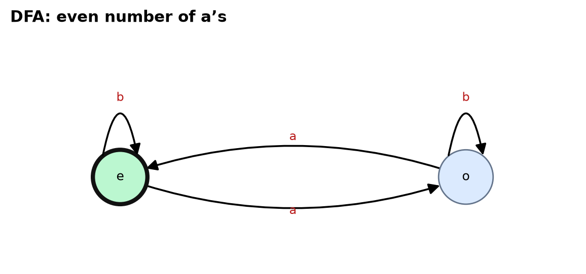


## 9. NFA and ε-NFA implementation

`ENFA` stores $\delta:Q\times(\Sigma\cup\{\varepsilon\})\to2^Q$; `NFA` is the ε-free subclass (constructing an `NFA` with an ε-transition raises). Execution maintains the **active-state set**; `eps_closure` and `eps_closure_steps` return the closure and the growing sets for visualisation; `to_nfa()` performs standard ε-removal (and adds states whose closure meets $F$ to the accepting set); `to_dfa()` is the subset construction over ε-closures with the empty set as an explicit dead state. A word is accepted iff the final active set meets $F$.

The agent specification yields an NFA (all positive-probability successors, probabilities forgotten) and an ε-NFA in which the **silent self-correction ("heal") edges** of corrupted states are ε-moves; in the website's laboratory the ε-closure of a corrupted state shows which clean states can be reached silently. *Nondeterminism of an NFA is a formal device (some path accepts); it is not the randomness of LLM sampling*, which is modelled by probabilities in the probabilistic automaton.

**Tests:** active-set transitions, acceptance (`ends in ab`), equivalence of NFA, its subset-construction DFA and (for the ε-NFA) the ε-free NFA over **all** words up to length 6–7, ε-closure on a chain of ε-moves, rejection of ε in the input alphabet.


## 10. Probabilistic automata

`ProbabilisticAutomaton` stores a distribution over successors for every enabled (state, symbol) pair. Construction **validates normalisation** (probabilities in $[0,1]$, row sums within $10^{-9}$ of 1, known states); an unenabled pair means the symbol is *blocked* (the run cannot accept). The exact semantics is $P(w)=e_{q_0}^\top M_{a_1}\cdots M_{a_n}\mathbf 1_F$ (`acceptance_probability`, `blocked_mass`); runs can be sampled with a seeded generator (reproducible: identical seeds give identical traces) and `monte_carlo_acceptance` returns the estimate with a Wilson interval and the sample size. This formalism is clearly distinct from NFA nondeterminism: an NFA asks *whether* a path accepts, a PA asks *how likely* acceptance is.

In the agent benchmark the policy is the *input* of the PA (action symbols) and the environment kernel is its randomness; the full agent (policy ⊗ kernel) is a time-augmented Markov chain whose success probability is computed exactly by backward induction and was validated against Monte Carlo (179 tests include a statistical check at 4σ).

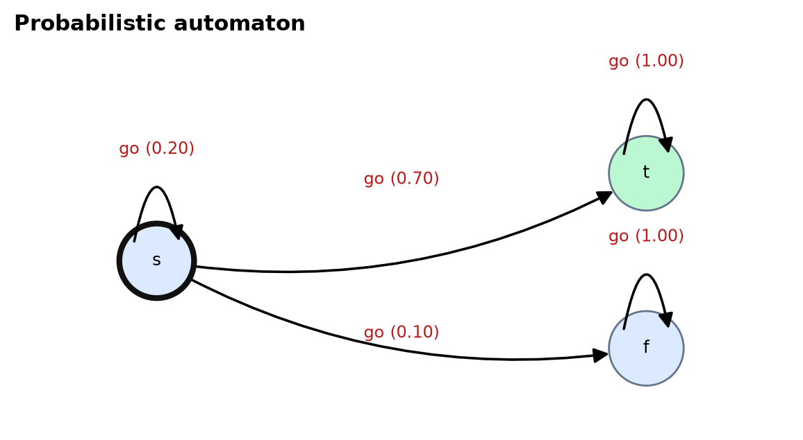


## 11. Labelled transition systems

`LTS` represents execution as labelled transitions $s\xrightarrow{a}s'$ with an optional probability and a *category* drawn from {reasoning, tool_use, observation, state_update, validation, recovery, success, failure}. It supports trace enumeration, label-sequence execution (set of reachable states), forward and backward **reachability**, **deadlock detection** (reachable non-terminal states without successors), reachability of accepting and rejecting states and the extraction of a **counterfactual branch** (the alternative transitions out of a state on a path). `AgentModel.to_lts()` exports the 48-state model with transition weights $\pi(a|q)P(q'|q,a)$; the tests assert that it has no deadlocks and that both outcomes are reachable.

## 12. Mealy and Moore machines

`Mealy` attaches outputs to transitions, `Moore` to states; both are total. A small tool-call controller demonstrates the Mealy-specific behaviour that **the same state emits different outputs for different inputs** (state `calling` emits `proceed` on `ok` and `retry` on `error`). `Mealy.to_moore` performs the required **state expansion** — Moore states are (state, last output) pairs reachable from the start, at most $|Q||\Gamma|+1$ — with a designated initial output; `Moore.to_mealy` needs no expansion. By convention a Moore machine emits $n+1$ outputs for $n$ inputs; the tests check that the Moore output sequence minus the initial output equals the Mealy output sequence on a test word, and that a Moore machine missing an output is rejected.

## 13. PDA and Turing-machine demonstrations

**PDA.** `PDA` is a nondeterministic pushdown automaton whose transitions $(q,a,X,q',\gamma)$ are classified as push, pop or no-op by their net stack effect; execution is a breadth-first search over configurations with bounds on the stack height and the number of expanded configurations (a *simulator* bound; the model itself is unbounded) and returns the shortest accepting computation with the stack before and after every step. Two machines are provided: balanced call/return nesting and **typed** tool nesting (`open_search … end_search`, `open_calc … end_calc`). The test that *requires stack information* builds a DFA that tracks nesting depth only up to 3 and shows that it rejects the depth-5 word the PDA accepts — a finite-state machine cannot capture unbounded recursion.

**Turing machine.** `TuringMachine` simulates a bounded tape (`max_cells`) with a step limit (`max_steps`); the result status is one of accept, reject, `step_limit`, `tape_bound` or `halt_no_transition`, and a full configuration trace is kept. Demonstrations: binary increment (read/write/move) and a palindrome decider. **The bounds are implementation conveniences, not a claim that a bounded simulator reproduces the power of an unbounded machine; a run that hits a bound means "unknown", not "rejected".**

## 14. Agent environments

**The 48-state automaton** (Stage A). Eight states in each of six groups. The groups and their decision/fault states:

| Group | States (8 each) | Planted fault at the decision state |
|---|---|---|
| PLAN | start, parse, decompose, **select subgoal**, wrong subgoal, plan tools, revise, commit | `select_wrong` (default ε = 0.25) |
| OBSERVE | query, **choose resource**, wrong resource, results, browse, **interpret document**, misread, evidence | `search_wrong` (0.15), `misread` (0.20) |
| TOOL | **select tool**, invalid tool, args, call, ok, error, retry, parsed | `tool_invalid` (0.10) |
| MEMORY | read, **write**, corrupt, **reason**, flawed reasoning, draft, flawed draft, stopped early | `mem_corrupt` (0.15), `stop_early` (0.10) |
| VALIDATE | check, fail, feedback, **diagnose**, replan, retry tool, bad recovery, validate flawed | `bad_recover` (0.20) |
| TERMINAL | success (exact), success (partial), fail: plan / evidence / tool / memory / early stop / timeout | — |

Every state carries a unique id, a human-readable label, a semantic description, a kind (non-terminal / accepting / rejecting), a role (benign, decision, fault entry, corridor, recovery, terminal) and a note on its relation to attribution. `build_agent_model(n)` validates: at least 40 logical states (unique ids and labels), policies and kernels are probability distributions, the reference action of every state exists, no deadlocks, every state reachable, accepting and rejecting states reachable, terminal states absorbing. Corrupted states heal with probability 0.08 per step, leak to a failure terminal with probability 0.06 and are wrongly accepted by the validator with probability 0.10; environment noise and the horizon (twice the state count) are configurable. Exact quantities: the value table $V_t(q)$ by backward induction; $\mu^{\mathrm{rep}}_t$ and $\mu^{\mathrm{res}}_t$ for any trajectory.

**The tool-using agent** (Stage B). A controlled *order-total* task: look up price, quantity and shipping, write to memory, compute with a restricted arithmetic `calc` tool (integers with +, −, ×; no names, calls or attributes — tested), validate and recover. Six planted failure types:

| Failure type | Fault action | Effect |
|---|---|---|
| incorrect planning decision | `plan_bad` | later lookups hit a decoy record (downstream propagation) |
| invalid tool choice | `wrong_tool` | the call returns garbage |
| incorrect observation interpretation | `misread` | a value is stored wrongly |
| memory corruption | `mem_corrupt` | stored quantity corrupted |
| premature stopping | `stop_early` | shipping skipped |
| incorrect recovery | `bad_recover` | recovery fails, wrong answer submitted |

States are hashable snapshots (so a replay restores any prefix exactly), the stochastic kernel is explicit (so ground truth is exact by memoised backward induction) and a **deterministic variant** schedules one fault with probability 1 and removes noise and recovery, giving $\mu_t\in\{0,1\}$ and a unique culprit (tested for four fault phases).

## 15. Counterfactual replay design

**Protocols.** *Repair* forces the reference action $\rho(q)$ at the chosen step; *resample* redraws the action from the agent's policy (CAR's null intervention). After the intervention the agent continues under its own stochastic policy; the outcome is the evaluator's $Y\in\{0,1\}$ of the terminal state. A genuine intervention differs from relabelling a trace: the continuation is **re-executed** from the restored state; the website's trajectory explorer displays original and counterfactual traces side by side and shows that repeated replays of the same step can end differently.

**Interfaces.** `ReplayEnv.pull(arm, rng)` returns a `PullResult` (outcome, simulated steps, arms for which the rollout is a *valid* extra observation, the arms that *naive* sharing would credit — used only as a negative control). Implementations: `BanditEnv` (prescribed arm means; the statistical core), `AutomatonEnv` (arms are the steps of a failed trajectory; optional state-reconstruction noise, which disables sharing), `ToolAgentEnv` (snapshot restoration), and `TextGameReplayEnv` (action-history prefix replay for LLM agents on deterministic text environments such as ALFWorld/TextWorld and a retrieval QA loop). Eligibility can be restricted to decision states (a domain prior) and is tracked per arm. **Model providers** are behind an interface (`ScriptedProvider`, `RecordingProvider`, `OpenAICompatProvider`), so the statistical algorithm never imports a model SDK and a deterministic test mode needs no model. The OpenAI-compatible provider is **untested** (no key, no network in the test-suite).

**State reconstruction.** `state_reconstruction_noise` replaces the start state, with the given probability, by another non-terminal state of the same group, modelling an imperfect reproduction of the prefix (A1 violated). The estimand becomes the *noisy replay context*; the exact value of that context is computed and used as ground truth in §22.

## 16. The AFCR algorithm (from the paper)

AFCR is a working name. **Input:** a failed trajectory, the task, intervention protocols, a replay environment, an outcome evaluator, δ, a rollout budget and optional seeds. **Output:** a culprit *or* an abstention with a candidate set; per-step estimates, intervals and pull counts; total rollouts and simulated steps; stopping status; whether the guarantee applies (and why not); original and counterfactual traces; a machine-readable record.

### Algorithm

```
AFCR(env, target, δ, budget):
  for each eligible step t:  N_t = 0, S_t = 0                          # one arm per candidate
  loop:
    [lo_t, hi_t] ← KL ball of radius x_n / n,  x_n = ln(2·K·n·(n+1)/δ)     # running intersection over time
    if target.decide(lo, hi):   return certified answer                     # δ-guarantee applies (Theorem 1)
    if rollouts ≥ budget:       return ABSTAIN(best guess, candidate set)   # not a δ-PAC event
    arms ← all unseen arms first; otherwise {h = argmax mean,  ℓ = argmax_{a≠h} hi_a}   # LUCB
    for a in arms:
        y ← replay(a)                          # a real intervention and re-simulation
        update (N_a, S_a) with y
        if prefix-aware:                       # only exact (time,state,action) matches (Theorem 3)
            for j in matched_arms(rollout): update (N_j, S_j) with y
```

The engine handles ties (tie-breaks by fewer pulls then index), insufficient observations (unseen arms), numerical edge cases (clipped KL, bisection with conservative bracket ends), budget exhaustion and invalid inputs (δ outside (0,1), negative budgets, unknown strategies, invalid sharing/confidence combinations raise readable errors).

### Confidence sequences

The primary sequence (**stack-KL**, ours) uses, for the $n$-th observation count of an arm,
$$B_{a,n}=\{q:\ n\,\mathrm{kl}(\hat\mu_{a,n},q)\le x_n\},\qquad x_n=\ln\frac{2Kn(n+1)}{\delta},$$
where $\mathrm{kl}$ is the Bernoulli KL divergence and $K$ the number of eligible arms. Baselines: **stack-Hoeffding** (same union bound, Hoeffding radius); the **KL-LUCB exploration rate** of Kaufmann and Kalyanakrishnan (2013, Theorem 1), $\beta(t,\delta)=\ln(k_1Kt^{\alpha}/\delta)+\ln\ln(k_1Kt^{\alpha}/\delta)$ with $\alpha>1$ and $k_1>2e+1+\tfrac{e}{\alpha-1}+\tfrac{e+1}{(\alpha-1)^2}$ ($\alpha=1.1\Rightarrow k_1\approx 405.5$), valid for independent arms with one observation per pull and therefore **not** combined with prefix sharing; and a **Wilson** interval for the CAR-style baseline, which is *not* anytime-valid. Each sequence carries `anytime_valid` and `valid_under_sharing` flags, and the engine reports `guarantee_applies = false` whenever the combination is not covered by a theorem.

### Baselines

Uniform and random allocation with the **same** stopping rule (matched confidence); successive elimination; equal budget without stopping (matched budget); a CAR-style fixed-K rule **re-implemented from the paper's description, not from its code**, with resample arms and Wilson intervals; naive sharing (negative control); and an oracle that knows the exact means. Baselines that need LLMs or labelled data (Who&When judges, AgenTracer, conformal methods, REFLECT) were **not reproduced**, and no comparative numbers from them are reported.

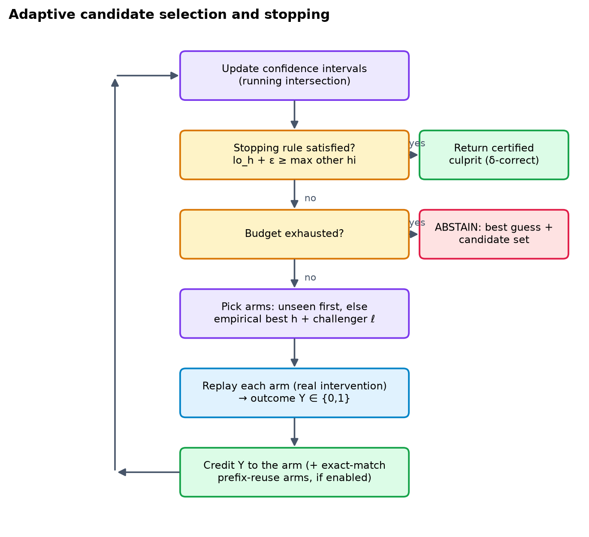


## 17. The prefix-aware extension (from the paper)

An intervention at an early step can change the state distribution, so a shared prefix does **not** make downstream outcomes interchangeable (CAR refuses to cache coalition values for the same reason). The extension therefore records the actual (time, state, action) path of every replay and credits a rollout started at arm $i$ to arm $j>i$ **only if** at time $j-1$ it is in the original state $q_{j-1}$ and (repair protocol) takes $\rho(q_{j-1})$. Under the resample protocol the state match suffices. Mechanisms and validity conditions:

| Mechanism | Valid when |
|---|---|
| Exact-match reuse (implemented) | A1–A4, Markov time-augmented state, exact state equality, action = reference action (repair) |
| Caching deterministic environment transitions | the environment kernel is deterministic given (state, action) |
| Sharing state-value information across candidates | **not** done: requires additional (parametric or model-based) assumptions |
| Naive sharing (implemented only as a negative control) | never |

Reuse is disabled automatically when state-reconstruction noise is present (A1 false). The Stage-B agent and the text-game adapter use the same rule with full-state or action-history equality.


## 18. Theoretical analysis (from the paper)

Setting: arms $a\in[K]$ with unknown $\mu_a\in[0,1]$; the observations of arm $a$, in collection order, are i.i.d. Bernoulli($\mu_a$).

### Correctness of the stopping rule

**Theorem 1 (δ-correctness for any sampling rule) [proved].** $\Pr(\exists a,n:\ \mu_a\notin B_{a,n})\le\delta$. Consequently every rule of the form "return $h$ when $\mathrm{lo}_h+\varepsilon\ge\max_{a\ne h}\mathrm{hi}_a$" (and the two threshold rules) returns a wrong answer with probability at most δ, whatever the sampling rule.

*Proof.* Reward-stack model: the $n$-th pull of arm $a$ reveals $X_{a,n}$ no matter when it happens, so for a fixed pair $(a,n)$ the first $n$ entries are i.i.d. and adaptivity only chooses *which* $n$ is observed. Fix $(a,n)$. The event $\mu_a<\mathrm{lo}$ means $\hat\mu_{a,n}>\mu_a$ and $n\,\mathrm{kl}(\hat\mu_{a,n},\mu_a)>x_n$, i.e. $\hat\mu_{a,n}\ge u$ where $u>\mu_a$ solves $n\,\mathrm{kl}(u,\mu_a)=x_n$; the Chernoff bound gives probability at most $e^{-x_n}$. The upper tail is symmetric, hence $\Pr(\mu_a\notin B_{a,n})\le2e^{-x_n}=\delta/(Kn(n+1))$. Summing over $a\le K$ and $n\ge1$ and using $\sum_{n\ge1}\frac1{n(n+1)}=1$ gives at most δ. On the complement event $E$ every interval contains its mean. If the rule stops with $\mathrm{lo}_h+\varepsilon\ge\mathrm{hi}_a\ge\mu_a$ for all $a\neq h$, then $\mu_h\ge\mathrm{lo}_h\ge\mu_a-\varepsilon$: $h$ is ε-optimal (for ε = 0, the unique best arm). A running intersection of intervals preserves coverage on $E$. Dependence between arms is irrelevant because only a union bound over arms is used. For the threshold rules, a step certified "above" has $\mu\ge\mathrm{lo}\ge\theta$ and a step certified "below" has $\mu\le\mathrm{hi}<\theta$, so the returned first/last step is exactly correct on $E$. ∎

### Sample complexity

**Theorem 2 (elimination) [proved for successive elimination only].** Let $\Delta_a=\mu^\star-\mu_a>0$ and $n_a=\min\{n:\ n>8x_n/\Delta_a^2\}$. On $E$, successive elimination with the stack-KL intervals stops after at most $n_{\max}+\sum_{a\ne a^\star}n_a$ rollouts, where $n_{\max}=\max_an_a$; in particular this is $O\!\big(\sum_a\Delta_a^{-2}\ln\frac{K}{\delta\Delta_a}\big)$ with probability at least $1-\delta$. The proof is in Appendix A. **For LUCB with the stack bound no bound is proved here (empirical only).** The literature bound for KL-LUCB (Kaufmann and Kalyanakrishnan, 2013, Theorem 3) is cited and applies to *their* exploration rate, not ours.

**Comparison with uniform allocation (upper bounds only).** Uniform allocation must give every arm $n_{\max}$ pulls, i.e. $Kn_{\max}$ rollouts; the elimination bound is $\sum_an_a\le Kn_{\max}$ with equality only when all gaps are equal. This compares *bounds*, not performance; performance is measured in §10.

### Number of candidates and trajectory length

Cost scales with the hardness $H=\sum_a\max(\Delta_a,\varepsilon/2)^{-2}$, so the best–second gap enters squared, and with $\ln K$ through $x_n$. Long trajectories add many early steps whose value is the re-roll baseline: they tie with each other but not with the best step, which is harmless for argmax certification but can make the runner-up gap small (§10.4).

### When prefix reuse is valid

**Theorem 3 (prefix reuse) [proved].** Let the process be Markov on time-augmented states, $Y$ a function of the terminal state, and arm $j$ defined by the start $(q_{j-1},j-1)$ with first action $\rho(q_{j-1})$. If a rollout of arm $i<j$ visits $(j-1,q_{j-1})$ and takes $\rho(q_{j-1})$, then, conditionally on that event, its outcome is Bernoulli($\mu_j$) and independent of the history before time $j-1$.

*Proof.* The event is determined by the rollout up to and including its action at time $j-1$, so it is a stopping-time event. By the strong Markov property the future after that action is independent of the past given (state, action) and has exactly the law used by a direct pull of arm $j$. Hence the matched observations of arm $j$, in collection order, are i.i.d. Bernoulli($\mu_j$) and the stack argument of Theorem 1 applies per arm; cross-arm dependence is handled by the union bound. ∎

The theorem is **false** when A1 fails (reconstruction noise) and for naive sharing. §10.8 checks it numerically.

### Established versus new

| Claim | Status | Source |
|---|---|---|
| $\mathbb E[\tau]\ge T^\star(\mu)\,\mathrm{kl}(\delta,1-\delta)$ for every δ-PAC strategy | cited | Garivier and Kaufmann (2016), Thm 1 (read) |
| KL-LUCB is δ-PAC with $\beta(t,\delta)$ above | cited | Kaufmann and Kalyanakrishnan (2013), Thm 1 (read) |
| Stack-KL is anytime-valid; stopping rule is δ-correct for any sampling rule | proved | Thm 1 (standard ingredients, assembled here) |
| Elimination sample complexity | proved | Thm 2 (shape agrees with Even-Dar et al., 2006, abstract-level) |
| LUCB + stack-KL sample complexity | empirical | §10 |
| Prefix reuse validity under Markov + exact match | proved | Thm 3 (+ numerical check, §10.8) |
| Pure exploration with side observations is a known setting | cited | Russo, Song and Pacchiano (2025), abstract-level |

### Finite-sample or asymptotic? Optimality

Theorems 1–3 are **finite-sample** statements. The Garivier–Kaufmann bound is a lower bound for independent arms, with $T^\star(\mu)^{-1}=\sup_w\inf_{\lambda\in\mathrm{Alt}(\mu)}\sum_aw_a\,d(\mu_a,\lambda_a)$; their optimality statement is asymptotic ($\delta\to0$), and they caution against calling an algorithm "optimal" for a constant-factor match. We compute $T^\star$ numerically and find the measured cost of LUCB 15–24× above the bound (Table 5), so **AFCR is not claimed to be sample-optimal in any sense**.

## 19. Software architecture


| Package | Responsibility |
|---|---|
| `afcr.automata` | the nine formal models; `benchmark48` (48/64/96-state agent automaton, exact DP, DFA/NFA/ε-NFA/PA/LTS views) |
| `afcr.statistics` | Bernoulli KL and its inversion, four confidence sequences (with `anytime_valid` / `valid_under_sharing` flags), complexity quantities ($H$, $T^\star$, the Garivier–Kaufmann bound) |
| `afcr.replay` | replay environments: bandit arms, automaton, tool agent |
| `afcr.attribution` | targets (decision rules), allocation strategies, the engine with abstention and accounting |
| `afcr.agents` · `afcr.benchmarks` | tool-agent world, model providers; ALFWorld / HotpotQA / text-game adapters |
| `afcr.experiments` · `afcr.evaluation` | spec execution, the experiment suite, metrics (Wilson, bootstrap), paired statistics (Wilcoxon, Holm) |
| `afcr.api` | FastAPI application consumed by the website |

**Design decisions.** (1) The *stopping rule* lives in the target and the confidence sequence, never in the sampling strategy, so no allocation rule can compromise δ-correctness. (2) The engine reports `guarantee_applies` and a human-readable reason on every result; fixed-budget strategies, non-anytime intervals and naive sharing switch it off. (3) Invalid input raises readable errors (δ outside (0,1), negative budgets, unknown strategies, combining the KL-LUCB rate with sharing). (4) Seeds are explicit everywhere. (5) Performance: a pure-Python scalar bisection path for per-pull interval updates made the full suite run in minutes.

**Test inventory (179/179 backend tests pass; `python -m pytest`).**

| Test module | Passed | Failed | Tests |
|---|---|---|---|
| `test_api_automata` | 36 | 0 | every_graph_has_q_numbered_states_one_start_and_valid_edges[dfa], every_graph_has_q_numbered_states_one_start_and_valid_edges[nfa], every_graph_has_q_numbered_states_one_start_and_valid_edges[enfa], every_graph_has_q_numbered_states_one_start_and_valid_edges[pa], every_graph_has_q_numbered_states_one_start_and_valid_edges[lts], every_graph_has_q_numbered_states_one_start_and_valid_edges[mealy], every_graph_has_q_numbered_states_one_start_and_valid_edges[moore], every_graph_has_q_numbered_states_one_start_and_valid_edges[pda], every_graph_has_q_numbered_states_one_start_and_valid_edges[pda_typed], every_graph_has_q_numbered_states_one_start_and_valid_edges[tm], every_graph_has_q_numbered_states_one_start_and_valid_edges[tm_pal], every_graph_has_q_numbered_states_one_start_and_valid_edges[tm_loop], agent48_states_are_q0_to_q47_and_the_count_is_48, agent48_dfa_view_is_total_and_draws_the_sink_without_counting_it, derived_views_of_nfa_and_enfa, toy_dfa_is_total_and_has_a_dead_state, every_documented_example_behaves_as_stated[dfa], every_documented_example_behaves_as_stated[nfa], every_documented_example_behaves_as_stated[enfa], every_documented_example_behaves_as_stated[pa], every_documented_example_behaves_as_stated[lts], every_documented_example_behaves_as_stated[mealy], every_documented_example_behaves_as_stated[moore], every_documented_example_behaves_as_stated[pda], every_documented_example_behaves_as_stated[pda_typed], every_documented_example_behaves_as_stated[tm], every_documented_example_behaves_as_stated[tm_pal], every_documented_example_behaves_as_stated[tm_loop], probabilistic_automaton_reports_a_probability_not_a_verdict, transducers_have_outputs_and_no_acceptance[mealy], transducers_have_outputs_and_no_acceptance[moore], pda_rejection_still_shows_where_it_failed, turing_machine_traces_are_consistent_and_unknown_is_not_reject, nfa_trace_exposes_active_sets_and_enfa_the_initial_closure, lts_blocked_step_is_reported, unknown_model_and_oversized_state_counts_are_rejected |
| `test_api_http` | 20 | 0 | replay_rejects_bad_input_with_422[body0], replay_rejects_bad_input_with_422[body1], replay_rejects_bad_input_with_422[body2], replay_rejects_bad_input_with_422[body3], replay_rejects_bad_input_with_422[body4], replay_rejects_bad_input_with_422[body5], estimate_rejects_negative_seed_with_422, no_endpoint_returns_500_for_out_of_range_numbers, oversized_experiment_is_refused_with_an_explanation, a_small_experiment_still_runs, replay_and_estimate_still_work_for_valid_input, static_fallback_never_serves_files_outside_dist[/../../pyproject.toml], static_fallback_never_serves_files_outside_dist[/..%2F..%2Fpyproject.toml], static_fallback_never_serves_files_outside_dist[/%2e%2e/%2e%2e/pyproject.toml], static_fallback_never_serves_files_outside_dist[/..%5C..%5Cpyproject.toml], static_fallback_never_serves_files_outside_dist[/assets/../../../pyproject.toml], static_fallback_never_serves_files_outside_dist[/....//....//pyproject.toml], unknown_api_and_file_routes_are_404_json_but_pages_still_load, built_assets_are_still_served, openapi_summaries_are_meaningful |
| `test_attribution` | 16 | 0 | deterministic_planted_culprit, ranking_with_different_probabilities, tied_best_abstains_not_fabricates, epsilon_resolves_ties, budget_exhaustion_accounting, validation_errors, reproducible_with_seed, rollout_accounting_and_stopping_rule_consistency, adaptive_beats_uniform_on_average, threshold_targets_exact, fixed_budget_car_and_oracle, prefix_sharing_valid_and_no_invalid_sharing, sharing_disabled_under_reconstruction_noise, prefix_reachability_last_step_shares_nothing, empirical_error_rate_below_delta, metrics_computed_from_raw_results |
| `test_automata` | 14 | 0 | dfa_total_deterministic_accepts, dfa_missing_transition_raises_and_sink_completion, dfa_invalid_inputs, nfa_active_set_and_acceptance, nfa_to_dfa_equivalence, enfa_closure_and_equivalence, pa_normalisation_and_probability, lts_reachability_deadlock, mealy_moore, pda_requires_stack, turing, agent48_state_count_and_validity, agent48_views_and_formal_properties, exact_mu_planted_culprit_is_argmax |
| `test_configs` | 13 | 0 | there_are_example_specs_for_every_instance_family, every_example_spec_runs_and_is_reproducible[spec_automaton_96.json], every_example_spec_runs_and_is_reproducible[spec_automaton_noise.json], every_example_spec_runs_and_is_reproducible[spec_automaton_prefix.json], every_example_spec_runs_and_is_reproducible[spec_automaton_uniform.json], every_example_spec_runs_and_is_reproducible[spec_bandit_gap.json], every_example_spec_runs_and_is_reproducible[spec_bandit_uniform.json], every_example_spec_runs_and_is_reproducible[spec_target_first_above.json], every_example_spec_runs_and_is_reproducible[spec_target_last_above.json], every_example_spec_runs_and_is_reproducible[spec_toolagent_deterministic.json], every_example_spec_runs_and_is_reproducible[spec_toolagent_stochastic.json], cli_overrides_and_validation, suite_configs_reference_known_groups |
| `test_results_consistency` | 31 | 0 | processed_summaries_are_recomputable_from_raw_rows[main], processed_summaries_are_recomputable_from_raw_rows[gap_sweep], processed_summaries_are_recomputable_from_raw_rows[K_sweep], processed_summaries_are_recomputable_from_raw_rows[delta_sweep], processed_summaries_are_recomputable_from_raw_rows[stress], processed_summaries_are_recomputable_from_raw_rows[size_sweep], processed_summaries_are_recomputable_from_raw_rows[eps_sweep], processed_summaries_are_recomputable_from_raw_rows[noise_sweep], processed_summaries_are_recomputable_from_raw_rows[ablation], processed_summaries_are_recomputable_from_raw_rows[budget_curve], processed_summaries_are_recomputable_from_raw_rows[toolagent], processed_summaries_are_recomputable_from_raw_rows[targets], paired_statistics_are_recomputable_from_raw_rows, raw_rows_are_internally_consistent[main], raw_rows_are_internally_consistent[gap_sweep], raw_rows_are_internally_consistent[K_sweep], raw_rows_are_internally_consistent[delta_sweep], raw_rows_are_internally_consistent[stress], raw_rows_are_internally_consistent[size_sweep], raw_rows_are_internally_consistent[eps_sweep], raw_rows_are_internally_consistent[noise_sweep], raw_rows_are_internally_consistent[ablation], raw_rows_are_internally_consistent[budget_curve], raw_rows_are_internally_consistent[toolagent], raw_rows_are_internally_consistent[targets], no_wrong_certified_answer_in_guaranteed_runs, sample_complexity_scales_with_the_gap, cost_grows_roughly_like_inverse_gap_squared_for_uniform, every_method_respects_the_lower_bound_on_average, adaptive_beats_uniform_in_every_gap_and_k_setting, summarize_matches_manual_computation_on_raw_rows |
| `test_statistics` | 34 | 0 | kl_basic_values, kl_inversion_brackets_the_ball[0.01-0.0], kl_inversion_brackets_the_ball[0.01-0.2], kl_inversion_brackets_the_ball[0.01-0.5], kl_inversion_brackets_the_ball[0.01-0.97], kl_inversion_brackets_the_ball[0.01-1.0], kl_inversion_brackets_the_ball[0.5-0.0], kl_inversion_brackets_the_ball[0.5-0.2], kl_inversion_brackets_the_ball[0.5-0.5], kl_inversion_brackets_the_ball[0.5-0.97], kl_inversion_brackets_the_ball[0.5-1.0], kl_inversion_brackets_the_ball[3.0-0.0], kl_inversion_brackets_the_ball[3.0-0.2], kl_inversion_brackets_the_ball[3.0-0.5], kl_inversion_brackets_the_ball[3.0-0.97], kl_inversion_brackets_the_ball[3.0-1.0], kl_inversion_infinite_radius_is_trivial, confidence_edge_cases[StackKL], confidence_edge_cases[StackHoeffding], confidence_shrinks_with_n_and_grows_with_confidence, stack_kl_never_wider_than_hoeffding, delta_validation[0.0], delta_validation[1.0], delta_validation[-0.1], delta_validation[1.5], input_validation, kl_lucb_rate_matches_published_constants, wilson_is_flagged_non_sequential, flags_for_sharing_validity, gaps_and_hardness, characteristic_time_two_arms_is_inverse_chernoff, characteristic_time_monotone_in_gap_and_inf_for_ties, confidence_sequence_coverage_under_adaptive_sampling[StackKL], confidence_sequence_coverage_under_adaptive_sampling[StackHoeffding] |
| `test_toolagent_and_benchmarks` | 15 | 0 | safe_calc_rejects_code_and_allows_arithmetic, tool_world_dp_matches_monte_carlo, tool_world_kernels_are_distributions, deterministic_variant_has_unique_culprit_and_is_deterministic, deterministic_planted_fault_each_type[0], deterministic_planted_fault_each_type[1], deterministic_planted_fault_each_type[4], deterministic_planted_fault_each_type[5], attribution_on_tool_agent_finds_good_culprit, theorem3_matched_observations_unbiased_and_naive_biased_automaton, theorem3_unbiased_on_tool_agent, providers, hotpot_game_and_evaluator, alfworld_unavailable_is_reported_cleanly, text_game_replay_env_with_mock_agent_is_not_a_benchmark_result |

## 20. Website architecture

The website is a React 18 + TypeScript + Vite single-page application served by the FastAPI backend (and proxied by `npm run dev`). Nothing it displays is hard-coded: every graph, trace, estimate, interval and table comes from an endpoint, and every simulated number is labelled *synthetic*. Libraries: React Router (nine routes, code-split), Framer Motion (page transitions, layout animations, reduced-motion aware), Recharts (charts with error bars), d3-zoom/d3-selection (graph pan/zoom), KaTeX (mathematics), Lucide (icons), and the Inter, Space Grotesk and JetBrains Mono variable fonts bundled locally.

**Design system.** Deep graphite/navy surfaces with restrained blue, cyan and violet accents; design tokens as CSS variables with a light theme; hairline borders and soft depth; a custom **dot-and-ring cursor** (spring-follow, hover/press/drag/text states) and a pointer-following **spotlight** on the background — both disabled on touch and for reduced motion; staggered reveals, animated counters, skeleton loaders, toasts and animated tabs/segmented controls; full keyboard access (focus rings, roving buttons, `aria` labels), responsive layouts (breakpoints at 1280, 1100, 960, 860 and 720 px; the sidebar becomes a drawer) and no horizontal overflow at phone width (verified).

**Pages.** *Overview* (live KPIs, the seven required sections as tabs, interactive 15-step pipeline, architecture diagram); *Problem and related work* (timeline, filterable evidence matrix with per-paper drill-down, outcome A/B/C, unresolved questions); *Automata laboratory* (an interactive 48-state graph with search + fly-to, zoom/pan, minimap, state details, trace playback with a travelling token, planted-culprit highlight, counterfactual-branch overlay, formalism views LTS/DFA/NFA/ε-NFA/PA, 48/64/96 states, and the other eight models with model-specific views — active sets, ε-closure steps, stack, tape, outputs, exact and Monte-Carlo acceptance probability, definitions, transition tables, comparison matrix and live test status); *Trajectory explorer* (failed trajectory, exact μ<sub>t</sub> chart, step selection, prefix state, intervention configuration, one counterfactual replay or an n-replay estimate with a Wilson interval, original vs counterfactual side by side); *Attribution dashboard* (the real algorithm with a round-by-round replayable forest plot, stopping-rule panel, ranking, uniform comparison on the same instance); *Experiment studio* (live simulations, saved results for all twelve groups, paired statistics, CSV/JSON export); *Theory* (KaTeX with expandable proofs and a claims ledger); *Reproducibility* (commands, seed policy, live test status, artifact links, checklist, figure gallery with lightbox); *Documentation* (searchable specification, generated API reference, glossary, troubleshooting).

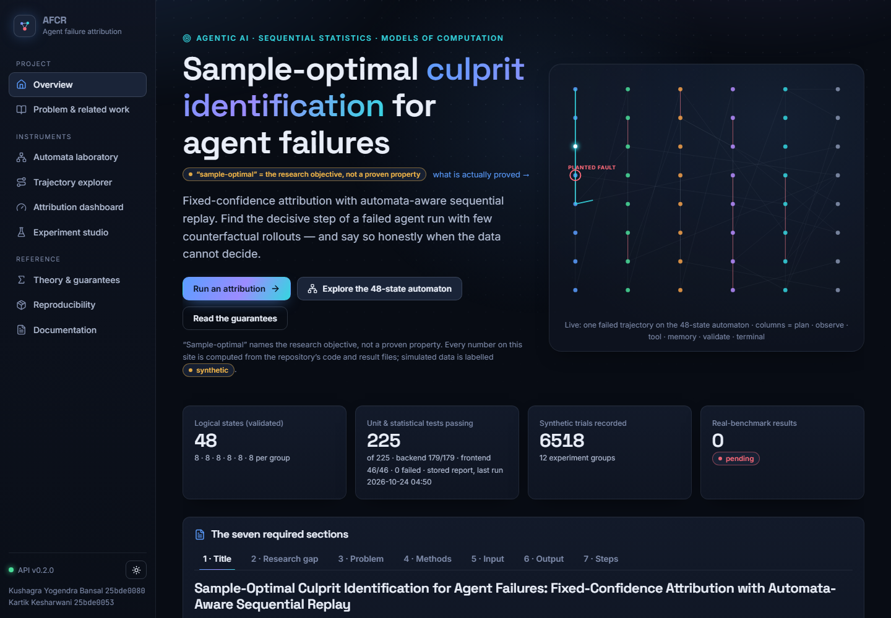

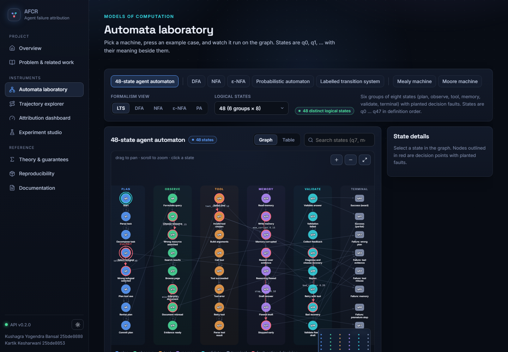

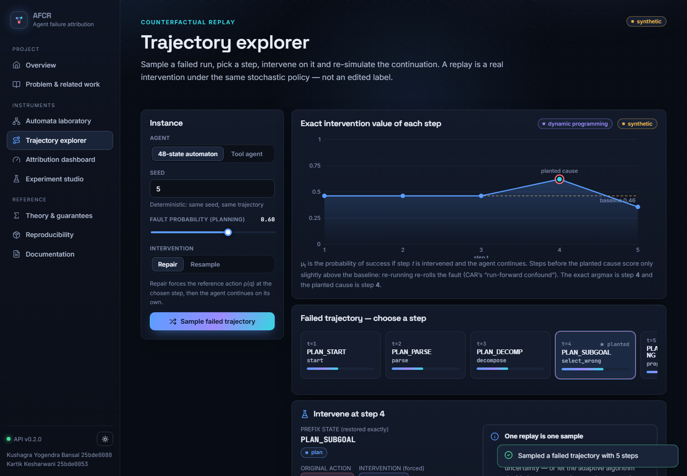

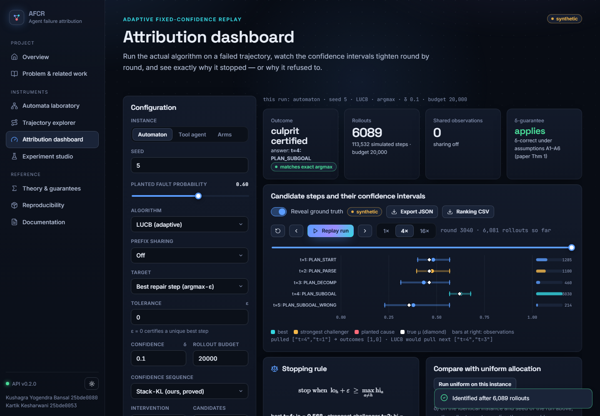

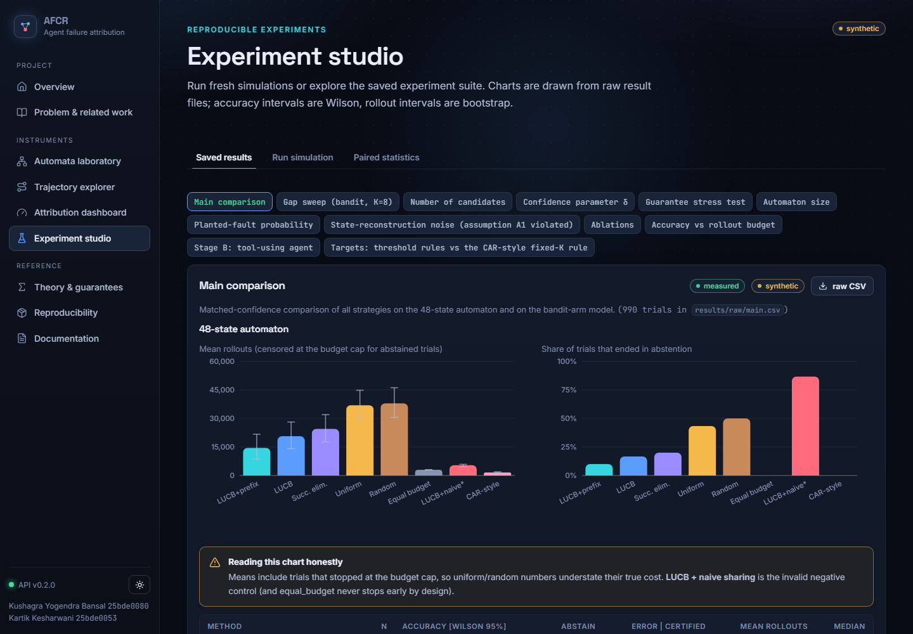

**Frontend tests** (46/46 pass; vitest + Testing Library): navigation and the mobile menu, live test counts from the API, model switching and graph requests, trace execution, backend validation errors surfaced in the UI, loading/error/retry states, graph selection by click and keyboard and search dimming, number-field validation (δ, budget, trial count), dashboard execution and the abstention message, simulation execution and CSV/JSON export, empty states, the novelty matrix, documentation search, API-client error mapping (FastAPI validation details; unreachable backend) and CSV serialisation. No browser end-to-end tests were written.

**API.**

| Method | Path | Purpose |
|---|---|---|
| POST | `/api/attribute` | Attribute |
| GET | `/api/automata/compare` | Compare |
| GET | `/api/automata/graph` | Graph |
| GET | `/api/automata/models` | List Models |
| POST | `/api/automata/trace` | Trace |
| POST | `/api/experiment/run` | Run Experiment |
| GET | `/api/health` | Health |
| POST | `/api/replay` | Replay |
| POST | `/api/replay/estimate` | Replay Estimate |
| GET | `/api/research/{what}` | Research |
| GET | `/api/results/export` | Results Export |
| GET | `/api/results/group/{name}` | Results Group |
| GET | `/api/results/index` | Results Index |
| GET | `/api/results/summary` | Results Summary |
| GET | `/api/status` | Status |
| GET | `/api/tests` | Tests Report |
| POST | `/api/trajectory` | Trajectory |
| GET | `/files/DELIVERY_SUMMARY.md` | Download DELIVERY SUMMARY.md |
| GET | `/files/README.md` | Download README.md |
| GET | `/files/RESEARCH_STATUS.md` | Download RESEARCH STATUS.md |

## 21. Experimental methodology (from the paper)

**Stages.** A: synthetic (bandit-arm model with prescribed gaps; 48/64/96-state automaton). B: controlled tool agent (stochastic and deterministic). C: ALFWorld **[pending]**. D: HotpotQA **[pending]**.

**Instances.** Automaton: the failed trajectory of one sampled run conditioned on failure, at least four steps and at least one planted fault; fault probability 0.6 at the planting state unless varied; exact ground truth $\arg\max_t\mu_t$ (and the planted step, recorded separately: *identification of a planted cause is not the same as identification of the argmax*). Bandit-arm model: $K$ arms, one best arm at 0.8, one runner-up at 0.8−gap, the rest at $\mathrm{clip}(0.8-3\,\mathrm{gap})$.

**Methods and budgets.** δ = 0.1 unless varied; rollout cap 60 000 (150 000 in sweeps with small gaps); equal-budget 3 000; naive sharing 6 000 (it is invalid and the run is only to show how it fails).

**Metrics.** Exact (or ε-optimal) accuracy with abstentions counted as forced-choice answers; certification rate; abstention rate; error among certified trials; mean/median/p90 rollouts with bootstrap intervals; rollouts to reach 90 % accuracy; wall-clock time and simulated steps are stored in the raw rows. *A stopping rule with a theoretical $(1-\delta)$ guarantee is a different object from an empirical 90 % accuracy target and the two are reported separately.*

**Statistics.** Trials are paired by instance (identical seeds across methods). Accuracy: Wilson 95 % intervals. Rollouts: 1 000–2 000-resample bootstrap. Paired differences: bootstrap CI and two-sided Wilcoxon signed-rank test; the four primary comparisons are corrected together with Holm–Bonferroni. Rollout counts of trials that hit the cap are *censored*; means and medians are therefore lower bounds on the true cost, most severely for uniform and random allocation. No other significance claims are made.

**Reproducibility.** Every trial is a plain-dict spec; instance seed = group base + trial index; algorithm RNG = seed + 7; raw rows (`results/raw/*.csv`) and aggregates (`results/processed/*.json`) are stored separately; `python -m afcr.experiments.suite --aggregate-only` recomputes the aggregates. Test-suite: 179/179 backend tests and 46/46 frontend tests pass.

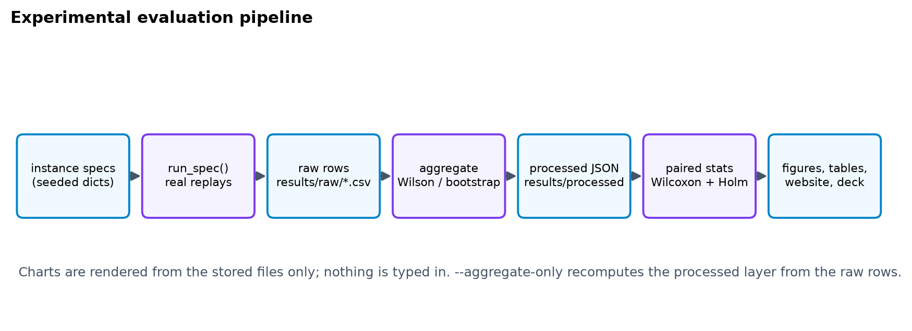

## 22. Synthetic experiments (from the paper)

### Main comparison on the 48-state automaton

**Table 1** (δ = 0.1; 30 paired instances per method; cap 60 000 rollouts).

| Method | n | Accuracy [Wilson 95%] | Certified | Abstained | Error among certified | Mean rollouts [95% CI] | Median |
|---|---|---|---|---|---|---|---|
| Oracle (exact means) | 30 | 100% [89%, 100%] | 100% | 0% | 0.0% | 0 [0–0] | 0 |
| LUCB + valid prefix reuse | 30 | 93% [79%, 98%] | 90% | 10% | 0.0% | 14,530 [8,646–21,704] | 4,281 |
| LUCB | 30 | 93% [79%, 98%] | 83% | 17% | 0.0% | 20,637 [14,124–28,126] | 8,328 |
| Successive elimination | 30 | 93% [79%, 98%] | 80% | 20% | 0.0% | 24,528 [17,691–31,998] | 12,320 |
| Uniform (same stopping rule) | 30 | 93% [79%, 98%] | 57% | 43% | 0.0% | 36,929 [29,737–44,830] | 34,274 |
| Random (same stopping rule) | 30 | 97% [83%, 99%] | 50% | 50% | 0.0% | 37,911 [30,554–46,150] | 46,100 |
| Equal budget (no stopping) | 30 | 80% [63%, 90%] | 0% | 0% | — | 3,000 [3,000–3,000] | 3,000 |
| LUCB + naive sharing (invalid) | 30 | 47% [30%, 64%] | 13% | 87% | 25.0% | 5,396 [4,747–5,880] | 6,000 |
| CAR-style fixed K=100 | 30 | 0% [0%, 11%] | 0% | 0% | — | 1,607 [1,283–1,957] | 1,300 |

*Reading the table.* Means include trials that stopped at the cap (censored); fixed-budget methods never certify by design; the CAR-style rule is scored against the planted step with resample arms (its own definition of locus) and is not comparable on the argmax estimand — in this model late corrupted states still produce a success among 100 rollouts, so "CI excludes zero" fires late; this is a property of our re-implementation on our model and **not** a verdict on CAR. Naive sharing certified 4 of 30 trials and 1 of those was wrong: with so few certified trials this is weak evidence by itself, and the stronger evidence is the bias test of §10.8.


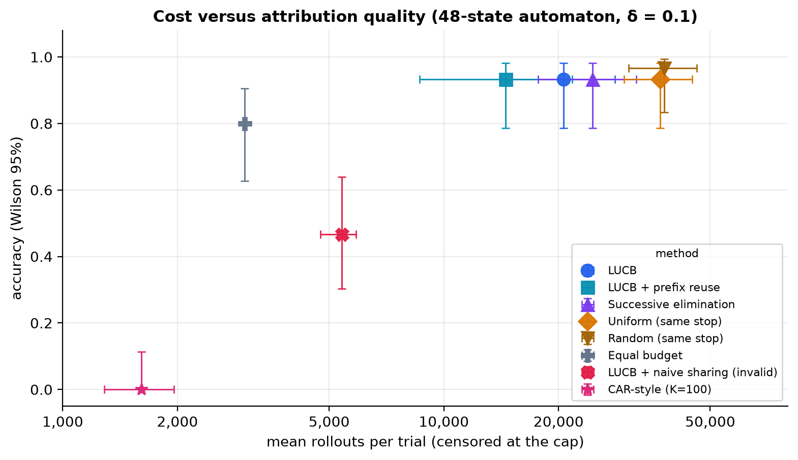


### Paired statistics (Holm-corrected)

**Table 2.**

| Comparison (second vs first) | Pairs | Ratio of mean rollouts | Mean difference [95% bootstrap CI] | p (Wilcoxon) | p (Holm) | Significant at 0.05 |
|---|---|---|---|---|---|---|
| Uniform (same stopping rule) vs LUCB | 30 | 1.79× | 16,292 [11,060, 22,096] | <0.001 | <0.001 | yes |
| Random (same stopping rule) vs LUCB | 30 | 1.84× | 17,275 [11,536, 23,887] | <0.001 | <0.001 | yes |
| Successive elimination vs LUCB | 30 | 1.19× | 3,891 [1,908, 6,404] | <0.001 | <0.001 | yes |
| LUCB vs LUCB + valid prefix reuse | 30 | 1.42× | 6,106 [4,185, 8,177] | <0.001 | <0.001 | yes |

Adaptive allocation therefore reduced cost relative to uniform and random allocation at the same stopping rule and δ (1.79× and 1.84×), successive elimination was 1.19× as costly as LUCB, and valid prefix reuse removed a further factor of 1.42. These ratios are ratios of *censored* means and are conservative.

### Bandit-arm model

**Table 3.**

| Gap | Method | n | Accuracy | Certified | Error among certified | Mean rollouts [95% CI] |
|---|---|---|---|---|---|---|
| 0.1 | LUCB | 60 | 100% | 100% | 0.0% | 6,709 [6,296–7,188] |
| 0.1 | Successive elimination | 60 | 100% | 100% | 0.0% | 7,876 [7,504–8,264] |
| 0.1 | Uniform (same stopping rule) | 60 | 100% | 100% | 0.0% | 23,467 [21,890–25,044] |
| 0.1 | Random (same stopping rule) | 60 | 100% | 100% | 0.0% | 23,192 [21,947–24,561] |
| 0.1 | Equal budget (no stopping) | 60 | 100% | 0% | — | 3,000 [3,000–3,000] |
| 0.1 | Oracle (exact means) | 60 | 100% | 100% | 0.0% | 0 [0–0] |
| 0.2 | LUCB | 60 | 100% | 100% | 0.0% | 1,503 [1,413–1,600] |
| 0.2 | Successive elimination | 60 | 100% | 100% | 0.0% | 1,736 [1,621–1,857] |
| 0.2 | Uniform (same stopping rule) | 60 | 100% | 100% | 0.0% | 5,783 [5,501–6,083] |
| 0.2 | Random (same stopping rule) | 60 | 100% | 100% | 0.0% | 5,766 [5,394–6,169] |
| 0.2 | Equal budget (no stopping) | 60 | 100% | 0% | — | 3,000 [3,000–3,000] |
| 0.2 | Oracle (exact means) | 60 | 100% | 100% | 0.0% | 0 [0–0] |

### Gap, number of candidates, automaton size, fault probability

**Table 4 (K = 8, δ = 0.1, cap 150 000; mean rollouts) and the Garivier–Kaufmann lower bound (Table 5 below).**

| Gap | LUCB | Successive elim. | Uniform | Lower bound T*·kl(δ,1−δ) | LUCB / lower bound |
|---|---|---|---|---|---|
| 0.050000000000000044 | 27,515 | 36,381 | 100,600 | 1,165 | 23.6× |
| 0.09999999999999998 | 6,609 | 7,837 | 25,481 | 313 | 21.1× |
| 0.15000000000000002 | 2,769 | 3,384 | 10,660 | 147 | 18.8× |
| 0.19999999999999996 | 1,537 | 1,867 | 5,781 | 86 | 17.8× |
| 0.30000000000000004 | 648 | 765 | 2,471 | 42 | 15.3× |

*(Table 5: the last two columns give $T^\star(\mu)\,\mathrm{kl}(\delta,1-\delta)$ and the ratio. Every method lies above the bound, necessarily; LUCB is 15–24× above it.)*


**Number of candidates (gap 0.2).**

| K | LUCB | Successive elim. | Uniform | Uniform / LUCB |
|---|---|---|---|---|
| 4 | 1,416 | 1,441 | 2,808 | 2.0× |
| 8 | 1,565 | 1,890 | 5,526 | 3.5× |
| 16 | 1,812 | 2,612 | 11,676 | 6.4× |
| 32 | 2,391 | 3,953 | 22,869 | 9.6× |
| 64 | 3,362 | 6,249 | 49,713 | 14.8× |


**Automaton size (48, 64, 96 logical states).**

| Logical states | Method | n | Certified | Mean rollouts [95% CI] |
|---|---|---|---|---|
| 48 | LUCB | 30 | 87% | 22,634 [15,340–29,860] |
| 48 | LUCB + valid prefix reuse | 30 | 97% | 14,282 [8,970–20,184] |
| 48 | Uniform (same stopping rule) | 30 | 57% | 40,204 [33,447–47,048] |
| 64 | LUCB | 30 | 80% | 28,140 [21,150–34,961] |
| 64 | LUCB + valid prefix reuse | 30 | 90% | 14,416 [8,578–21,172] |
| 64 | Uniform (same stopping rule) | 30 | 47% | 44,908 [38,194–50,621] |
| 96 | LUCB | 30 | 77% | 35,263 [28,064–41,893] |
| 96 | LUCB + valid prefix reuse | 30 | 90% | 13,860 [7,697–20,360] |
| 96 | Uniform (same stopping rule) | 30 | 50% | 50,354 [46,284–54,020] |

**Planted-fault probability** (a smaller probability brings the planted step closer to the re-roll baseline and therefore shrinks the true gap):

| Fault prob. | mean true gap | Method | Certified | Mean rollouts [95% CI] |
|---|---|---|---|---|
| 0.3 | 0.068 | LUCB | 73% | 31,470 [24,627–38,586] |
| 0.3 | 0.068 | LUCB + valid prefix reuse | 90% | 19,044 [13,101–25,453] |
| 0.3 | 0.068 | Uniform (same stopping rule) | 20% | 57,140 [53,369–59,601] |
| 0.45 | 0.084 | LUCB | 70% | 26,281 [18,521–34,085] |
| 0.45 | 0.084 | LUCB + valid prefix reuse | 80% | 19,619 [11,903–27,193] |
| 0.45 | 0.084 | Uniform (same stopping rule) | 53% | 47,749 [42,209–52,954] |
| 0.6 | 0.119 | LUCB | 77% | 19,717 [12,335–27,998] |
| 0.6 | 0.119 | LUCB + valid prefix reuse | 90% | 14,803 [8,008–22,739] |
| 0.6 | 0.119 | Uniform (same stopping rule) | 73% | 31,439 [24,637–38,561] |
| 0.8 | 0.159 | LUCB | 80% | 16,652 [9,332–24,791] |
| 0.8 | 0.159 | LUCB + valid prefix reuse | 93% | 13,600 [6,488–21,477] |
| 0.8 | 0.159 | Uniform (same stopping rule) | 77% | 22,807 [14,397–30,968] |

### Calibration of δ and a stress test

Across **all** guaranteed runs in every group (3,620 certified trials) we observed **0 wrong answers**. On the hardest instances we could construct (two arms, gap 0.06, δ up to 0.5) the observed errors were δ=0.1: 0/300; δ=0.3: 0/300; δ=0.5: 0/300 (total 0/900). Zero errors is consistent with Theorem 1 but also shows that the stack bound is **conservative**: the test cannot demonstrate tightness, and it is used as a bug detector, not as a proof.

**Table 6 (K = 8, gap 0.15).**

| δ | n | Observed error among certified | Certified | Mean rollouts |
|---|---|---|---|---|
| 0.01 | 60 | 0.0% | 100% | 3,221 |
| 0.05 | 60 | 0.0% | 100% | 2,935 |
| 0.1 | 60 | 0.0% | 100% | 2,784 |
| 0.2 | 60 | 0.0% | 100% | 2,688 |
| 0.4 | 60 | 0.0% | 100% | 2,531 |

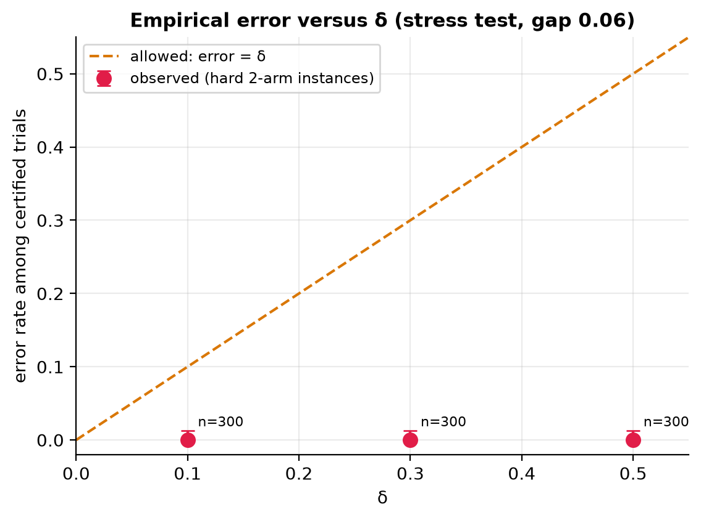


### Accuracy versus rollout budget, and the 90 % target

**Table 7** (forced-choice accuracy; adaptive methods return their best guess when they cannot certify).

| Method | B=100 | B=200 | B=500 | B=1,000 | B=2,000 | B=5,000 | B=10,000 | B=20,000 |
|---|---|---|---|---|---|---|---|---|
| LUCB + valid prefix reuse | 87% | 93% | 95% | 93% | 97% | 97% | 98% | 97% |
| LUCB | 53% | 63% | 80% | 88% | 90% | 98% | 97% | 97% |
| Equal budget (no stopping) | 45% | 62% | 72% | 80% | 90% | 95% | 98% | 98% |
| Random budget | 35% | 58% | 70% | 78% | 95% | 98% | 97% | 95% |

| Method | Smallest B with accuracy ≥ 90% (point estimate) | … with Wilson lower bound ≥ 90% |
|---|---|---|
| LUCB + valid prefix reuse | 200 | 10000 |
| LUCB | 2000 | 5000 |
| Equal budget (no stopping) | 2000 | 10000 |
| Random budget | 2000 | 5000 |

LUCB without sharing is **not** clearly better than equal-budget spending in forced-choice accuracy at small budgets; its advantage is in the number of rollouts needed to *certify*. Prefix reuse is far more efficient per rollout (shared observations are free), which is why its accuracy at B = 100 is much higher. The 90 % line is an empirical target on a grid of budgets and is not the (1−δ) guarantee.


### Ablations

**Table 8** (30 paired instances per level).

| Factor | Level | Accuracy | Certified | Error among certified | Mean rollouts [95% CI] |
|---|---|---|---|---|---|
| confidence | stack_kl | 93% | 83% | 0.0% | 18,448 [12,059–26,396] |
| confidence | stack_hoeffding | 93% | 83% | 0.0% | 22,764 [16,069–30,633] |
| confidence | kl_lucb_rate | 93% | 83% | 0.0% | 19,831 [13,554–27,394] |
| allocation | lucb | 93% | 83% | 0.0% | 18,448 [12,059–26,396] |
| allocation | successive_elim | 93% | 83% | 0.0% | 20,944 [14,662–28,386] |
| allocation | uniform_fc | 97% | 67% | 0.0% | 36,493 [30,004–43,330] |
| allocation | random_fc | 100% | 63% | 0.0% | 36,397 [29,789–43,632] |
| sharing | none | 93% | 83% | 0.0% | 18,448 [12,059–26,396] |
| sharing | valid | 97% | 87% | 0.0% | 12,693 [6,193–20,749] |
| sharing | naive | 47% | 20% | 16.7% | 5,355 [4,781–5,848] |
| candidates | all | 93% | 83% | 0.0% | 18,448 [12,059–26,396] |
| candidates | decision | 100% | 97% | 0.0% | 6,578 [2,125–12,883] |
| epsilon | 0.0 | 93% | 83% | 0.0% | 18,448 [12,059–26,396] |
| epsilon | 0.02 | 100% | 97% | 0.0% | 14,222 [8,936–21,317] |
| epsilon | 0.05 | 100% | 100% | 0.0% | 7,203 [4,860–10,929] |

Stack-KL needed fewer rollouts than stack-Hoeffding; the KL-LUCB rate was between the two here. Naive sharing is invalid and rarely certifies. Restricting candidates to decision states (a **domain prior**: it assumes we know which steps could be faulty) reduced cost considerably; this is a different problem from the unrestricted one and must not be presented as a like-for-like speed-up. A tolerance ε > 0 reduced cost and abstentions substantially by declaring near-ties acceptable.


### Empirical check of Theorem 3, and why naive sharing is invalid

One instance (seed 5), 8 000 rollouts started at the first candidate step. For every later candidate we compare the mean of the *validly matched* observations with its exact value, and the mean of the observations that *naive sharing* would credit.

| Candidate step | exact μ | matched observations (n) | mean of matched observations | z | naive-credited observations (n) | mean of naive observations | z |
|---|---|---|---|---|---|---|---|
| t=2: PLAN_PARSE | 0.462 | 7761 | 0.458 | -0.7 | 8000 | 0.459 | -0.5 |
| t=3: PLAN_DECOMP | 0.462 | 7517 | 0.456 | -0.9 | 8000 | 0.459 | -0.5 |
| t=4: PLAN_SUBGOAL | 0.620 | 2863 | 0.628 | 0.8 | 8000 | 0.459 | -29.7 |
| t=5: PLAN_SUBGOAL_WRONG | 0.356 | 4441 | 0.344 | -1.6 | 8000 | 0.459 | 19.2 |

The z-scores of matched observations are small (unbiased); the naive observations are strongly biased for every candidate whose value differs from the re-roll baseline (here the planted step and the first corrupted step; |z| ≈ 20–30), which also explains why naive sharing prevents certification. The same check passes on the tool agent in the test-suite.


### State-reconstruction noise (assumption A1 violated)

**Table 9.** Accuracy is measured against the argmax of the *noisy replay context*, the estimand that is actually being sampled; prefix reuse is disabled automatically.

| Reconstruction noise | n | Accuracy vs noisy-context argmax | Certified | Mean rollouts |
|---|---|---|---|---|
| 0.0 | 30 | 97% [83%, 99%] | 97% | 11,908 |
| 0.1 | 30 | 97% [83%, 99%] | 77% | 23,514 |
| 0.25 | 30 | 100% [89%, 100%] | 70% | 31,055 |
| 0.5 | 30 | 80% [63%, 90%] | 30% | 54,780 |

As noise grows the replay context drifts from the original, certification becomes rarer and the guarantee concerns the replay model, not the original run.

### Stage B: the tool-using agent

**Table 10.**

| Variant | Method | n | Accuracy (ε-optimal) | Certified | Mean rollouts [95% CI] |
|---|---|---|---|---|---|
| stochastic | LUCB | 30 | 100% | 83% | 6,623 [4,845–8,591] |
| stochastic | LUCB + valid prefix reuse | 30 | 100% | 83% | 5,578 [3,938–7,451] |
| stochastic | Uniform (same stopping rule) | 30 | 100% | 47% | 11,612 [9,936–13,189] |
| stochastic | Equal budget (no stopping) | 30 | 97% | 0% | 3,000 [3,000–3,000] |
| stochastic | Oracle (exact means) | 30 | 100% | 100% | 0 [0–0] |
| deterministic_phase0 | LUCB | 1 | 100% | 100% | 92 [92–92] |
| deterministic_phase0 | Uniform (same stopping rule) | 1 | 100% | 100% | 121 [121–121] |
| deterministic_phase1 | LUCB | 1 | 100% | 100% | 92 [92–92] |
| deterministic_phase1 | Uniform (same stopping rule) | 1 | 100% | 100% | 122 [122–122] |
| deterministic_phase4 | LUCB | 1 | 100% | 100% | 92 [92–92] |
| deterministic_phase4 | Uniform (same stopping rule) | 1 | 100% | 100% | 125 [125–125] |
| deterministic_phase5 | LUCB | 1 | 100% | 100% | 92 [92–92] |
| deterministic_phase5 | Uniform (same stopping rule) | 1 | 100% | 100% | 126 [126–126] |

In the deterministic variant each of four planted failure types (planning, tool choice, memory, premature stop) is identified with fewer than 130 rollouts (single instance per type, so no interval is meaningful).

### Targets and the CAR-style rule

**Table 11.**

| Target | Method | n | Agreement with exact target | Certified | Mean rollouts |
|---|---|---|---|---|---|
| last_above | LUCB | 30 | 100% | 47% | 34,333 |
| last_above | CAR-style fixed K=100 | 30 | 3% | 0% | 1,320 |
| last_above | CAR-style fixed K=500 | 30 | 3% | 0% | 6,600 |
| first_above | LUCB | 30 | 100% | 100% | 32,362 |
| first_above | Uniform (same stopping rule) | 30 | 100% | 0% | 60,000 |

The threshold targets are exactly correct whenever the rule stops (agreement 100 % among certified trials), at the price of abstaining when a step's value lies close to θ. The CAR-style fixed-K rule never agrees with the θ-defined locus here, again because it answers a different question.

### Summary of what the evidence supports

(i) Adaptive allocation reduces the number of replays needed to certify a culprit at matched confidence on these synthetic instances (RQ1). (ii) No wrong certified answer was observed among 3,620 guaranteed trials, consistent with δ (RQ2). (iii) Exact-match prefix reuse reduces cost further, naive sharing is biased (RQ3). (iv) Cost grows steeply as the gap shrinks and with K; tied best steps lead to abstention (RQ4). **Not supported:** any claim about real LLM agents, optimality, or superiority over published baselines other than the re-implemented CAR-style rule.

## 23. Benchmark experiments (ALFWorld, HotpotQA)

**ALFWorld [pending].** MIT licence per package metadata (secondary source); text mode needs `pip install alfworld` (TextWorld) and `alfworld-download`. `afcr.benchmarks.ALFWorldGame` wraps the environment and raises `BenchmarkUnavailable` if it is not installed. **HotpotQA [pending].** CC BY-SA 4.0 per secondary sources; `HotpotQAGame` loads a *local* distractor-setting file you provide, exposes `search:`/`finish:` actions and scores normalised exact match. The generic `TextGameReplayEnv` replays an action-history prefix exactly and is exercised only with a scripted mock agent; **that test is an interface check, not a benchmark result.** A fixed model, prompt, tool interface and evaluation protocol are required for a valid run; none exists in this repository, and no synthetic result is labelled as ALFWorld or HotpotQA.

## 24. Results and statistical analysis

The primary comparisons are paired by instance and corrected together (Table 2 of §22). With 30 pairs per comparison all four primary differences are significant after Holm correction (largest adjusted p = 0.0007); effect sizes are ratios of *censored* means, so they are conservative; no other significance claim is made. Accuracy intervals are Wilson intervals, rollout intervals are bootstrap intervals, and the sample size of every cell is reported. There are no missing runs: every spec in `suite.py` produced a row (`results/processed/suite_meta.json` records the row count and wall time of every group). Sensitivity analyses: gap, number of candidates, automaton size, fault probability, δ, reconstruction noise and five ablation factors.

## 25. Ablation studies

| Factor | Level | Accuracy | Certified | Error among certified | Mean rollouts [95% CI] |
|---|---|---|---|---|---|
| confidence | stack_kl | 93% | 83% | 0.0% | 18,448 [12,059–26,396] |
| confidence | stack_hoeffding | 93% | 83% | 0.0% | 22,764 [16,069–30,633] |
| confidence | kl_lucb_rate | 93% | 83% | 0.0% | 19,831 [13,554–27,394] |
| allocation | lucb | 93% | 83% | 0.0% | 18,448 [12,059–26,396] |
| allocation | successive_elim | 93% | 83% | 0.0% | 20,944 [14,662–28,386] |
| allocation | uniform_fc | 97% | 67% | 0.0% | 36,493 [30,004–43,330] |
| allocation | random_fc | 100% | 63% | 0.0% | 36,397 [29,789–43,632] |
| sharing | none | 93% | 83% | 0.0% | 18,448 [12,059–26,396] |
| sharing | valid | 97% | 87% | 0.0% | 12,693 [6,193–20,749] |
| sharing | naive | 47% | 20% | 16.7% | 5,355 [4,781–5,848] |
| candidates | all | 93% | 83% | 0.0% | 18,448 [12,059–26,396] |
| candidates | decision | 100% | 97% | 0.0% | 6,578 [2,125–12,883] |
| epsilon | 0.0 | 93% | 83% | 0.0% | 18,448 [12,059–26,396] |
| epsilon | 0.02 | 100% | 97% | 0.0% | 14,222 [8,936–21,317] |
| epsilon | 0.05 | 100% | 100% | 0.0% | 7,203 [4,860–10,929] |

Reading: the confidence sequence matters moderately (stack-KL < KL-LUCB rate < stack-Hoeffding in cost); the allocation rule matters most (uniform and random roughly double the cost and certify far less often); valid prefix reuse reduces cost while naive sharing destroys certification; restricting candidates to decision states (a domain prior) is a different, easier problem; ε > 0 trades exactness for cost.

## 26. Error analysis


1. **Abstentions are not failures of the method.** The abstaining LUCB trials are instances in which the best arm is (almost exactly) tied with another — gaps below $10^{-4}$ — so there is nothing to certify; the engine reports the candidate set instead of guessing. With ε > 0 these trials are certified (Table 8).
2. **Cost and the gap.** Cost rises steeply as the best–second gap shrinks (Table 4); on automaton instances with a small planted-fault probability the planted step is only slightly better than a pure re-roll (Table: fault probability), and certification needs tens of thousands of rollouts.
3. **Invalid sharing.** Naive credit is biased for every candidate whose value differs from the re-roll baseline (|z| ≈ 20–30 in the numerical check) and consequently almost never certifies and sometimes certifies wrongly.
4. **CAR-style rule.** The fixed-K "CI excludes zero" rule returns a late corridor step because corrupted states heal with probability 0.08 and any success among K rollouts is enough; this reflects *its estimand* (latest step that can still be rescued) on *our* model. It is not an error of the original method.
5. **Assumption violations.** Reconstruction noise reduces certification (Table 9); the target changes to the noisy context, so accuracy against the *original* argmax is not the right metric.

## 27. Limitations

* **Joint causes** (AND-failures) and unique-cause assumption: out of scope (see GCJR, CAR-Shapley).
* **Non-stationary policies**, provider non-determinism and hidden context violate A2–A4 for real LLM agents.
* **Expensive replay** and **model stochasticity**: the benefit on real agents is a hypothesis.
* **State-reconstruction errors** void sharing (A1); §10.9 quantifies the effect only for the automaton.
* **Dependence between interventions** is handled by a union bound, which is conservative.
* **Generalisation:** the automaton is hand-designed by the authors and may favour the method; sweeps vary its parameters but not its topology.
* **Finite-state abstractions** cannot represent unbounded agent state; the PDA demonstrates the gap formally.
* **Censoring** at the budget cap biases mean rollouts downwards for the weakest methods.
* **Small samples:** 30 paired instances per method (60 for bandit cells); intervals are reported.
* **Novelty** is provisional (abstract-level reading of some neighbours; fast-moving literature).
* **Compute:** experiments ran on a shared 24-logical-core Windows machine; wall-clock numbers are not performance claims.

## 28. Reproducibility

**Environment.** Python ≥ 3.10 (developed on 3.13), Node ≥ 18 (developed on 24); Windows 11. **Commands.**

```
pip install -e ".[dev,docs]"
python -m pytest                                              # backend tests
python scripts/run_tests_report.py                            # also writes results/processed/test_report.json
cd website && npm install && npm test && npm run build        # frontend tests and production build
OPENBLAS_NUM_THREADS=1 python -m afcr.experiments.suite --trials 30 --workers 6
python -m afcr.experiments.suite --aggregate-only             # recompute aggregates from raw rows
python scripts/make_figures.py && python scripts/build_paper.py && python scripts/build_report.py
python scripts/build_deck.py && python scripts/build_pdfs.py
uvicorn afcr.api.app:app --port 8000                          # website + API at http://localhost:8000
```

**Seeds.** Instance seed = group base + trial index (main 20 000, gap sweep 30 000, K sweep 31 000, δ sweep 32 000, stress 33 000, size 40 000, fault probability 41 000, noise 42 000, ablation 43 000, budget curve 44 000, tool agent 50 000, targets 60 000/61 000); algorithm RNG = seed + 7. **Windows note.** Many parallel workers can exhaust the paging file; use at most six workers and `OPENBLAS_NUM_THREADS=1`. **Hardware.** A shared 24-logical-core machine; the full suite took 26 minutes of wall time with six workers (wall-clock numbers are not performance claims). No paid model API is needed. Raw rows and aggregates are stored separately (`results/raw`, `results/processed`).

## 29. Conclusion and future work

Adaptive fixed-confidence replay reduced the cost of certifying a culprit on synthetic instances with exact ground truth, an exact-match prefix-reuse rule reduced it further, and the stopping rule never returned a wrong certified answer in 3,620 trials. Claims about real agents remain hypotheses. Future work: ALFWorld and HotpotQA runs with a fixed open model; confidence sequences with LIL-type growth; Track-and-Stop allocation; joint-cause sets; common random numbers across divergent contexts; Markov abstractions of real agent histories.

## 30. References

See the reference list of the paper (§References of `paper/main.md`) and `paper/references.bib` for the full list. Verified neighbours: Zhang et al. 2025 (arXiv:2505.00212); Shah 2026 (arXiv:2606.08275); Zhang et al. 2025 (arXiv:2509.03312); Feng et al. 2026 (arXiv:2605.06788); Garivier and Kaufmann 2016 (arXiv:1602.04589); Kaufmann and Kalyanakrishnan 2013 (COLT, PMLR 30); Ma et al. 2025 (arXiv:2509.08682); Lin et al. 2026 (arXiv:2606.09071); Bonagiri et al. 2026 (arXiv:2605.25338); Cha et al. 2026 (arXiv:2606.14805); Li et al. 2026 (arXiv:2608.29228); Luan et al. 2026 (arXiv:2608.25920); Ma et al. 2025 (arXiv:2512.06749).

## 31. Appendices

### Appendix A. Proof of Theorem 2 (from the paper)

**Algorithm.** Pull every unseen arm once; thereafter pull, one at a time, the surviving arm with the fewest observations (ties by index), where an arm $a$ is *eliminated* once $\mathrm{hi}_a<\max_b\mathrm{lo}_b$ (running-intersection intervals). Stop at the first time $\mathrm{lo}_h>\max_{a\ne h}\mathrm{hi}_a$ (ε = 0). Sharing is off, so survivors always have equal counts at the end of a round.

**Half-width.** By Pinsker's inequality $\mathrm{kl}(p,q)\ge2(p-q)^2$, hence $B_{a,n}\subseteq[\hat\mu-w_n,\hat\mu+w_n]$ with $w_n=\sqrt{x_n/(2n)}$. On $E$, $|\hat\mu_{a,n}-\mu_a|\le w_n$, so $B_{a,n}\subseteq[\mu_a-2w_n,\mu_a+2w_n]$, and the running intersection can only shrink the interval.

**The best arm is never eliminated.** On $E$, $\mathrm{hi}_{a^\star}\ge\mu^\star\ge\mu_b\ge\mathrm{lo}_b$ for every $b$, so $\mathrm{hi}_{a^\star}<\max_b\mathrm{lo}_b$ never holds; $a^\star$ is pulled in every round and has $n$ observations after round $n$.

**Elimination time.** Fix $a\ne a^\star$ and let $n_a=\min\{n:\,4w_n<\Delta_a\}$; since $4w_n<\Delta_a\iff n>8x_n/\Delta_a^2$ this is the $n_a$ of the statement. If $a$ is still active after round $n_a$, then $\mathrm{hi}_a\le\mu_a+2w_{n_a}<\mu^\star-2w_{n_a}\le\mathrm{lo}_{a^\star}$, so $a$ is eliminated. Hence $a$ is pulled at most $n_a$ times.

**The stopping rule fires.** Let $N^\star$ be the number of observations of $a^\star$ and suppose $N^\star\ge n_{\max}=\max_an_a$. For every other arm $a$, either (i) $a$ was pulled $n_a$ times, so $\mathrm{hi}_a<\mathrm{lo}_{a^\star}$ as just shown, or (ii) $a$ was eliminated earlier because $\mathrm{hi}_a(t_a)<\mathrm{lo}_{b}(t_a)$ for some arm $b$ at that time. In case (ii), $\mathrm{lo}_b(t_a)\le\mu_b\le\mu^\star-\Delta_b$ if $b\ne a^\star$, and $N^\star\ge n_{\max}\ge n_b$ gives $2w_{N^\star}<\Delta_b/2$, so $\mathrm{lo}_{a^\star}\ge\mu^\star-2w_{N^\star}>\mu^\star-\Delta_b\ge\mathrm{lo}_b(t_a)>\mathrm{hi}_a$; if $b=a^\star$, monotonicity of the running intersection gives $\mathrm{lo}_{a^\star}(\text{now})\ge\mathrm{lo}_{a^\star}(t_a)>\mathrm{hi}_a$. So $\mathrm{lo}_{a^\star}>\mathrm{hi}_a$ for all $a\ne a^\star$ and the stopping rule has fired by the end of round $n_{\max}$.

**Count.** Arm $a^\star$ is pulled at most $n_{\max}$ times and each other arm at most $n_a$ times, giving the stated total. Finally $n_a\le 1+\frac8{\Delta_a^2}\ln\frac{2Kn_a(n_a+1)}{\delta}$, whose solution is $O(\Delta_a^{-2}\ln(K/(\delta\Delta_a)))$. ∎

### Appendix B. Confidence-sequence notes (from the paper)

The stack-KL interval is obtained by bisection on $n\,\mathrm{kl}(\hat\mu,q)\le x_n$; the returned end of the final bracket is the *conservative* one (the side on which the KL exceeds the radius), so the computed interval always contains the exact KL ball. A radius of $+\infty$ (no observations) gives $[0,1]$. A pure-Python scalar path is used for small arrays (identical semantics, about 25× faster than the vectorised path for per-pull updates).

### Appendix C. Figure index

All 21 figures are produced by `scripts/make_figures.py`; kind, caption and source of each are in `results/figures/manifest.json` and `paper/figures/CAPTIONS.md`. Each is saved as PNG (200 dpi) and SVG. *Conceptual:* 1, 3, 4, 6, 7, 8, 9, 14. *Structural (drawn from the real model objects):* 12, 13. *Experimental (drawn only from result files, or from a real run stated in the caption):* 2, 5, 10, 11, 15–21.

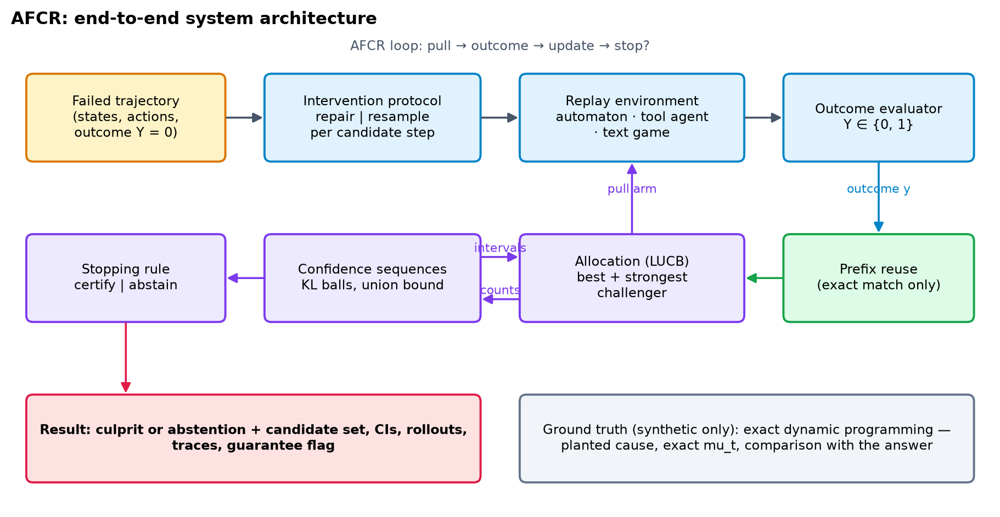

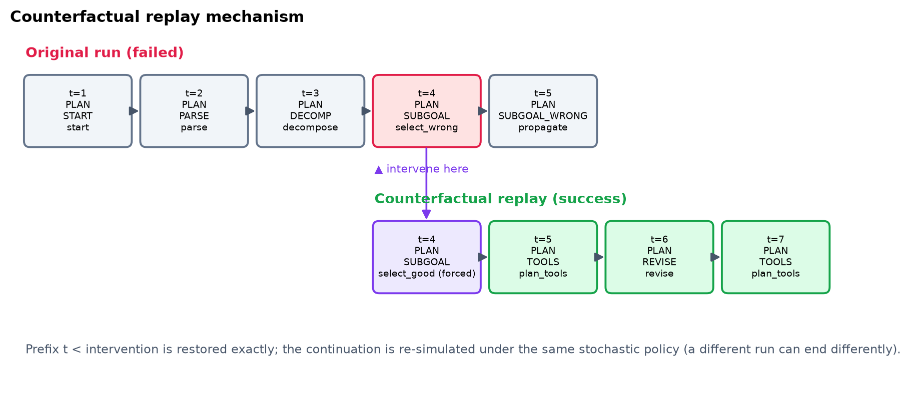


